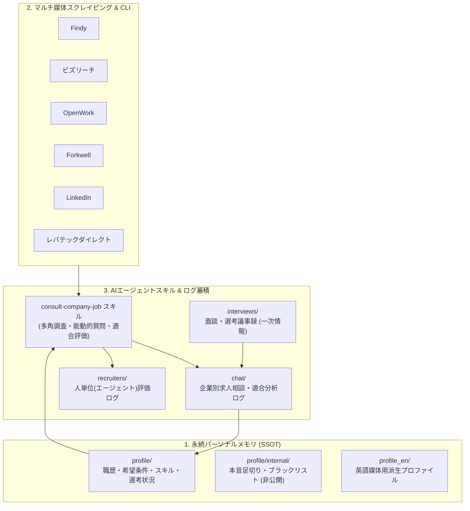

# AI駆動型 就活・転職支援エージェント基盤 (Job Hunt Assistant)

> **AIエージェントと二人三脚で進める、パーソナルメモリ・多媒体自動化・選考トラッキングのための転職活動支援フレームワーク**

本リポジトリは、LLM / AIコーディングエージェント（Google Antigravity, Claude Code, Cursor, Windsurf等）と協調しながら、エンジニアの転職活動における「情報収集」「求人精査・適合度判定」「リクルーター見極め」「面談メモ・選考進捗管理」「職務経歴書の各サイト同期」を一気通貫で自動化・構造化管理するためのリポジトリです。

Web UIをあえて持たず、**CLIツール**と**Frontmatter付きMarkdown**による単一の正本（SSOT: Single Source of Truth）管理を採用することで、高い検索性・ポータビリティ・バージョン管理性能を実現しています。

---

## 3つのコア機能



### 1. 永続パーソナルメモリ（SSOT）と本音基準の隔離
- 職務経歴書マスター（`profile/resume.md`）、希望条件（`profile/preferences.md`）、保有スキル（`profile/skills.md`）、選考進捗ダッシュボード（`profile/status.md`）を一元管理。
- 外部やエージェントには明かせない「本音の足切り条件（Dealbreakers）」「企業格付け・ブラックリスト」「本音の転職理由」を `profile/internal/` に完全隔離。AIがスクリーニング・意思決定支援時にのみ参照し、外部露出を厳格に防止します。
- 英語媒体（LinkedIn等）向けの派生プロフィール（`profile_en/`）と日本語マスターとの差分検知・同期スクリプト（`scripts/profile/sync_en.py`）を完備。

### 2. 6大転職プラットフォームの自動化・CLIスクリプト
- **対応サービス**: Findy, ビズリーチ, OpenWork, Forkwell, LinkedIn, レバテックダイレクト
- **自動化機能**:
  - オンライン求人検索・詳細取得・ローカルMarkdown保存（Frontmatter付き）
  - 各種サイトのプロフィール・職歴CRUD（Findy, ビズリーチ, Forkwell, LinkedIn, レバテックダイレクト）
  - 口コミ・評価スコア・退職理由の取得（OpenWork）
  - スカウト・受信メッセージ・いいね一覧の巡回取得
- **安全な認証ハンドオフ**:
  - 就活共通ブラウザプロファイル（`job-hunt`）へのセッション永続化。
  - 未認証時はユーザーのローカル環境へ安全にハンドオフし、パスワードや機密資格情報をAIエージェントのコンテキストやログに一切露出させません。

### 3. 多角的調査・リクルーター見極めスキル (`consult-company-job`)
- **エビデンスレベルの明示**: 求人票スペックのみの判断に頼らず、OpenWork口コミ・テックブログ・IR・一次情報面談まで「何をどこまで確認したか」を段階的に明記。
- **fit_score のレンジ提示**: 建前の求人票による安易な決めつけを排除し、「50〜90/100」のように確信度に応じた幅（レンジ）で評価。
- **人単位（エージェント／ヘッドハンター）の評価**: 求人そのものだけでなく、「誰が紹介してきたか（定型文スパムか、希望を汲んだ良提案か）」を独立して格付け・記録（`recruiters/`）。
- **三層構造の選考・面談トラッキング**:
  - `profile/status.md`: 全社の進捗ダッシュボード（薄い一覧）
  - `chat/{folder}/{company}.md`: 企業ごとの調査・適合度・最新ステータス
  - `interviews/{company}/{stage}.md`: 面談・面接ごとの生メモ・質疑応答一次情報

---

## ディレクトリ構成

```text
job_hunt/
├── .agents/                    # AIエージェント設定（Antigravity / Cursor / Claude 等）
│   ├── rules/                 # エージェント行動規範・運用ルール
│   └── skills/                # 専門スキル（consult-company-job 等）
├── scripts/                    # CLI自動化スクリプト
│   ├── common/                # 共通基盤（認証、正規化、保存、求人検索）
│   ├── findy/                 # Findy用スクリプト
│   ├── bizreach/              # ビズリーチ用スクリプト
│   ├── openwork/              # OpenWork用スクリプト
│   ├── forkwell/              # Forkwell用スクリプト
│   ├── linkedin/              # LinkedIn用スクリプト
│   ├── levtech_direct/        # レバテックダイレクト用スクリプト
│   └── profile/               # 英語プロファイル同期等
├── docs/                       # 詳細仕様・サイト構造ドキュメント
├── templates/                  # 初期化用テンプレート雛形（profile, chat, recruiters 等）
├── profile/                    # [非公開] ユーザープロフィールSSOTマスター
├── profile_en/                 # [非公開] 英語媒体用派生プロフィール
├── chat/                       # [非公開] 企業別求人相談・調査ログ (active/rejected/declined...)
├── recruiters/                 # [非公開] リクルーター・ヘッドハンター評価ログ
├── interviews/                 # [非公開] 面談・面接詳細議事録 (一次情報)
├── data/                       # [非公開] 取得した求人Markdown・検索履歴・キャッシュ
├── QUICKSTART.md               # はじめての方向けセットアップ・利用手順ガイド
└── README.md                   # 本ドキュメント
```

> [!NOTE]
> `profile/`, `profile_en/`, `chat/`, `recruiters/`, `interviews/`, `data/` などの個人情報・選考ログディレクトリは、プライバシー保護のためパブリックリポジトリには含まれていません（GitHub Actionsによる自動ホワイトリスト同期で完全除外）。
> 代わりに、公開リポジトリには雛形ディレクトリ **`templates/`** が含まれており、コピーするだけですぐに自分用の環境を初期化できます（詳細は [`QUICKSTART.md`](QUICKSTART.md) 参照）。

---

## はじめかた

公開リポジトリを取得した方が、自分専用の就活サポート基盤をセットアップしてAIエージェントに相談を開始するまでの具体的な手順は、**[`QUICKSTART.md`](./QUICKSTART.md)** をご覧ください。

1. **環境構築**: Python環境（`uv`）とPlaywrightの準備
2. **SSOT作成**: `profile/` に職歴書・希望条件・スキル等のテンプレートを配置
3. **ログフォルダ準備**: `chat/`, `recruiters/`, `interviews/` の作成
4. **AIエージェントへの相談**: `consult-company-job` スキルを活用した求人分析・リクルーター見極め

---

## 関連ドキュメント

- **[`QUICKSTART.md`](./QUICKSTART.md)**: 初回セットアップ＆AIプロンプト実践ガイド
- **[`docs/README.md`](./docs/README.md)**: サイト別自動化ガイド・共通基盤・設計アーキテクチャ目次
- **[新規サイトスクレイパー追加ガイド](./docs/guides/new_site_scraper_guide.md)**: 新たな求人媒体を追加する際の実装手順
