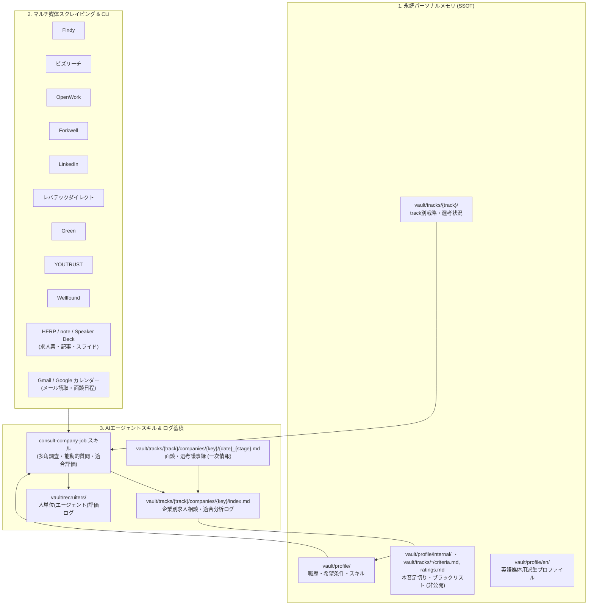

# AI駆動型 就活・転職支援エージェント基盤 (Job Hunt Assistant)

> **AIエージェントと二人三脚で進める、パーソナルメモリ・多媒体自動化・選考トラッキングのための転職活動支援フレームワーク**

本リポジトリは、LLM / AIコーディングエージェント（Google Antigravity, Claude Code, Cursor, Windsurf等）と協調しながら、エンジニアの転職活動における「情報収集」「求人精査・適合度判定」「リクルーター見極め」「面談メモ・選考進捗管理」「職務経歴書の各サイト同期」を一気通貫で自動化・構造化管理するためのリポジトリです。

正本は**Frontmatter付きMarkdown**（SSOT: Single Source of Truth）で、AIエージェントが**CLIツール**で検索・取得・記録を担当します。人間は**閲覧専用のローカル Web UI**で絞り込み・閲覧します。フロントマターは Python のスキーマ1か所で定義・検証し、Web UI と横断検索は Markdown から作り直せる SQLite 索引を読むだけなので、正本の検索性・ポータビリティ・git での差分管理はそのまま保たれます。

---

## 3つのコア機能



### 1. 永続パーソナルメモリ（SSOT）と本音基準の隔離
- 職務経歴書マスター（`vault/profile/resume.md`）、共通の希望条件（`vault/profile/preferences.md`）、保有スキル（`vault/profile/skills.md`）、媒体アカウントの登録・同期状況（`vault/profile/accounts.md`）を一元管理。
- 転職活動は track（`domestic`: 日本法人での就業 / `overseas`: 海外法人との雇用・契約）ごとに分け、track 固有の希望条件（年収・出社/勤務地・企業フェーズ・雇用形態）を `vault/tracks/{track}/strategy.md`、選考進捗ダッシュボードを `vault/tracks/{track}/pipeline.md` で管理。
- 外部やエージェントには明かせない「本音の足切り条件（Dealbreakers）」「企業格付け・ブラックリスト」「本音の転職理由」を `vault/tracks/{track}/criteria.md`・`vault/tracks/{track}/ratings.md`・`vault/profile/internal/` に完全隔離。AIがスクリーニング・意思決定支援時にのみ参照し、外部露出を厳格に防止します。
- 英語媒体（LinkedIn, Wellfound等）向けの派生プロフィール（`vault/profile/en/`）と日本語マスターとの差分検知・同期スクリプト（`scripts/profile/sync_en.py`）を完備。

### 2. 転職・求人プラットフォームと周辺サービスの自動化・CLIスクリプト
- **対応サービス**:
  - **国内エンジニア・スカウト媒体**: Findy, ビズリーチ, OpenWork, Forkwell, レバテックダイレクト, Green, YOUTRUST
  - **グローバル・スタートアップ媒体**: LinkedIn, Wellfound (旧AngelList)
  - **企業調査ソース**: HERP（求人票）, note（記事）, Speaker Deck（会社紹介・登壇スライド）
  - **Google**: Gmail（就活メールの読み取り専用取得）, Google カレンダー（空き時間からの面談候補日算出・予定登録）
- **自動化機能**:
  - **求人検索・取得**: オンライン求人検索・一覧取得・詳細保存（Frontmatter付きMarkdown。Findy, ビズリーチ, OpenWork, Forkwell, LinkedIn, レバテックダイレクト, Green）
  - **プロフィール・経歴CRUD**: 各種サイトの基本情報・職歴・学歴・スキル・自己PRの閲覧・更新（Findy, ビズリーチ, Forkwell, LinkedIn, レバテックダイレクト, Green, YOUTRUST, Wellfound）
  - **企業・口コミリサーチ**: 口コミ・評価スコア（8項目）・退職理由の取得（OpenWork）、記事・スライドの文字起こしと企業フォルダへの資料保存（note, Speaker Deck）
  - **メール・日程調整**: 就活メールの検索・スレッド取得（Gmail）、面談候補日の算出と予定の作成・更新・削除（Google カレンダー）
  - **定期実行ブリーフ**: PC にログオンしている間、タスク スケジューラから Claude Code / Antigravity を無人実行し、雑務・メール・予定から「今日やること」をまとめてトースト通知（ステップ・プロンプト・スケジュールは YAML で定義。[`docs/automation/README.md`](docs/automation/README.md)）
  - **スカウト・メッセージ巡回**: スカウト・受信メッセージ・いいね・気になる・つながり申請一覧の取得と履歴保存（Findy, ビズリーチ, OpenWork, Forkwell, LinkedIn, Green, レバテックダイレクト等）
- **スクリプト一覧**: 全 CLI の一覧は [`docs/scripts/catalog.md`](docs/scripts/catalog.md)（各スクリプトの docstring から自動生成）、使い方は各スクリプトの `--help`。
- **安全な認証ハンドオフ**:
  - 就活共通ブラウザプロファイル（`job-hunt`）へのセッション永続化。
  - 未認証時はユーザーのローカル環境へ安全にハンドオフし、パスワードや機密資格情報をAIエージェントのコンテキストやログに一切露出させません。

### 3. 多角的調査・リクルーター見極めスキル (`consult-company-job`)
- **エビデンスレベルの明示**: 求人票スペックのみの判断に頼らず、OpenWork口コミ・テックブログ・IR・一次情報面談まで「何をどこまで確認したか」を段階的に明記。
- **fit_score のレンジ提示**: 建前の求人票による安易な決めつけを排除し、「50〜90/100」のように確信度に応じた幅（レンジ）で評価。
- **人単位（エージェント／ヘッドハンター）の評価**: 求人そのものだけでなく、「誰が紹介してきたか（定型文スパムか、希望を汲んだ良提案か）」を独立して格付け・記録（`vault/recruiters/`）。
- **三層構造の選考・面談トラッキング**:
  - `vault/tracks/{track}/pipeline.md`: 全社の進捗ダッシュボード（薄い一覧。`scripts/vault/build_pipeline.py` で自動生成）
  - `vault/tracks/{track}/companies/{company}/index.md`: 企業ごとの調査・適合度・最新ステータス（ステータスはフロントマターで管理）
  - `vault/tracks/{track}/companies/{company}/{date}_{stage}.md`: 面談・面接ごとの生メモ・質疑応答一次情報

### vault スキーマと人間用 Web UI（閲覧専用）

| 担当 | やること | 使うもの |
|---|---|---|
| AIエージェント | 調査・取得・vault への記録（Markdown を直接編集） | CLI スクリプト、`scripts/vault/validate.py` |
| 人間 | 会社名検索、「進行中だけ」「fit_score 下限 ≥ N」などの絞り込み・閲覧 | Web UI（`webui/`） |

- **スキーマ SSOT**: vault のフロントマター（キー・型・許容値・ステータスの分類）は `scripts/vault/schema/`（Pydantic）で定義し、一覧 [`docs/vault/schema.md`](docs/vault/schema.md) はそこから生成。年収（万円の整数）・勤務形態（enum＋週あたり出社日数）・fit_score（下限/上限）は構造化フィールドなのでフィルタが効きます。
- **検証**: `uv run python scripts/vault/validate.py` で vault 全件をスキーマ検証（pre-commit でも実行）。
- **索引**: `uv run python scripts/vault/build_index.py` で vault と取得済み求人（`data/*/jobs`）から SQLite 索引（`data/vault_index.sqlite`、日本語全文検索）を作ります。派生キャッシュなのでいつでも作り直せます。`-q キーワード` で AI 用の横断検索にも使えます。
- **Web UI**: `uv run python -m webui` で起動し、<http://127.0.0.1:8765> を開きます。ダッシュボード（要対応・確定予定・連絡待ち）、企業一覧/詳細、リクルーター、スクリーニング、求人、全文検索を閲覧できます。待ち受けは 127.0.0.1 のみで、vault には書き込みません。非公開ファイル（`criteria.md`・`ratings.md`・`vault/profile/internal/`）は表示しません。ポートが使用中で起動できないときの対処は [webui/README.md](webui/README.md) を参照してください。

---

## ディレクトリ構成

```text
job_hunt/
├── .agents/                    # AIエージェント設定の正本（Antigravity 形式）
│   ├── rules/                 # エージェント行動規範・運用ルール
│   ├── skills/                # 専門スキル（consult-company-job 等）
│   └── agents/                # カスタムサブエージェント定義
├── .claude/                    # Claude Code 用設定（.agents/ から自動生成。rules / skills / agents）
├── ai/
│   └── tools/                 # スキルから呼び出す補助CLI（pwq, pwdo）
├── scripts/                    # CLI自動化スクリプト
│   ├── common/                # 共通基盤（認証、正規化、保存、求人検索）
│   ├── findy/                 # Findy用スクリプト（推薦・求人検索・いいね・メッセージ・職歴CRUD）
│   ├── bizreach/              # ビズリーチ用スクリプト（求人検索・スカウト・経歴書CRUD）
│   ├── openwork/              # OpenWork用スクリプト（求人検索・口コミ・スコア・企業ID解決）
│   ├── forkwell/              # Forkwell用スクリプト（求人検索・プロフィール・職歴CRUD）
│   ├── linkedin/              # LinkedIn用スクリプト（求人検索・メッセージ・招待・職歴CRUD）
│   ├── levtech_direct/        # レバテックダイレクト用スクリプト（求人検索・メッセージ・プロファイル同期）
│   ├── green/                 # Green用スクリプト（求人検索・気になる・メッセージ・プロフィールCRUD）
│   ├── youtrust/              # YOUTRUST用スクリプト（プロフィール・職歴・学歴CRUD）
│   ├── wellfound/             # Wellfound用スクリプト（プロフィール・Bio・ソーシャル・職歴CRUD）
│   ├── herp/                  # HERP用スクリプト（求人詳細取得）
│   ├── note/                  # note用スクリプト（記事検索・文字起こし）
│   ├── speakerdeck/           # Speaker Deck用スクリプト（スライド検索・文字起こし）
│   ├── gmail/                 # Gmail用スクリプト（就活メール検索・スレッド取得。読み取り専用）
│   ├── gcal/                  # Google カレンダー用スクリプト（候補日算出・予定管理）
│   ├── google/                # Google API 共通認証（Gmail・カレンダー共用）
│   ├── profile/               # 英語プロファイル同期・職務経歴書/履歴書の PDF 出力
│   ├── automation/            # 定期実行ルーチン（YAML 定義・無人実行・タスク スケジューラ登録・ブリーフ）
│   ├── vault/                 # vault スキーマ SSOT（schema/）・ローダー・検証・SQLite 索引・pipeline.md 生成
│   ├── templates/             # 新規媒体スクレイパーの雛形
│   └── dev/                   # 開発用（.agents/ → .claude/ 同期・公開漏れ検査）
├── webui/                      # 人間用の閲覧専用 Web UI（FastAPI + Jinja2 + htmx）
├── docs/                       # 詳細仕様・サイト構造ドキュメント（vault/schema.md・scripts/catalog.md は生成物）
├── templates/
│   ├── vault/                 # 初期化用テンプレート雛形（vault/ と同じ構成）
│   └── interview/             # 面談ログの雛形（カジュアル面談・本選考・エージェント面談）
├── vault/                      # [非公開] 個人データ一式（構成は vault/README.md 参照）
│   ├── profile/               # ユーザープロフィールSSOTマスター（en/: 英語版, internal/: 本音メモ, employers/: 前職・現職）
│   ├── tracks/
│   │   ├── domestic/          # 国内 track（strategy / pipeline / criteria / ratings / companies/ / screening/）
│   │   └── overseas/          # 海外 track（同構成）
│   ├── recruiters/            # リクルーター・ヘッドハンター評価ログ・面談ログ
│   └── automation/            # 定期実行ルーチンの定義（routines.yaml）
├── data/                       # [非公開] 取得した求人Markdown・検索履歴・キャッシュ
├── QUICKSTART.md               # はじめての方向けセットアップ・利用手順ガイド
└── README.md                   # 本ドキュメント
```

> [!NOTE]
> `vault/`, `data/`, `ai/plans/`, `internal/`, `.scratch/` などの個人情報・選考ログ・作業用ディレクトリは、プライバシー保護のためパブリックリポジトリには含まれていません（GitHub Actionsによる自動ホワイトリスト同期で完全除外）。
> 代わりに、公開リポジトリには雛形ディレクトリ **`templates/vault/`** が含まれており、`cp -r templates/vault vault` でコピーするだけですぐに自分用の環境を初期化できます（詳細は [`QUICKSTART.md`](QUICKSTART.md) 参照）。

---

## はじめかた

公開リポジトリを取得した方が、自分専用の就活サポート基盤をセットアップしてAIエージェントに相談を開始するまでの具体的な手順は、**[`QUICKSTART.md`](./QUICKSTART.md)** をご覧ください。

1. **環境構築**: Python環境（`uv`）とPlaywrightの準備
2. **vault 初期化**: `templates/vault/` を `vault/` としてコピー（`cp -r templates/vault vault`）
3. **SSOT記入**: `vault/profile/` に職歴書・希望条件・スキル、`vault/tracks/{track}/strategy.md` に track 別の希望条件を記入
4. **AIエージェントへの相談**: `consult-company-job` スキルを活用した求人分析・リクルーター見極め

---

## AIコーディングエージェントで使う場合

ルール・スキル・サブエージェント定義は、主要なエージェントがそのまま読み込める場所に配置済みです。リポジトリのルートでエージェントを起動してください。

| エージェント | 読み込まれる設定 | 必要な作業 |
|---|---|---|
| **Google Antigravity** | `.agents/rules/`, `.agents/skills/`, `.agents/agents/` | なし |
| **Claude Code** | `.claude/rules/`, `.claude/skills/`, `.claude/agents/` | なし（リポジトリルートで `claude` を起動） |
| **その他**（Cursor, Codex CLI, Windsurf 等） | 自動では読み込まれない | 下記「その他のエージェント」を参照 |

### `.agents/` と `.claude/` の関係

- 正本は `.agents/` です。`.claude/` は同じ内容を Claude Code の形式に変換したもので、ファイル先頭に変換元を示すコメントが入っています。
- 変換で変わるのは次の点だけです。
  - **rules**: Antigravity の `trigger: glob` は Claude Code の `paths:` に変換されます。`trigger: model_decision`（エージェントが必要と判断したときに読むルール）は Claude Code に同等の仕組みがないため常時読み込みになり、本文冒頭に「適用条件」が書かれます。
  - **agents**: ツール名を Claude Code のもの（`Read`, `Grep`, `Bash` 等）に置き換えます。
  - **skills**: 形式が共通なので内容はそのままです。同期しないものは `scripts/dev/sync_agents.yaml` の `exclude` で指定します。
- 公開リポジトリの `.agents/` と `.claude/` は、公開時点で同期済みのスナップショットです。ルールやスキルを自分用に書き換える場合は、使っているエージェント側のフォルダを編集してください（両方使う場合は両方に反映が必要です）。

### その他のエージェント

自動読み込みの仕組みがないため、最初の指示で読ませるか、各ツールのルール機構から参照させてください。

- **常時守らせるルール**: `.agents/rules/` のうちフロントマターが `trigger: always_on` のもの（`goal.md`, `role.md`, `playwright-action.md`）。各ツールのルールファイル（Cursor の `.cursor/rules/`、Codex の `AGENTS.md` 等）から参照させます。
- **場面ごとのルール**: 残りのルールは、フロントマターの `description`（または `globs`）に書かれた場面でのみ読めば足ります。
- **スキル**: 依頼するときに「`.agents/skills/consult-company-job/SKILL.md` を読んでから進めて」のように、該当スキルの `SKILL.md` を指定してください。

### 補助ツール（`ai/tools/`）

ブラウザ操作系のスキル（`using-playwright-cli`, `sharing-browser-with-user`）は、補助CLI `pwq`（出力の要約でコンテキストを節約）と `pwdo`（ブラウザ操作の一部を安価なモデルに委譲）を使う場合があります。使う場合のみビルドしてください。

```powershell
cd ai/tools/pwq;  pnpm install; pnpm build
cd ../pwdo;       pnpm install; pnpm build
```

LLM を使う機能には OpenRouter の API キーが必要です。`.env.example` をコピーしてリポジトリ直下に `.env` を作成し、`OPENROUTER_API_KEY` を設定してください。詳細は [`ai/tools/pwq/README.md`](ai/tools/pwq/README.md) と [`ai/tools/pwdo/README.md`](ai/tools/pwdo/README.md) を参照してください。

---

## 関連ドキュメント

- **[`QUICKSTART.md`](./QUICKSTART.md)**: 初回セットアップ＆AIプロンプト実践ガイド
- **[`docs/README.md`](./docs/README.md)**: サイト別自動化ガイド・共通基盤・設計アーキテクチャ目次
- **[`docs/vault/schema.md`](./docs/vault/schema.md)**: vault フロントマタースキーマ（自動生成）
- **[`docs/scripts/catalog.md`](./docs/scripts/catalog.md)**: スクリプト一覧（自動生成）
- **[新規サイトスクレイパー追加ガイド](./docs/guides/new_site_scraper_guide.md)**: 新たな求人媒体を追加する際の実装手順
