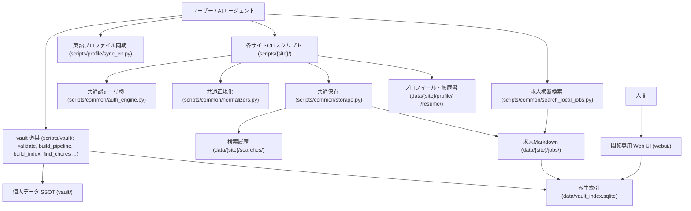

# 就活サポートシステム ドキュメント目次 (docs/)

本リポジトリにおける求人探索・企業調査・プロフィール管理・自動化スクリプトに関するドキュメント一覧です。

---

## 1. サイト別自動化・調査ガイド

各転職・求人プラットフォームに対応した自動化スクリプト、CLIツールの使い方、およびサイト構造仕様書です。

| 媒体 | ガイド (README) | サイト構造仕様 (site_structure) | 実装スクリプト・主な機能 |
|---|---|---|---|
| **Findy** | [`docs/findy/README.md`](../docs/findy/README.md) | [`docs/findy/site_structure.md`](../docs/findy/site_structure.md) [`docs/findy/work_history_api.md`](../docs/findy/work_history_api.md) | 求人検索、おすすめ求人取得、いいね取得、メッセージ取得、プロフィール取得、職歴・プロジェクトCRUD |
| **ビズリーチ** | [`docs/bizreach/README.md`](../docs/bizreach/README.md) | [`docs/bizreach/site_structure.md`](../docs/bizreach/site_structure.md) | 求人検索、メッセージ取得、添付求人取得、職務経歴書取得、WEB履歴書・職歴CRUD |
| **OpenWork** | [`docs/openwork/README.md`](../docs/openwork/README.md) | [`docs/openwork/site_structure.md`](../docs/openwork/site_structure.md) | 求人検索、WEB履歴書取得、メッセージ取得、会社名解決、口コミ・8項目スコア取得 |
| **Forkwell** | [`docs/forkwell/README.md`](../docs/forkwell/README.md) | [`docs/forkwell/site_structure.md`](../docs/forkwell/site_structure.md) | 求人検索、求人詳細API取得、プロフィール取得、自己紹介・やりたいこと更新、職歴・プロジェクトCRUD |
| **LinkedIn** | [`docs/linkedin/README.md`](../docs/linkedin/README.md) | [`docs/linkedin/site_structure.md`](../docs/linkedin/site_structure.md) | 求人検索、求人詳細取得、プロフィール取得、Headline/About更新、職歴CRUD（安全ガード付）、スキルCRUD |
| **レバテックダイレクト** | [`docs/levtech_direct/README.md`](../docs/levtech_direct/README.md) | [`docs/levtech_direct/site_structure.md`](../docs/levtech_direct/site_structure.md) | 求人検索、求人詳細取得・保存、条件フィルタ（年収・ソート・リモート） |
| **Green** | [`docs/green/README.md`](../docs/green/README.md) | [`docs/green/site_structure.md`](../docs/green/site_structure.md) | プロフィールCRUD、メッセージ・スカウト取得、受信気になる取得、サーチバー求人検索・詳細取得 |
| **YOUTRUST** | [`docs/youtrust/README.md`](../docs/youtrust/README.md) | [`docs/youtrust/site_structure.md`](../docs/youtrust/site_structure.md) | プロフィール（基本情報・職歴・自己紹介・公開範囲）CRUD管理・SSOT同期・バックアップ |
| **Wellfound** | [`docs/wellfound/README.md`](../docs/wellfound/README.md) | [`docs/wellfound/site_structure.md`](../docs/wellfound/site_structure.md) | プロフィール（About/Bio・ソーシャル・職歴・学歴・スキル等）閲覧・更新CRUD管理・SSOT同期 |
| **HERP** | [`docs/herp/README.md`](../docs/herp/README.md) | [`docs/herp/site_structure.md`](../docs/herp/site_structure.md) | 求人詳細取得・保存（静的HTTP、認証不要） |
| **note** | [`docs/note/README.md`](../docs/note/README.md) | [`docs/note/site_structure.md`](../docs/note/site_structure.md) | 記事検索・一覧取得、単一記事の Markdown 化 |
| **Speaker Deck** | [`docs/speakerdeck/README.md`](../docs/speakerdeck/README.md) | [`docs/speakerdeck/site_structure.md`](../docs/speakerdeck/site_structure.md) | スライド検索、スライド文字起こし・画像/PDF取得、企業フォルダ `materials/` への保存 |

### Google API 連携（Gmail・カレンダー）

| ドキュメント | 説明 |
|---|---|
| [`docs/google/README.md`](../docs/google/README.md) | Gmail・カレンダー共通の GCP 準備・OAuth 認証・スコープ・失効対応 |
| [`docs/gmail/README.md`](../docs/gmail/README.md) | 就活メールの読み取り専用検索・スレッド取得 |
| [`docs/gcal/README.md`](../docs/gcal/README.md) | 空き時間からの面談候補日算出、予定の参照・作成・更新・削除 |

### Web 調査（Tavily）

| ドキュメント | 説明 |
|---|---|
| [`docs/web/README.md`](../docs/web/README.md) | 一般 Web の検索・既知 URL の本文抽出（`scripts/web/`）。判断フロー・出力の読み方・API キー設定 |

---

## 2. 共通基盤・開発ガイド

| ドキュメント | 説明 |
|---|---|
| [`docs/common/README.md`](../docs/common/README.md) | 認証ハンドオフ（`auth_engine`, `browser_auth`）、CLI標準化（`cli`）、データ正規化（`normalizers`）、保存（`storage`）、求人横断検索（`search_jobs`）の仕様 |
| [`docs/automation/README.md`](../docs/automation/README.md) | 定期実行エージェントルーチン（今日やることブリーフ）: YAML の書き方・タスク スケジューラ登録・出力の読み方・トラブルシュート |
| [`docs/scripts/catalog.md`](../docs/scripts/catalog.md) | 全 CLI エントリポイントの一覧（媒体・カテゴリ別）。各スクリプトの docstring 1 行目から `scripts/dev/gen_script_catalog.py` で自動生成 |
| [`docs/guides/new_site_scraper_guide.md`](../docs/guides/new_site_scraper_guide.md) | 新規求人サイトスクレイパー追加開発ガイド（テンプレート活用、実装手順、チェックリスト） |

---

## 3. プロフィール管理・同期

| ドキュメント | 説明 |
|---|---|
| [`docs/profile/README.md`](../docs/profile/README.md) | ユーザープロフィールSSOT（`vault/profile/`）と英語媒体連携用派生プロファイル（`vault/profile/en/`）の差分管理・メタデータ同期（`scripts/profile/sync_en.py`）ガイド |
| [`docs/vault/schema.md`](../docs/vault/schema.md) | vault フロントマタースキーマ（企業・面談・リクルーター・スクリーニング等のキー・型・許容値）。`scripts/vault/schema/` から自動生成 |
| [`docs/vault/chores.md`](../docs/vault/chores.md) | vault 雑務検出 CLI（`scripts/vault/find_chores.py`）の検出器・閾値・処理区分・優先度・出力形式 |
| [`webui/README.md`](../webui/README.md) | 人間用の閲覧専用 Web UI の起動方法・画面構成 |

---

## 4. 全体アーキテクチャ

