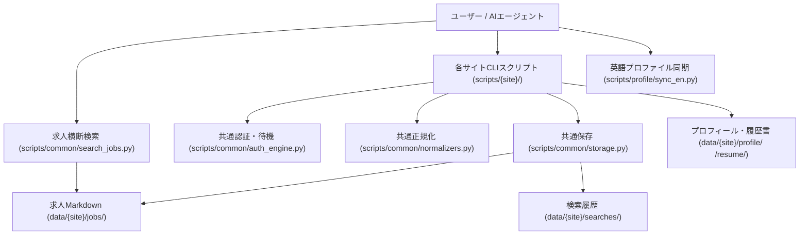

# 就活サポートシステム ドキュメント目次 (docs/)

本リポジトリにおける求人探索・企業調査・プロフィール管理・自動化スクリプトに関するドキュメント一覧です。

---

## 1. サイト別自動化・調査ガイド

各転職・求人プラットフォームに対応した自動化スクリプト、CLIツールの使い方、およびサイト構造仕様書です。

| 媒体 | ガイド (README) | サイト構造仕様 (site_structure) | 実装スクリプト・主な機能 |
|---|---|---|---|
| **Findy** | [`docs/findy/README.md`](file:///c:/C/job_hunt/docs/findy/README.md) | [`docs/findy/site_structure.md`](file:///c:/C/job_hunt/docs/findy/site_structure.md) [`docs/findy/work_history_api.md`](file:///c:/C/job_hunt/docs/findy/work_history_api.md) | 求人検索、おすすめ求人取得、いいね取得、メッセージ取得、プロフィール取得、職歴・プロジェクトCRUD |
| **ビズリーチ** | [`docs/bizreach/README.md`](file:///c:/C/job_hunt/docs/bizreach/README.md) | [`docs/bizreach/site_structure.md`](file:///c:/C/job_hunt/docs/bizreach/site_structure.md) | 求人検索、メッセージ取得、添付求人取得、職務経歴書取得、WEB履歴書・職歴CRUD |
| **OpenWork** | [`docs/openwork/README.md`](file:///c:/C/job_hunt/docs/openwork/README.md) | [`docs/openwork/site_structure.md`](file:///c:/C/job_hunt/docs/openwork/site_structure.md) | 求人検索、WEB履歴書取得、メッセージ取得、会社名解決、口コミ・8項目スコア取得 |
| **Forkwell** | [`docs/forkwell/README.md`](file:///c:/C/job_hunt/docs/forkwell/README.md) | [`docs/forkwell/site_structure.md`](file:///c:/C/job_hunt/docs/forkwell/site_structure.md) | 求人検索、求人詳細API取得、プロフィール取得、自己紹介・やりたいこと更新、職歴・プロジェクトCRUD |
| **LinkedIn** | [`docs/linkedin/README.md`](file:///c:/C/job_hunt/docs/linkedin/README.md) | [`docs/linkedin/site_structure.md`](file:///c:/C/job_hunt/docs/linkedin/site_structure.md) | 求人検索、求人詳細取得、プロフィール取得、Headline/About更新、職歴CRUD（安全ガード付）、スキルCRUD |
| **レバテックダイレクト** | [`docs/levtech_direct/README.md`](file:///c:/C/job_hunt/docs/levtech_direct/README.md) | [`docs/levtech_direct/site_structure.md`](file:///c:/C/job_hunt/docs/levtech_direct/site_structure.md) | 求人検索、求人詳細取得・保存、条件フィルタ（年収・ソート・リモート） |
| **Green** | [`docs/green/README.md`](file:///c:/C/job_hunt/docs/green/README.md) | [`docs/green/site_structure.md`](file:///c:/C/job_hunt/docs/green/site_structure.md) | プロフィールCRUD、メッセージ・スカウト取得、受信気になる取得、サーチバー求人検索・詳細取得 |
| **YOUTRUST** | [`docs/youtrust/README.md`](file:///c:/C/job_hunt/docs/youtrust/README.md) | [`docs/youtrust/site_structure.md`](file:///c:/C/job_hunt/docs/youtrust/site_structure.md) | プロフィール（基本情報・職歴・自己紹介・公開範囲）CRUD管理・SSOT同期・バックアップ |

---

## 2. 共通基盤・開発ガイド

| ドキュメント | 説明 |
|---|---|
| [`docs/common/README.md`](file:///c:/C/job_hunt/docs/common/README.md) | 認証ハンドオフ（`auth_engine`, `browser_auth`）、CLI標準化（`cli`）、データ正規化（`normalizers`）、保存（`storage`）、求人横断検索（`search_jobs`）の仕様 |
| [`docs/guides/new_site_scraper_guide.md`](file:///c:/C/job_hunt/docs/guides/new_site_scraper_guide.md) | 新規求人サイトスクレイパー追加開発ガイド（テンプレート活用、実装手順、チェックリスト） |

---

## 3. プロフィール管理・同期

| ドキュメント | 説明 |
|---|---|
| [`docs/profile/README.md`](file:///c:/C/job_hunt/docs/profile/README.md) | ユーザープロフィールSSOT（`profile/`）と英語媒体連携用派生プロファイル（`profile_en/`）の差分管理・メタデータ同期（`scripts/profile/sync_en.py`）ガイド |

---

## 4. 全体アーキテクチャ

