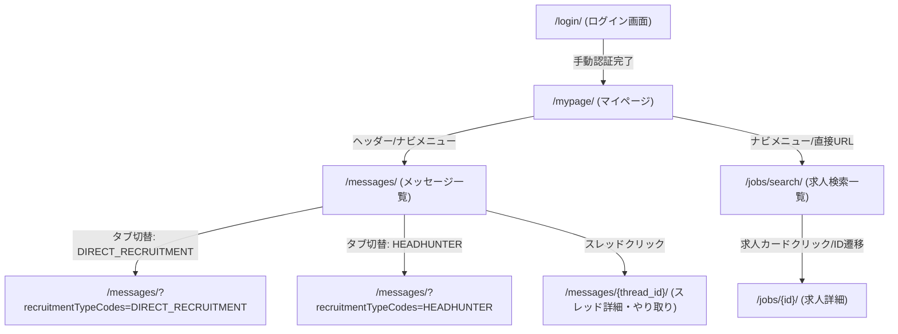

# ビズリーチ（BizReach）サイト構造リファレンス

本ドキュメントは、AIエージェントが `sharing-browser-with-user` スキルや `playwright-cli` を利用してビズリーチ（[bizreach.jp](https://www.bizreach.jp/)）を探索・自動操作する際、事前の探索オーバーヘッドを削減するためのサイト構造ガイドです。

---

## 1. サイト基本情報 & 認証基盤

| 項目 | 内容 |
|---|---|
| **メインドメイン** | `https://www.bizreach.jp/` |
| **認証ドメイン** | `https://auth.id.bizreach.jp/`（リダイレクトされる認証基盤） |
| **ログインURL** | `https://www.bizreach.jp/login/` |
| **推奨プロファイル** | `job-hunt`（永続ブラウザプロファイル） |
| **セッション管理** | Cookie永続化。ログイン完了後は数週間〜数ヶ月有効 |
| **未ログイン判定** | URLが `auth.id.bizreach.jp` や `/login` を含む、またはページ内に `#login-form` / `input[name="email"]` が存在 |

---

## 2. 主要URLマップ

| 画面名 | パス / URL | 認証 | 備考 |
|---|---|---|---|
| **トップページ** | `/` | 不要 | 未ログイン時はランディングページ |
| **ログイン画面** | `/login/` | 不要 | メールアドレス・パスワード入力画面 |
| **マイページ** | `/mypage/` | 要 | ログイン後のホーム画面 |
| **メッセージ（すべて）** | `/messages/` | 要 | 企業・ヘッドハンター全スレッド一覧 |
| **メッセージ（企業）** | `/messages/?recruitmentTypeCodes=DIRECT_RECRUITMENT` | 要 | 企業直応募・直接スカウトのみ |
| **メッセージ（ヘッドハンター）** | `/messages/?recruitmentTypeCodes=HEADHUNTER` | 要 | エージェント・ヘッドハンターのみ |
| **求人検索** | `/jobs/search/` | 要/不要 | 公開/会員向け求人検索（クエリパラメータで絞り込み可） |
| **求人詳細** | `/jobs/{id}/` | 要/不要 | 各求人の募集要項・仕事内容詳細 |
| **職務経歴書（企業・職歴）** | `/resume/company/` | 要 | 職歴、担当プロジェクト、基本情報、経験職種・業種 |
| **職務経歴書（フリーフォーマット）** | `/resume/freetext/` | 要 | 自由記述フォーマットの自己PR・職務要約の閲覧・編集 |
| **メッセージスレッド詳細** | `/messages/{thread_id}/` | 要 | 個別やり取り画面、添付求人リンク |

---

## 3. 画面遷移フロー



---

## 4. 主要画面のDOM構造・セレクタ

### 4.1 メッセージ一覧画面 (`/messages/`)

メッセージ一覧画面は、左側（または全画面）にスレッドリスト、クリックで詳細が表示される2ペイン構造（または一覧画面）です。

```text
body
  ├── header (グローバルナビゲーション)
  └── main / #contents
        ├── タブメニュー (すべて / 企業 / ヘッドハンター)
        └── スレッドリストコンテナ (スクロール可能コンテナ)
              ├── スレッドアイテム (div/li)
              │     ├── 送信者・企業名 (div/span)
              │     ├── 担当者名 (span)
              │     ├── 件名 (h3/p)
              │     ├── 受信日時 (span/time)
              │     ├── 未読バッジ (span/svg)
              │     ├── プラチナスカウト等のバッジ (span)
              │     └── 本文抜粋スニペット (p/div)
              └── ...
```

#### 推奨セレクタ一覧

| 対象要素 | 代表的なセレクタ候補 | 判定ロジック・備考 |
|---|---|---|
| **メッセージタブ** | `a[href*="/messages/"]`, `button[role="tab"]` | `recruitmentTypeCodes` クエリで直接遷移推奨 |
| **スレッド一覧コンテナ** | `[class*="messageList"]`, `ul[class*="list"]`, `div[class*="thread"]` | スクロールイベントが発生するコンテナ要素 |
| **スレッド行（カード）** | `a[href*="/messages/"]`, `div[class*="threadItem"]`, `li[class*="item"]` | `href` に `/messages/\d+/` が含まれるリンク要素 |
| **企業名 / 送信者** | `[class*="company"]`, `[class*="sender"]`, `span[class*="name"]` | 企業名と担当者名が含まれる |
| **件名 (タイトル)** | `[class*="subject"]`, `[class*="title"]`, `h3`, `p` | 太字やメイン見出し |
| **未読マーク** | `[class*="unread"]`, `span:has-text("未読")`, 赤丸バッジ | 未読クラスや未読アイコンの有無 |
| **バッジ** | `[class*="badge"]`, `[class*="label"]`, `span:has-text("プラチナ")` | 「プラチナスカウト」「求人あり」等のタグ |
| **本文抜粋** | `[class*="snippet"]`, `[class*="body"]`, `p` | 冒頭のプレビューテキスト |

### 4.2 求人検索一覧画面 (`/jobs/search/`)

求人検索一覧画面は、左側に絞り込み条件（キーワード、職種、業種、年収、勤務地、特徴タグ等）、右側に検索結果求人カード一覧（1ページあたり約20件）とページネーションが表示されます。

```text
body
  ├── header (グローバルナビゲーション)
  └── main
        ├── 絞り込みパネル (左サイドバー)
        │     ├── キーワード入力 (input[placeholder*="キーワード"])
        │     ├── 年収選択 (Radix UI Select, incomeCode)
        │     ├── 求人タイプ (RadioGroup: DIRECT_RECRUITMENT / HEADHUNTER)
        │     └── リモートワークチェック (specialConditionCodes=REMOTE_WORK_AVAILABLE)
        └── 検索結果コンテナ (右側メイン)
              ├── 件数表示 (h2/h3: "xx,xxx 件")
              ├── 求人カードリスト
              │     ├── 求人カード (div[class*="JobListItemWithCompanyLink"][class*="card"])
              │     │     ├── 詳細リンク (a[class*="background-link"][href^="/jobs/"])
              │     │     ├── 求人タイトル (h3[class*="job-title"])
              │     │     ├── 想定年収 (p[class*="color-accent-primary"])
              │     │     ├── 職種 (span[class*="business-bag"] の親/隣接 p)
              │     │     ├── 業種 (span[class*="building"] の親/隣接 p)
              │     │     ├── 勤務地 (div[aria-label="work-location"] p)
              │     │     ├── 特徴タグ (div[aria-label="appeals"] div[class*="Label"])
              │     │     └── 企業名 (a[class*="company-link"] p)
              └── ページネーション (div[class*="pagination"])
```

#### 推奨セレクタ一覧（求人検索）

| 対象要素 | 代表的なセレクタ候補 | 判定ロジック・備考 |
|---|---|---|
| **求人カード** | `div[class*="JobListItemWithCompanyLink"][class*="card"]` | 各求人の外枠カード要素 |
| **求人詳細リンク** | `a[class*="JobListItemWithCompanyLink"][class*="background-link"]` | `href` が `/jobs/{id}/` 形式 |
| **求人タイトル** | `h3[class*="job-title"]`, `h3` | タイトル文字列（例: `【松山】Pythonエンジニア...`） |
| **想定年収** | `p[class*="color-accent-primary"]`, `p:has-text("万円")` | 例: `500万円〜900万円`, `1,000万円〜1,000万円` |
| **職種カテゴリ** | `span[class*="business-bag"] ~ p`, `p[class*="high-emphasis"]` | 例: `SE（Web・オープン系）...` |
| **業種カテゴリ** | `span[class*="building"] ~ p` | 例: `ソフトウエア インターネットサービス` |
| **勤務地** | `div[aria-label="work-location"] p` | 例: `東京都`, `勤務地問わず` |
| **特徴タグ** | `div[aria-label="appeals"] div[class*="Label"]` | 例: `管理職・マネージャー`, `フレックスタイム` |
| **企業名** | `a[class*="company-link"] p`, `a[class*="company-link"]` | 企業名テキスト（社名非公開時もあり） |
| **総件数表示** | `h3:has-text("件")`, `h2:has-text("件")` | 例: `18,670 件` |
| **ページネーション** | `div[class*="pagination"] nav` | `button[aria-label="前のページ"]`, `[aria-label="次のページ"]` |

#### 検索クエリパラメータ仕様

`https://www.bizreach.jp/jobs/search/` に以下のクエリパラメータを付与することで、直接絞り込み検索が可能です。

| パラメータ名 | 説明 | 例 / 選択肢 |
|---|---|---|
| `keyword` | フリーワード・キーワード | `keyword=Python` |
| `incomeCode` | 最低年収コード | `A` (300万), `B` (400万), `C` (500万), `D` (600万), `E` (700万), `F` (800万), `G` (900万), `H` (1000万)...`U` (5000万) |
| `specialConditionCodes` | こだわり条件 | `REMOTE_WORK_AVAILABLE` (リモートワーク可能) |
| `recruitmentTypeCodes` | 求人タイプ | `DIRECT_RECRUITMENT` (企業直募), `HEADHUNTER` (ヘッドハンター) |
| `pageNumber` | ページ番号 | `1`, `2`, `3`... |
| `sort` | 並び順 | `RECOMMENDED` (おすすめ順) |

---

### 4.3 求人詳細画面 (`/jobs/{id}/`)

各求人の募集要項・仕事内容詳細ページです。プロジェクト共通求人フォーマット（`job-data-format.md`）の各項目に対応するDOM構造を持ちます。

```text
main
  ├── ヘッダー領域
  │     ├── タイトル (h1)
  │     ├── 年収表示 (h2[class*="color-accent-primary"])
  │     ├── 職種 / 業種 / 勤務地 (h2)
  │     └── 企業名 (h2[class*="company-name-label"], a[class*="link"])
  └── 各種セクション (section[class*="JobSection"])
        ├── 仕事内容 (h2: "仕事内容")
        │     └── 募集背景、組織ミッション、具体業務、キャリアパス等
        ├── 労働条件 (h2: "労働条件")
        │     └── 雇用形態、就業時間、年収・給与詳細、勤務地、福利厚生、選考プロセス等
        ├── 応募資格 (h2: "応募資格")
        │     ├── 必須要件 (h3: "必須(MUST)")
        │     ├── 歓迎要件 (h3: "歓迎(WANT)" / "その他(OTHER)")
        │     └── 求める人物像
        ├── 職場情報 (h2: "職場情報")
        │     └── リモートワーク可否 (可/否/条件)、受動喫煙対策 (屋内禁煙等)
        └── 採用企業情報 (h2: "採用企業情報")
              └── 所在地、資本金、会社規模、設立、従業員数、事業内容
```

#### 推奨セレクタ一覧（求人詳細）

| 対象要素 | 代表的なセレクタ候補 | 取得・パース内容 |
|---|---|---|
| **求人タイトル** | `h1` | 求人タイトル |
| **想定年収** | `h2[class*="color-accent-primary"]` | 例: `1,000万円〜1,000万円` |
| **企業名** | `h2[class*="company-name-label"]`, `a[href*="/company/"]` | 企業名文字列 |
| **仕事内容** | `section:has(h2:has-text("仕事内容"))` | 業務内容・概要テキスト |
| **労働条件** | `section:has(h2:has-text("労働条件"))` | 勤務条件、給与内訳、勤務地、福利厚生 |
| **必須要件** | `h3:has-text("必須") ~ *`, 応募資格セクション内 | 必須スキル・経験 |
| **歓迎要件** | `h3:has-text("歓迎") ~ *`, `h3:has-text("その他") ~ *` | 歓迎スキル・人物像 |
| **職場情報 / リモート** | `section:has(h2:has-text("職場情報")) table` | リモートワーク欄（「可」「在宅に限る」等） |
| **企業基本情報** | `section:has(h2:has-text("採用企業情報"))` | 所在地、会社規模、資本金等 |

---

### 4.4 メッセージ詳細・添付求人画面 (`/messages/{thread_id}/`)

各スレッドの右ペインまたは詳細ページには、メッセージ本文とともに添付求人カード（リンク）が表示されます。

- **添付求人リンク**: `a[href*="/jobs/"]`, `a[href*="/job/"]`
- **求人ID抽出**: 正規表現 `(?:/jobs/|/job/)(\d+)`
- **送信者名**: `div[class*="sender"]`, `span[class*="name"]`

---

### 4.5 職務経歴書画面 (`/resume/company/`, `/resume/freetext/`)

ビズリーチのWEB履歴書は、職歴・基本情報を管理する `/resume/company/` と、自由記述の自己PRを管理する `/resume/freetext/` に分かれています。

#### 1. 企業・職歴画面 (`/resume/company/`)
- **基本情報**: 氏名、現年収、英語レベル、最終学歴、直近経験職種
- **職歴ブロック**: `div[class*="resume-company-item"]`, `section[class*="company"]`
  - 企業名 (`input[name*="companyName"]`, 見出し)
  - 在籍期間 (`input[name*="startDate"]`, `input[name*="endDate"]`)
  - 業種・職種、年収
  - プロジェクト詳細 (`textarea[name*="project"]`, 業務内容)

#### 2. フリーフォーマット画面 (`/resume/freetext/`)
- **自己PR / 職務要約入力エリア**: `textarea[name="freeFormat"]` または `textarea[id*="free"]`
- **保存ボタン**: `button[type="submit"]`, `button:has-text("保存")`
- **更新完了通知**: トーストメッセージまたはURLリダイレクト

1. **オンデマンド読み込み（仮想スクロール / 遅延読み込み）**:
   - メッセージ一覧は一度に全件描画されず、画面下部へのスクロールによって追加ロードされます。
   - `scrollBy(0, 1000)` を複数回実行し、DOM内のカード件数が増加しなくなるまで待機することで全件収集可能です（`navigate_messages.mjs` で実装済み）。

2. **認証ガードの挙動**:
   - 未ログイン状態で `/messages/` にアクセスすると、`auth.id.bizreach.jp/login/...` に302リダイレクトされます。
   - ログインが完了すると自動的に元の `/messages/` に戻ります。

3. **ポップアップ・ダイアログ**:
   - ログイン直後やマイページ遷移時にアンケートやキャンペーンのモーダルダイアログが表示される場合があります（閉じるボタン: `[aria-label="close"]`, `button:has-text("閉じる")`）。

4. **求人詳細DOMの重複セクション**:
   - 求人詳細画面（`/jobs/{id}/`）には、実際のコンテンツを持つ `section[class*="JobSection"]` の他に、同名見出しを持つ空の `section` が重複存在することがあります。テキスト長や子要素の有無を確認して本文を抽出する必要があります。

5. **Windows環境でのURL特殊文字（`&`）エスケープ**:
   - Windows環境の `playwright-cli open <url>` に `&` を含む複合クエリURLを直接渡すと、cmd.exeの引数展開でコマンドが切断される制約があります。安全な固定URLでブラウザを開き、一時スクリプト内の `page.goto()` 経由で遷移するのが安全です。

---

## 6. Playwright CLI / AI探索時の推奨コマンド

```powershell
# 1. 共通プロファイルでメッセージ一覧を開く
playwright-cli -s=job-hunt open https://www.bizreach.jp/messages/ --profile="$env:LOCALAPPDATA\claude-browser-profiles\job-hunt"

# 2. 現在のURLとページタイトルを確認（ログイン確認）
playwright-cli -s=job-hunt eval "JSON.stringify({ url: location.href, title: document.title })"

# 3. ページ内のスレッド要素一覧のスナップショット
playwright-cli -s=job-hunt snapshot

# 4. 企業タブへ直接遷移
playwright-cli -s=job-hunt goto "https://www.bizreach.jp/messages/?recruitmentTypeCodes=DIRECT_RECRUITMENT"

# 5. スクロールして追加メッセージを読み込み
playwright-cli -s=job-hunt eval "window.scrollBy(0, 1500)"
```
