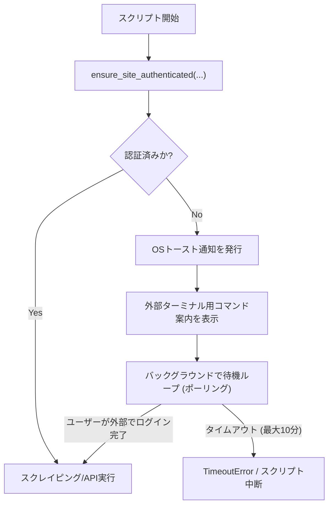

# 共通設計・ユーティリティ利用ガイド (`scripts/common/`)

本ディレクトリでは、各求人・転職サイトスクリプト（`findy/`, `bizreach/`, `openwork/`, `forkwell/`, `linkedin/` 等）間で共有される共通ロジック、認証ハンドオフ基盤、CLI引数・出力規約基盤、データ正規化・永続化モデル、および全サイト横断求人検索ツールの仕様と利用方法をまとめています。

---

## 目次

1. [共通モジュール一覧](#1-共通モジュール一覧)
2. [モジュール別仕様・APIリファレンス](#2-モジュール別仕様apiリファレンス)
   - [2.1 認証エンジン (`auth_engine.py`)](#21-認証エンジン-auth_enginepy)
   - [2.2 ブラウザ操作・セッション管理 (`browser_auth.py`)](#22-ブラウザ操作セッション管理-browser_authpy)
   - [2.3 CLI引数・標準規約 (`cli.py`)](#23-cli引数標準規約-clipy)
   - [2.4 データ正規化・抽出 (`normalizers.py`)](#24-データ正規化抽出-normalizerspy)
   - [2.5 データ永続化・モデル (`storage.py`)](#25-データ永続化モデル-storagepy)
3. [求人Markdown横断検索CLI (`search_jobs.py`)](#3-求人markdown横断検索cli-search_jobspy)
4. [データ格納ディレクトリ構造方針](#4-データ格納ディレクトリ構造方針)
5. [新規サイト追加時のガイドライン](#5-新規サイト追加時のガイドライン)

---

## 1. 共通モジュール一覧

| モジュール | 主な役割 |
|---|---|
| [`scripts/common/auth_engine.py`](file:///c:/C/job_hunt/scripts/common/auth_engine.py) | サイト横断の認証状態確認、未認証/認証壁/CAPTCHA検知時のOSトースト通知・手動ログイン待機ハンドオフ |
| [`scripts/common/browser_auth.py`](file:///c:/C/job_hunt/scripts/common/browser_auth.py) | Playwright CLIセッション管理、共通プロファイル解決、Playwrightスクリプト実行ラッパー、OSトースト通知発行 |
| [`scripts/common/cli.py`](file:///c:/C/job_hunt/scripts/common/cli.py) | リポジトリ共通CLI引数パーサー（標準規約: `--summary`, `--json`, `-n/--limit`, `--force` 等）およびコンテキストガード（パスのみ出力、エラーハンドリング） |
| [`scripts/common/normalizers.py`](file:///c:/C/job_hunt/scripts/common/normalizers.py) | 年収パース（円単位整数化・表示用整形）、勤務形態判定（フルリモート/ハイブリッド/出社）、スキル抽出（単語境界マッチ）、企業名正規化 |
| [`scripts/common/storage.py`](file:///c:/C/job_hunt/scripts/common/storage.py) | `job-data-format.md` 準拠の求人データモデル（`JobData`）、フロントマター付きMarkdown保存、検索結果一覧Markdown/JSON保存 |
| [`scripts/common/search_jobs.py`](file:///c:/C/job_hunt/scripts/common/search_jobs.py) | `data/*/jobs/*.md` に蓄積された求人Markdownの全媒体横断検索・条件フィルタリング・JSON出力CLI |

---

## 2. モジュール別仕様・APIリファレンス

### 2.1 認証エンジン (`auth_engine.py`)

#### 概要
各転職サイトでは、セッション切れやWAF/CAPTCHAによって未認証状態になることがあります。Windowsのサンドボックス制約（プロセスが分離された仮想デスクトップで実行されるため、エージェント側から可視ブラウザを表示できない制約）を回避するため、認証状態判定と待機ハンドオフを統一的に管理します。



#### 主要API
- `SiteAuthConfig`: サイト別の認証設定データクラス
  - `site_name`: サイト表示名（例: `"ビズリーチ"`, `"Forkwell"`）
  - `login_url`: ログインページURL
  - `target_url`: 認証確認用ターゲットURL（例: マイページやダッシュボード）
  - `auth_wall_regex`: ログイン壁URL正規表現（例: `r"/login|/users/sign_in"`）
  - `logged_in_selectors`: ログイン中を示すDOMセレクタリスト
  - `is_captcha_site`: CAPTCHA/WAF検知が必要かどうかの真偽値
- `ensure_site_authenticated(session, config, timeout=600)`: サイトの認証状態を確認し、未認証なら手動ログインを待機

### 2.2 ブラウザ操作・セッション管理 (`browser_auth.py`)

#### 主要API
- `resolve_profile_path(session_name: str, explicit_path: str | None = None) -> Path`:
  - セッション名（既定: `job-hunt`）からプロファイルの物理パス（`%LOCALAPPDATA%\claude-browser-profiles\job-hunt`）を解決。
- `run_code_snippet(session: str, code: str, timeout: float = 30.0) -> dict[str, Any] | None`:
  - Playwrightコードスニペットを実行し、`window.__playwright_result` または標準出力からJSONを抽出。
- `run_code_script(session: str, script_path: Path, ...)`:
  - `.mjs` ファイルを実行してJSON結果を取得。
- `send_os_notification(title: str, body: str)`:
  - Windows PowerShell経由でネイティブトースト通知を送信。

### 2.3 CLI引数・標準規約 (`cli.py`)

本リポジトリのCLI規約（`.agents/rules/scripts-entrypoint.md`）に準拠した引数パースと出力制御を提供します。

#### 主要API
- `create_base_parser(description: str, default_limit: int = 20) -> argparse.ArgumentParser`:
  - `--summary`, `--json`, `-n, --limit`, `--force` を備えた基底パーサーを生成。
- `create_search_parser(description: str, default_limit: int = 20) -> argparse.ArgumentParser`:
  - 上記に加え、`query`（位置引数）、`--min-salary`, `--max-salary`, `--remote`, `--download` 等の求人検索標準引数を備えたパーサーを生成。
- `entrypoint_guard(summary: bool, json_mode: bool) -> ContextManager[EntrypointContext]`:
  - stdoutへの作成ファイルパス出力、エラー時のstderr出力・非ゼロ終了コード制御、サマリ表示を自動管理するコンテキストマネージャ。

### 2.4 データ正規化・抽出 (`normalizers.py`)

各媒体のテキストから表記揺れを吸収し、統一データ型に変換します。

#### 主要API
- `parse_salary_range(text: str) -> tuple[int | None, int | None]`:
  - "800万〜1200万円"、"月給50万〜" 等から `(8000000, 12000000)` の円単位整数タプルを取得。
- `parse_salary_arg(val: str | int | None) -> int | None`:
  - CLI引数の "800"、"800万"、"8000000" を円単位数値 `8000000` に変換。
- `detect_remote_type(location_text: str, body_text: str) -> str`:
  - `"フルリモート"`, `"ハイブリッド"`, `"出社"`, `"記載なし"` を判定。
- `extract_skills_from_text(text: str) -> list[str]`:
  - SSOT辞書（`KNOWN_SKILL_KEYWORDS`）に基づき、単語境界（Word Boundary）を考慮してスキル名を重複なく抽出。
- `normalize_company_name(name: str) -> str`:
  - 「株式会社」「（株）」等の法人格を除去し、全角半角正規化を行った企業名文字列を取得。
- `normalize_url(url: str, base_url: str = "") -> str`:
  - 相対URLの絶対化、トラッキングパラメータ（`utm_*`等）の自動除去。

### 2.5 データ永続化・モデル (`storage.py`)

#### 主要API
- `JobData`: `job-data-format.md` に完全準拠した求人データモデル（dataclass）。
- `save_job_markdown(job: JobData, output_dir: Path, force: bool = False) -> tuple[Path, bool]`:
  - フロントマター付き求人Markdownを `output_dir / f"{job.id}.md"` に保存。既存スキップ／上書きを制御。
- `save_search_result(source: str, keyword: str, jobs: list[dict], searches_dir: Path) -> tuple[Path, Path]`:
  - 検索結果一覧のMarkdown（`YYYY-MM-DD-HHMMSS_{keyword}.md`）およびJSONを保存。

---

## 3. 求人Markdown横断検索CLI (`search_jobs.py`)

### 概要
`data/*/jobs/*.md`（`findy`, `bizreach`, `openwork`, `forkwell`, `linkedin` 等）に保存されたすべての求人Markdownを横断走査し、キーワード・技術スタック・年収・リモート形態などの条件で高速にフィルタリング・表示します。

### 基本的な使い方

```powershell
# 1. 全文フリーワード検索（AND一致）
uv run python scripts/common/search_jobs.py "FastAPI" "PostgreSQL"

# 2. 技術スタック・年収での絞り込み
uv run python scripts/common/search_jobs.py -s Python -s Go --min-salary 800

# 3. フルリモート求人のみを抽出
uv run python scripts/common/search_jobs.py --remote "フルリモート"

# 4. 特定企業名で検索し、本文概要付きで表示
uv run python scripts/common/search_jobs.py -c "メルカリ" --detail

# 5. 特定の媒体（例: Forkwell）のみに絞り込み
uv run python scripts/common/search_jobs.py -s Python --source forkwell

# 6. 結果をJSONで出力（他ツールやLLM連携用）
uv run python scripts/common/search_jobs.py "AI" --json
```

### 主なオプション一覧

| オプション | 引数 | 説明 |
|---|---|---|
| `query` | 文字列（複数可） | タイトル・企業名・スキル・本文に対する全文検索キーワード |
| `-c, --company` | 文字列 | 企業名（部分一致） |
| `-t, --title` | 文字列 | 求人タイトル（部分一致） |
| `-s, --skill` | 文字列（複数可） | 必須スキル（例: `-s Python -s React`） |
| `--min-salary` | 数値/文字列 | 最低年収（例: `700`, `700万`, `7000000`） |
| `--max-salary` | 数値/文字列 | 最高年収（例: `1200`, `1200万`） |
| `-r, --remote` | 文字列 | リモート形態（例: `フルリモート`, `ハイブリッド`） |
| `--source` | 文字列 | 求人媒体（`findy`, `bizreach`, `openwork`, `forkwell`, `linkedin` 等） |
| `-d, --detail` | - | 本文スニペットを含む詳細表示 |
| `--json` | - | JSON形式で出力 |
| `--files-only` | - | 一致したMarkdownのファイルパスのみ出力 |

---

## 4. データ格納ディレクトリ構造方針

本リポジトリでは、すべてのデータとスクリプトを「サイト名（小文字）」を第1階層として管理します。

```text
data/
  ├── bizreach/
  │   ├── jobs/              # ビズリーチ 求人詳細Markdown ({job_id}.md)
  │   ├── messages/          # スカウト・メッセージ履歴 (YYYY-MM-DD-HH.md / .json)
  │   ├── resume/            # 職務経歴書スナップショット (latest.md / backups/)
  │   └── searches/          # 検索結果一覧 (YYYY-MM-DD-HHMMSS_{query}.md / .json)
  ├── findy/
  │   ├── jobs/              # Findy 求人詳細Markdown ({job_id}.md)
  │   ├── likes/             # いいね履歴 (YYYY-MM-DD-HH.md / .json)
  │   ├── messages/          # メッセージ一覧履歴 (YYYY-MM-DD-HH.md / .json)
  │   ├── profile/           # キャリア・スキル情報 (latest.md / backups/)
  │   ├── recommends/        # おすすめ求人履歴 (YYYY-MM-DD-HHMMSS.md / .json)
  │   └── searches/          # 検索結果一覧
  ├── forkwell/
  │   ├── jobs/              # Forkwell 求人詳細Markdown ({job_id}.md)
  │   ├── profile/           # プロフィール・設定情報 (latest.md / backups/)
  │   └── searches/          # 検索結果一覧
  ├── linkedin/
  │   ├── experience/        # 職歴データ (latest.md / backups/)
  │   ├── jobs/              # LinkedIn 求人詳細Markdown ({job_id}.md)
  │   ├── profile/           # プロフィール・スキル (latest.md / backups/)
  │   └── searches/          # 検索結果一覧
  └── openwork/
      ├── jobs/              # OpenWork 求人詳細Markdown ({job_id}.md)
      ├── messages/          # スカウト・メッセージ履歴 (YYYY-MM-DD-HH.md / .json)
      ├── resume/            # WEB履歴書 (latest.md / .json)
      ├── reviews/           # 会社クチコミ・8項目スコア ({m_id}.md)
      └── searches/          # 検索結果一覧
```

---

## 5. 新規サイト追加時のガイドライン

新しい求人媒体を追加する際は、[`docs/guides/new_site_scraper_guide.md`](file:///c:/C/job_hunt/docs/guides/new_site_scraper_guide.md) を参照してください。
雛形テンプレート [`scripts/templates/site_scraper_template.py`](file:///c:/C/job_hunt/scripts/templates/site_scraper_template.py) を利用することで、上記の共通基盤をそのまま活用して最小限の実装工数で安全に追加できます。
