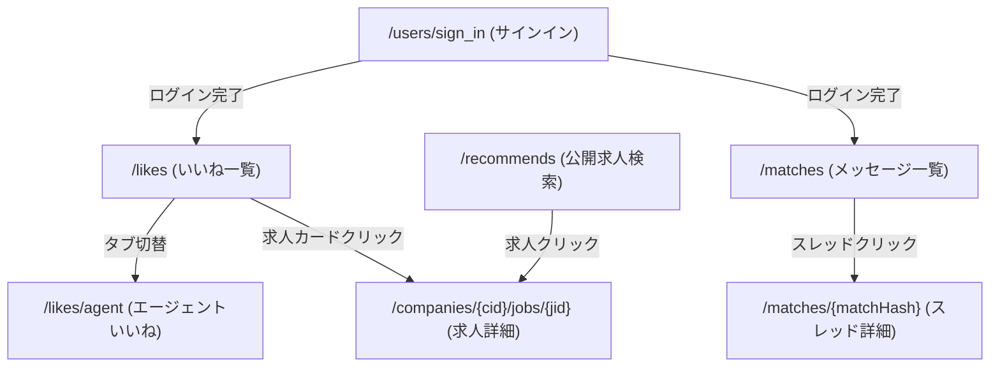

# Findy サイト構造リファレンス

本ドキュメントは、AIエージェントが `sharing-browser-with-user` スキルや `playwright-cli` を利用してFindy（[findy-code.io](https://findy-code.io/)）を探索・自動操作する際、事前の探索オーバーヘッドを削減するためのサイト構造ガイドです。

---

## 1. サイト基本情報 & 認証基盤

| 項目 | 内容 |
|---|---|
| **メインドメイン** | `https://findy-code.io/` |
| **ログインURL** | `https://findy-code.io/users/sign_in` |
| **推奨プロファイル** | `job-hunt`（永続ブラウザプロファイル） |
| **認証方式** | GitHub / Google / メールアドレス等によるOAuth/パスワード認証 |
| **未ログイン判定** | URLが `/users/sign_in` や `/users/sign_up` を含む、またはログインボタン・認証フォームが表示される |
| **フロントエンド技術** | **Next.js (SSR / React)**。HTML内に `<script id="__NEXT_DATA__">` が埋め込まれており、求人一覧や詳細の完全な構造化JSONが取得可能。 |

---

## 2. 主要URLマップ

| 画面名 | パス / URL | 認証 | 備考 |
|---|---|---|---|
| **トップページ** | `/` | 不要 | サービス概要・ランディング |
| **ログイン** | `/users/sign_in` | 不要 | サインイン画面 |
| **求人検索（公開）** | `/recommends` | 不要 | 公開求人検索画面（キーワード・技術・年収等で検索可） |
| **おすすめ求人（会員）** | `/recommends?sort=recommend` | 要 | 推薦アルゴリズム準拠のおすすめ求人一覧 |
| **求人詳細** | `/companies/{company_id}/jobs/{job_id}` | 不要 | 求人票の詳細・応募要件・開発環境 |
| **いいね（企業から）** | `/likes` | 要 | 企業から直接受け取ったいいね一覧（デフォルト） |
| **いいね（エージェント）** | `/likes/agent` | 要 | エージェントからのいいね一覧 |
| **いいね（送信済み）** | `/likes/sent` | 要 | 自分が企業へ送信したいいね |
| **いいね（期限切れ）** | `/likes/expired` | 要 | 有効期限（7日間等）が切れたいいね |
| **いいね（見送り）** | `/likes/passed` | 要 | スキップ・見送った求人 |
| **キャリア・スキル** | `/me/career-skills` | 要 | 職歴、保有スキル、現年収、自己PR、AI活用、学歴、資格 |
| **マイページ / プロフィール** | `/my/profile` | 要 | スキル偏差値、職務経歴、希望条件設定 |
| **メッセージ・スカウト一覧** | `/matches` | 要 | 企業・エージェントからのメッセージ／スカウト／連絡一覧 |
| **メッセージ詳細（スレッド）** | `/matches/{matchHash}` | 要 | 個別企業とのメッセージやり取り画面 |

---

## 3. 画面遷移フロー



---

## 4. 主要画面のDOM構造・セレクタ

### 4.1 いいね一覧画面 (`/likes`)

```text
body
  ├── header (グローバルナビゲーション: スキル偏差値、いいね、メッセージ等のリンク)
  └── main
        ├── タブメニュー (企業からのいいね / エージェントからのいいね / 送信済み / 期限切れ / 見送り)
        └── いいね求人リストコンテナ
              ├── 求人カード (div/article)
              │     ├── 企業名 (h3/a)
              │     ├── 求人タイトル (h2/a)
              │     ├── 想定年収 (span/div - 例: 700万円〜1,000万円)
              │     ├── いいね有効期限 (span - 例: あと3日)
              │     ├── 技術タグ・魅力タグ (ul/li/span)
              │     ├── 詳細リンク (a[href*="/companies/.../jobs/..."])
              │     └── アクションボタン (「いいかも」「見送る」等)
              └── ...
```

#### 推奨セレクタ一覧

| 対象要素 | 代表的なセレクタ候補 | 判定ロジック・備考 |
|---|---|---|
| **いいねタブ** | `a[href="/likes"]`, `a[href="/likes/agent"]` 等 | URLパスで直接遷移が確実 |
| **求人カード** | `a[href*="/companies/"][href*="/jobs/"]`, `div[class*="card"]` | `/companies/\d+/jobs/[a-zA-Z0-9_-]+` リンクを含む要素 |
| **企業名** | `[class*="companyName"]`, `h3`, `p` | 求人タイトルと並ぶ会社名 |
| **求人タイトル** | `[class*="title"]`, `h2`, `h3` | 求人の見出しテキスト |
| **想定年収** | `span:has-text("万円")`, `[class*="salary"]` | `\d+万円〜\d+万円` などの文字列 |
| **有効期限** | `span:has-text("日")`, `[class*="deadline"]` | 「あとX日」「本日まで」などの表示 |
| **技術タグ** | `[class*="tag"]`, `[class*="skill"]`, `li` | Go, Python, AWS などのスキルバッジ |

---

### 4.2 公開求人検索画面 (`/recommends`)

- キーワード検索パラメータ: `?keywords=Python+Go`
- ページネーション: `?page=2`
- **高速データ抽出**: HTML内の `<script id="__NEXT_DATA__">` から `props.pageProps.jobDescriptionsData.list` を直接抽出可能（`scripts/findy/search_online.py` で実装済み）。

---

### 4.3 求人詳細画面 (`/companies/{cid}/jobs/{jid}`)

- **高速データ抽出**: `<script id="__NEXT_DATA__">` 内の `props.pageProps.jobDescription` に、仕事内容（`description`）、必須要件（`mustSkills`）、歓迎要件（`desiredSkills`）、開発環境（`developmentEnvironment`）、年収レンジ（`numericSalaryMin` / `numericSalaryMax`）等の全構造化データが含まれています。

---

### 4.4 キャリア・スキル画面 (`/me/career-skills`)

- **画面の役割**: 職歴・プロジェクト履歴、職務要約、保有スキル・経験年数、現年収、AI活用方針、自己PR、今後やりたいこと、学歴、資格等のマスタープロフィール設定画面。
- **GraphQL API 仕様**:
  - 画面ロード時にクライアントサイドSPAから以下のGraphQL APIが呼び出されます。
  - エンドポイント: `https://api.findy-code.io/graphql/user?opname=FetchCareerSkillsCurrentUser`
  - クエリ名: `FetchCareerSkillsCurrentUser`
  - 主要レスポンスデータ構造:
    - `currentUser.profile`: `numericAnnualIncome`（現年収）, `inputProgress`（進捗率）, `selfUpdatedAt`（最終更新日）, `latestDevelopmentResults`（職務要約）, `bio`（自己PR）, `vision`（今後やりたいこと）, `englishSkill`（語学力）, `workExperienceDoc`（PDF職歴書）
    - `currentUser.jobRoles`: 登録職種および経験年数区分（`userJobYearType`）
    - `currentUser.experiencedSkills`: 保有スキル一覧、経験年数、算出区分（`AUTO_CALCULATED` / `USER_INPUT`）
    - `currentUser.workHistories`: 所属企業、雇用形態、在籍期間、および配下の `workHistoryProjects`（プロジェクト名、役割、チーム規模、使用技術、業務詳細）
    - `currentUser.aiUsage`: エンジニアリング領域におけるAI活用コメント（`comment`）
    - `currentUser.educationalBackground`: 学校名、学部学科、卒業年月、専攻詳細
    - `currentUser.certifications`: 保有資格一覧、取得年
    - `currentUser.toeicScore` / `toeflScore`: 語学スコア
- **高速データ抽出**: Next.js SPAのため `__NEXT_DATA__` 内の `pageProps` は空であり、Playwrightのレスポンスインターセプト（`page.on('response', ...)`）によってGraphQL生データをキャッチして抽出するのが最も確実かつ高精度です（`scripts/findy/fetch_profile.py` で実装済み）。
- **職歴・プロジェクトCRUD GraphQL Mutation**:
  - 詳細仕様: [work_history_api.md](work_history_api.md)
  - 職歴作成: `CreateCareerSkillsWorkHistory` (`createWorkHistory(input: CreateWorkHistoryInput!)`)
  - 職歴更新: `UpdateCareerSkillsWorkHistory` (`updateWorkHistory(input: UpdateWorkHistoryInput!)`)
  - 職歴削除: `DeleteCareerSkillsWorkHistory` (`deleteWorkHistory(input: DeleteWorkHistoryInput!)`)
  - プロジェクト作成: `CreateCareerSkillsWorkHistoryProject` (`createWorkHistoryProject(input: CreateWorkHistoryProjectInput!)`)
  - プロジェクト更新: `UpdateCareerSkillsWorkHistoryProject` (`updateWorkHistoryProject(input: UpdateWorkHistoryProjectInput!)`)
  - プロジェクト削除: `DeleteCareerSkillsWorkHistoryProject` (`deleteWorkHistoryProject(input: DeleteWorkHistoryProjectInput!)`)
  - 呼び出し要件: POST `https://api.findy-code.io/graphql/user?opname=<OpName>`。必須ヘッダー `x-requested-with: XMLHttpRequest`。Playwrightブラウザコンテキストからの `fetch` 実行が最も堅牢。

---

### 4.5 メッセージ・スカウト一覧画面 (`/matches`)

- **画面の役割**: 企業や転職エージェントからのメッセージ／スカウト／返信一覧を表示・管理する画面。
- **GraphQL API 仕様**:
  - エンドポイント: `POST https://api.findy-code.io/graphql/user?opname=FetchMessageContexts`
  - クエリ名: `FetchMessageContexts`
  - ヘッダー: `x-requested-with: XMLHttpRequest`, `credentials: 'include'`
  - 変数:
    - `page`: ページ番号（1〜）
    - `pageSize`: 取得件数（最大50推奨）
    - `filter`: フィルターオブジェクト
      - すべて: `null`
      - 未読: `{"isReadMessage": false}`
      - 未返信: `{"isReadMessage": false, "isRepliedMessage": false}`
      - 非表示: `{"isArchived": true}`
  - レスポンスデータ: `data.messageContexts.list`（`Match`, `AgentMatch`, `FindyMessageConversation` 等のオブジェクト）
- **主要プロパティ**:
  - `matchHash`: スレッドURLのハッシュID（`/matches/{matchHash}`）
  - `jobDescription.company.name`: 企業名
  - `jobDescription.id`: 求人票ID
  - `latestMessage`: 最新メッセージ（本文 `message`, 送信日時 `createdAt`, 既読日時 `userReadAt`）
  - `enterprisePremiumScouts`: プレミアムスカウト時のメッセージ配列
  - `isReadMessage` / `isRepliedMessage` / `isArchived`: 状態フラグ
- **データ抽出**: Playwrightで `/matches` を開いた後、ブラウザコンテキストから `FetchMessageContexts` を `fetch` 実行するのが最も高速・高精度（`scripts/findy/navigate_messages.py` で実装済み）。

---

## 5. レンダリング・操作特性と勘所

1. **Next.js の活用**:
   - FindyはNext.jsで構築されているため、公開求人一覧や詳細ではページ内の `__NEXT_DATA__` をパースした方が10倍以上高速かつ欠落なくデータが取得できます。
   - 一方、`/me/career-skills` などのマイページはSPA通信（GraphQL）でデータをロードするため、Playwrightでのネットワークインターセプトが最適です。
2. **認証状態の保持**:
   - 共通プロファイル `job-hunt` にGitHubやGoogleでログインしていれば、次回以降もセッションが維持されます。
3. **いいね画面のタブ**:
   - `/likes` (企業)
   - `/likes/agent` (エージェント)
   - `/likes/sent` (送信済み)
   - クエリではなくパスでタブが切り替わります。

---

## 6. Playwright CLI / AI探索時の推奨コマンド

```powershell
# 1. 共通プロファイルでいいね一覧を開く
playwright-cli -s=job-hunt open https://findy-code.io/likes --profile="$env:LOCALAPPDATA\claude-browser-profiles\job-hunt"

# 2. キャリア・スキル画面を開く
playwright-cli -s=job-hunt open https://findy-code.io/me/career-skills --profile="$env:LOCALAPPDATA\claude-browser-profiles\job-hunt"

# 3. 現在のURLとタイトルを確認
playwright-cli -s=job-hunt eval "JSON.stringify({ url: location.href, title: document.title })"

# 4. 画面スナップショットを取得
playwright-cli -s=job-hunt snapshot

# 5. エージェントからのいいねタブへ遷移
playwright-cli -s=job-hunt goto "https://findy-code.io/likes/agent"

# 6. 求人検索画面で特定キーワードを検索
playwright-cli -s=job-hunt goto "https://findy-code.io/recommends?keywords=AI+LLM"

# 7. 職歴・プロジェクト管理スクリプト（manage_work_history.py）の利用
# 職歴・プロジェクト一覧確認
python scripts/findy/manage_work_history.py list

# マスタ一覧確認
python scripts/findy/manage_work_history.py masters

# スキル検索（ID取得）
python scripts/findy/manage_work_history.py search-skills -q Python

# 職歴追加
python scripts/findy/manage_work_history.py add-company --name "株式会社〇〇" --employment 1 --start-year 2024 --start-month 4 --current

# プロジェクト追加
python scripts/findy/manage_work_history.py add-project --company-id <ID> --name "〇〇開発" --start-year 2024 --start-month 4 --current --detail "業務詳細（50文字以上必須）..." --skill-ids "5,81"

# 8. メッセージ・スカウト一覧取得スクリプト（navigate_messages.py）の利用
# 全件取得・ファイル保存（標準出力はファイルパスのみ）
python scripts/findy/navigate_messages.py

# 整形サマリを表示
python scripts/findy/navigate_messages.py --summary -n 5

# 未読のみ取得
python scripts/findy/navigate_messages.py --tab unread --summary

# 未返信のみ取得
python scripts/findy/navigate_messages.py --tab unreplied --summary
```
