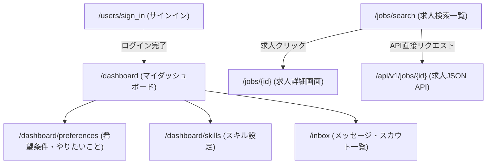

# Forkwell（フォークウェル）サイト構造リファレンス

本ドキュメントは、AIエージェントが `sharing-browser-with-user` スキルや自動化スクリプトを利用してForkwell Jobs（[jobs.forkwell.com](https://jobs.forkwell.com/)）を探索・自動操作する際、事前の探索オーバーヘッドを削減するためのサイト構造・セレクタ・API仕様書です。

---

## 1. サイト基本情報 & 認証基盤

| 項目 | 内容 |
|---|---|
| **メインドメイン** | `https://jobs.forkwell.com/` |
| **求人検索URL** | `https://jobs.forkwell.com/jobs/search` |
| **ログインURL** | `https://jobs.forkwell.com/users/sign_in` |
| **推奨プロファイル** | `job-hunt`（永続ブラウザプロファイル） |
| **認証方式** | GitHub / Google / メールアドレス等によるOAuth/パスワード認証 |
| **未ログイン判定** | URLが `/users/sign_in` や `/users/sign_up` を含む、またはログインボタン・認証フォームが表示される |
| **APIアーキテクチャ** | 求人詳細に公式REST API（`/api/v1/jobs/{id}`）が存在し、完全な構造化JSONが取得可能 |

---

## 2. 主要URLマップ

| 画面名 | パス / URL | 認証 | 備考 |
|---|---|---|---|
| **トップページ** | `/` | 不要 | サービス概要・ランディング |
| **ログイン** | `/users/sign_in` | 不要 | サインイン画面 |
| **求人検索（公開）** | `/jobs/search` | 不要 | キーワード、職種、技術、年収、リモート形態等で検索 |
| **求人詳細** | `/jobs/{id}` | 不要 | 各求人の募集要項・仕事内容詳細 |
| **求人詳細API** | `/api/v1/jobs/{id}` | 不要 | 求人票の完全なJSONデータを返すエンドポイント |
| **マイダッシュボード** | `/dashboard` | **要** | 職歴、プロフィール概要、スカウト状況 |
| **希望条件設定** | `/dashboard/preferences` | **要** | やりたいこと、希望年収、働き方、スカウト受取設定 |
| **スキル設定** | `/dashboard/skills` | **要** | 経験技術、フレームワーク、ツール、資格 |
| **メッセージ・スカウト** | `/inbox` | **要** | スカウト・やりとり、アーカイブ、スレッド詳細 |

---

## 3. 画面遷移フロー



---

## 4. 求人詳細API仕様 (`/api/v1/jobs/{id}`)

Forkwellの求人詳細画面は、公式API `/api/v1/jobs/{id}` から直接JSONを取得できます。

### レスポンス構造の主要フィールド

```json
{
  "job": {
    "id": 12345,
    "title": "バックエンドエンジニア（Go/GCP）",
    "company": {
      "id": 678,
      "name": "株式会社サンプル",
      "logo_url": "https://..."
    },
    "salary_min": 7000000,
    "salary_max": 10000000,
    "salary_text": "700万円〜1000万円",
    "location": "東京都港区",
    "remote_type": "フルリモート",
    "description": "仕事内容の詳細...",
    "requirements": "【必須要件】...",
    "welcome_requirements": "【歓迎要件】...",
    "technology_stacks": ["Go", "GCP", "Kubernetes", "PostgreSQL"],
    "created_at": "2026-01-10T10:00:00Z"
  }
}
```

---

## 5. 主要画面のDOM構造・セレクタ

### 5.1 求人検索結果画面 (`/jobs/search`)

```text
body
  ├── header (グローバルナビゲーション)
  └── main
        ├── 検索フォーム・フィルタサイドバー
        └── 求人カードリスト
              ├── 求人カード (article / div[class*="job-card"])
              │     ├── 企業名 (div[class*="company-name"] a)
              │     ├── 求人タイトル (h2 / a[href*="/jobs/"])
              │     ├── 給与レンジ (span[class*="salary"])
              │     ├── 勤務地・リモートタグ (span[class*="tag"])
              │     └── 技術タグ一覧 (ul[class*="tags"] li)
              └── ページネーション (nav.pagination)
```

### 5.2 ダッシュボード画面 (`/dashboard`)

```text
body
  ├── header
  └── main.dashboard
        ├── プロフィールサマリ (ユーザー名、現職、Bio)
        ├── 職歴リスト (company_users / work_histories)
        │     ├── 企業ブロック (div[data-company-id])
        │     │     ├── 社名、在籍期間、雇用形態、役職
        │     │     └── 担当プロジェクトリスト (div[data-project-id])
        │     └── 編集・追加ボタン (a[href*="/edit"], button)
        └── 右サイドバー (ナビゲーションリンク)
```

### 5.3 インボックス・メッセージ画面 (`/inbox`)

```text
body
  └── div[data-react-class="Inbox"]
        └── .row
              ├── 左ペイン (col-md-3, col-lg-3): タブナビゲーション & メッセージカード一覧
              │     ├── nav > ul
              │     │     ├── li.nav-item:has-text("スカウト・やりとり") (アクティブ時: .active)
              │     │     └── li.nav-item:has-text("アーカイブ")
              │     └── .list-group.list-group-flush
              │           └── .list-group-item.list-group-item-action (各メッセージカード)
              │                 ├── 企業アイコン・企業名 (img[alt="{企業名}"])
              │                 ├── 件名・タイトル (.card-content-space-top.small)
              │                 ├── 状況・有効期限・最終更新日 (.text-muted, time)
              │                 └── 種別バッジ一覧 (.badge.rounded-pill.bg-primary)
              └── 右ペイン (col-md-9, col-lg-9): メッセージ詳細・求人内容
                    └── .message__inbox_scout_body.card
                          ├── ヘッダー (.message__header.card-header)
                          │     └── 企業名リンク (h2.message__header__title a)
                          ├── 添付求人カード (.scout-content-job)
                          │     ├── 求人タイトル & リンク (a[href*="/jobs/"])
                          │     └── 雇用形態・年収・職種テキスト
                          └── メッセージ本文 (.message__body または card全体)
                                ├── 企業からのメッセージ
                                ├── 魅力に感じた技術や経歴
                                ├── 一緒に解決したい課題や困りごと
                                ├── 雇用形態 / 想定年収 / 開発技術スタック
                                └── 返信選択肢・有効期限
```

