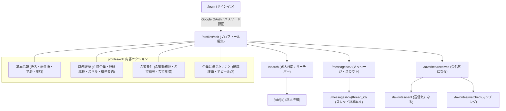

# Green（グリーン）サイト構造リファレンス

本ドキュメントは、AIエージェントおよび自動化スクリプトがGreen（[green-japan.com](https://www.green-japan.com/)）を安全かつ高精度に探索・操作するためのサイト構造、認証仕様、DOMセレクタ、および内部REST API仕様書です。

---

## 1. サイト基本情報 & 認証基盤

| 項目 | 内容 |
|---|---|
| **メインドメイン** | `https://www.green-japan.com` |
| **プロフィール編集URL** | `https://www.green-japan.com/profiles/edit` |
| **ログインURL** | `https://www.green-japan.com/login` |
| **未ログイン時リダイレクト** | `https://www.green-japan.com/login?target_url=%2Fprofiles%2Fedit` |
| **推奨プロファイル** | `job-hunt`（リポジトリ共通永続ブラウザプロファイル: `%LOCALAPPDATA%\claude-browser-profiles\job-hunt`） |
| **認証方式** | Google OAuth / メールアドレス・パスワード認証 |
| **未ログイン判定** | URLが `/login` または `accounts.google.com` を含む、タイトルが `ログイン | IT/Web業界の求人・中途採用情報に強い転職サイトGreen(グリーン)` |
| **ログイン済み判定** | URLが `/profiles/edit` 等の内部画面、ヘッダーにユーザー名タブ（例: `毎熊 星湾`）、または `window.__NEXT_DATA__.props.pageProps.userData.isLogin === true` |
| **フロントエンド技術** | **Next.js (SSR/SSG)** + **React** + **Material UI (MUI)** |
| **APIアーキテクチャ** | 画面読み込み時に `window.__NEXT_DATA__.props.pageProps` に全プロフィールデータが構造化JSONとして埋め込まれ、更新時は内部REST API（`/user/me/...`）へ非同期リクエスト（XHR/fetch）を送信 |

---

## 2. 主要URLマップ

| 画面名 | パス / URL | 認証 | 備考 |
|---|---|---|---|
| **トップページ** | `/` | 不要 | サービス概要・求人一覧入口 |
| **ログイン** | `/login` | 不要 | サインイン画面（Google認証連携） |
| **求人検索** | `/search` | 不要 | 画面上部サーチバー・条件指定（キーワード、職種、勤務地、年収等） |
| **求人詳細** | `/job/{id}` | 不要 | 各求人の募集要項・仕事内容（`/company/{client_id}/job/{id}` からも参照可） |
| **プロフィール編集** | `/profiles/edit` | **要** | 基本情報、職歴、スキル、希望条件、自己PR編集 |
| **レジュメパーサー** | `/profiles/resume_parser` | **要** | 職務経歴書ファイル自動パース画面 |
| **気になる一覧** | `/favorites/received` | **要** | 受信した気になる求人・企業一覧（旧 `/client_users/interests` から移行） |
| **気になる（送信）** | `/favorites/sent` | **要** | 自分が気になると送った求人一覧 |
| **気になる（マッチング）** | `/favorites/matched` | **要** | 相互マッチング成立求人一覧 |
| **気になる（興味なし）** | `/favorites/uninterested` | **要** | 興味なしに設定した求人一覧 |
| **メッセージ一覧** | `/messages/v2` | **要** | 新UIメッセージ・スカウト一覧（企業／エージェントタブ切替、旧 `/messages` から移行） |
| **スレッド詳細** | `/messages/v2/{thread_id}` | **要** | 特定企業/エージェントとのメッセージ本文・添付求人 |

---

## 3. 画面遷移フロー



---

## 4. プロフィール構造化データ仕様 (`window.__NEXT_DATA__`)

Greenの `/profiles/edit` 画面はNext.jsで構築されており、ページ初期化時に `window.__NEXT_DATA__.props.pageProps` 配下にすべてのプロフィール情報とマスターデータが完全な型・ID付きで格納されています。

### 4.1 主要オブジェクト構成

```text
window.__NEXT_DATA__.props.pageProps
  ├── userData (基本情報・スキル・経歴・希望条件の大部分)
  ├── userResume (職務経歴書・自己PRフリーフォーマット)
  ├── blockCompanies (非公開・ブロック対象企業一覧)
  ├── prefectureMasterData (47都道府県マスター)
  ├── employmentStatusMasterData (正社員・契約社員等の雇用形態マスター)
  ├── schoolMasterData (学校区分・卒業区分マスター)
  ├── jobTagCategoriesData (職種カテゴリ・職種タグマスター)
  ├── masterSkillData (全技術スキルマスター)
  ├── masterAreaData (エリアマスター)
  ├── languageMasterData (語学マスター)
  └── masterUserNeedsForJob (転職先に求めるものマスター)
```

### 4.2 `userData` の主要フィールド

| フィールド | 型 | 説明 | 例 |
|---|---|---|---|
| `id` | `number` | ユーザーID | `1714069` |
| `isLogin` | `boolean` | ログイン状態フラグ | `true` |
| `mail` | `string` | 登録メールアドレス | `user@example.com` |
| `firstName` / `lastName` | `string` | 氏名（名 / 姓） | `"星湾"` / `"毎熊"` |
| `firstKana` / `lastKana` | `string` | フリガナ（メイ / セイ） | `"セイワン"` / `"マイクマ"` |
| `gender` | `object` | 性別オブジェクト | `{ id: 1, name: "男性" }` |
| `birthdayTimestamp` | `number` | 生年月日（UNIX秒） | `885826800` (1998/01/27) |
| `age` | `number` | 年齢 | `28` |
| `areaId` | `number` | 現住所都道府県ID | `13` (東京都) |
| `address` | `string` | 住所詳細 | `"羽村市栄町..."` |
| `phoneNumber` | `string` | 電話番号（ハイフンなし） | `"08030925522"` |
| `salary` | `number` | 現（前）年収（万円単位） | `400` |
| `toeic` / `toefl` | `number \| null` | 語学テストスコア | `955` / `null` |
| `userGraduationSchool` | `object` | 最終学歴 | `schoolName` (学校名), `departmentName` (学部学科), `schoolTypeName` (大学等), `schoolGraduationYear` / `Month`, `graduationTypeName` (卒業) |
| `userCompanies` | `array` | 在籍企業リスト | `id`, `companyName` (社名), `employmentStatusName` (雇用形態), `startedOnYear` / `Month` (入社年月), `endedOnYear` / `Month` (退社年月), `enrolment` (在籍中bool) |
| `userSkills` | `array` | 保有スキルリスト | `id`, `skill: { id, name }`, `skillScore: { id, name }` (`1年未満`, `1年～3年`, `3年～5年`, `5年以上`), `skillCategory` |
| `userExpJobTags` | `array` | 経験職種リスト | `id`, `jobTag: { id, name, yearsOfExperience }` |
| `userHopeAreas` | `array` | 希望勤務地リスト | `id`, `hopeArea: { id, name }` |
| `userHopeJobTags` | `array` | 希望職種リスト | `id`, `jobTag: { id, name }` |
| `userHopeConditions` | `array` | スカウト希望条件 | `hopeSalary`, `hopeSalaryRemark`, `hopeJobCondition` 等 |
| `careerChangeStatement` | `object` | 企業に伝えたいこと | `careerChangePoint: { comment, ... }`, `careerHighlight: { comment }`, `careerChangeStatementSupplement: { comment }` |

### 4.3 `userResume` のフィールド

```json
{
  "resume": "■職務要約\n...\n【会社名】...\n■最終学歴...\n■経験職種...\n■所有スキル..."
}
```

### 4.4 `blockCompanies` のフィールド

```json
{
  "userBlockCompanies": [
    {
      "id": 2828545,
      "company": {
        "id": 44799,
        "name": "ヘッドウォータース",
        "homepageUrl": "https://www.headwaters.co.jp/"
      }
    }
  ]
}
```

---

## 5. 内部REST APIエンドポイント一覧 (CRUD仕様)

Greenのプロフィール更新は、各セクションごとに専用のREST APIエンドポイント（`/api/v2/` 配下）へ非同期リクエスト（XHR/fetch）を送信するアーキテクチャになっています。
Next.jsクライアントのAxiosインスタンスは `baseURL: "/api/v2/"` が設定されており、リクエストインターセプターによりキャメルケースのキーが自動的にスネークケース（`decamelizeKeys`）へ変換されてRailsバックエンドに送信されます。直接 `fetch` を呼ぶ場合は `/api/v2` プレフィックスおよびスネークケース形式を遵守する必要があります。

| 操作対象 | メソッド | エンドポイント | リクエスト形式 | 説明 |
|---|---|---|---|---|
| **基本情報** | `PATCH` | `/api/v2/user/me/basic_info` | JSON (`first_name`, `last_name`, `phone`, `salary`, `school_graduation_year`, `school_department_name` 等) | 氏名、現住所、電話番号、学歴、年収等を更新 |
| **職務経歴書・自己PR** | `POST` | `/api/v2/user/me/resume` | `{"resume": string}` | 職務経歴書フリーテキストを更新 |
| **在籍企業（職歴）** | `POST` | `/api/v2/user/me/exp_companies/replace_all` | `{"user_companies": [...]}` | 職歴企業リストを一括置換 |
| **保有スキル** | `POST` | `/api/v2/user/me/skills/replace_all` | `{"skills": [{"skill_id": number, "skill_score_id": number}]}` | スキルID・経験年数スコアリストを一括置換（score: 1=1年未満, 2=1〜3年, 3=3〜5年, 4=5年以上） |
| **経験職種** | `POST` | `/api/v2/user/me/exp_job_tags/replace_all` | `{"user_exp_job_tags": [...]}` | 経験職種リストを一括置換 |
| **希望職種** | `POST` | `/api/v2/user/me/hope_job_tags/replace_all` | `{"job_tag_ids": [number...]}` | 希望職種タグリストを一括置換 |
| **語学** | `POST` | `/api/v2/user/me/languages/replace_all` | JSON | 第一言語・その他言語を一括置換 |
| **ブロック企業** | `POST` | `/api/v2/user/me/block_companies/replace_all` | JSON | ブロック企業リストを一括置換 |
| **企業に伝えたいこと** | `PATCH` | `/api/v2/user/career_change_statement` | JSON (`career_change_point`: `{career_change_point_category_ids, comment}`, `career_highlight`: `{comment}`, `career_change_statement_supplement`: `{comment}`) | 転職理由・見てほしい経験・その他PRを更新 |
| **ユーザー情報取得** | `GET` | `/api/v2/user/me` | - | 認証ユーザー情報の取得 |

### 共通リクエストヘッダー仕様
- `Accept: application/json`
- `Content-Type: application/json`
- `X-Requested-With: XMLHttpRequest`
- Cookie認証（ブラウザの既存Cookieセッションが自動送信される）

---

## 6. 主要画面のDOMセレクタリファレンス

ブラウザ自動化（Playwright）でDOM要素を特定する際のセレクタ一覧です。MUIのハッシュ化クラス名（例: `css-1x7c4io`）はビルド毎に変動するため、**セマンティックな属性（aria属性、ラベル、プレースホルダー、階層）**での特定を推奨します。

### 6.1 基本情報セクション
- **姓**: `input[placeholder=""][id*="Rqjk"]` または `label:has-text("姓") + div input` / `textbox "姓"`
- **名**: `textbox "名"`
- **セイ**: `textbox "セイ"`
- **メイ**: `textbox "メイ"`
- **都道府県**: `combobox[aria-label*="都道府県"]` または `div:has-text("都道府県") .MuiSelect-select`
- **現住所**: `input[placeholder*="例：港区麻布十番"]` または `textbox "住所"`
- **電話番号**: `input[placeholder="09011111111"]` または `textbox "電話番号"`
- **生年月日**: `input[placeholder="YYYY/MM/DD"]`
- **性別ラジオ**: `input[type="radio"][value="1"]` (男性), `value="2"` (女性), `value="3"` (無回答)
- **最終学歴（学校名）**: `input[placeholder*="学校名を入力してください"]`
- **最終学歴（学部学科名）**: `input[placeholder*="学部学科名を入力してください"]`
- **現（前）年収**: `input[type="text"]:near(:text("現（前）年収"))` または `textbox "現（前）年収"`

### 6.2 職務経歴セクション
- **職務経歴・自己PRテキストエリア**: `textarea[placeholder*="今までの職務内容"]` または `textbox "職務経歴・自己PR"`
- **経験社数**: `combobox:near(:text("経験社数"))`
- **スキルタグ追加ボタン**: `button:has-text("スキルリストから追加する")`
- **職歴追加ボタン**: `button:has-text("その他学歴を追加する")`

### 6.3 送信・安全ガード
- **保存ボタン**: `button:has-text("保存する")[type="submit"]`
  - 初期状態は `disabled`（変更検知で有効化）

### 6.4 メッセージ画面 (`/messages/v2`) セレクタ
- **タブ切り替え**:
  - 企業から: `button:has-text("企業から")`, `a:has-text("企業から")`
  - エージェントから: `button:has-text("エージェントから")`, `a:has-text("エージェントから")`
- **スレッドリスト項目**:
  - スレッド行コンテナ: `a[href*="/messages/v2/"]`, `div[class*="message-item"]`, `div[class*="ThreadItem"]`
  - 企業名: `.company-name`, `p:has-text("")`
  - 送信者・担当者名: `.sender-name`, `span[class*="sender"]`
  - スカウト種別バッジ: `span:has-text("プラチナスカウト")`, `span:has-text("スカウト")`
  - 本文プレビュー: `p[class*="body"]`, `p[class*="snippet"]`
- **スレッド詳細画面 (`/messages/v2/{thread_id}`)**:
  - メッセージカード: `div[class*="Message_bubble"]`, `div[class*="message-box"]`, `div[class*="message"]`
  - 送信日時: `time`, `span[class*="date"]`, `span[class*="time"]`
  - 本文テキスト: `div[class*="Message_text"]`, `div[class*="body"]`
  - 添付求人情報: `div[class*="AttachedJob"]`, `a[href*="/job/"]`

### 6.5 気になる画面 (`/favorites/received`) セレクタ
- **タブ切り替え**:
  - 企業から（受信）: `a[href*="/favorites/received"]`, `button:has-text("企業から")`
  - あなたから（送信）: `a[href*="/favorites/sent"]`, `button:has-text("あなたから")`
  - マッチング: `a[href*="/favorites/matched"]`, `button:has-text("マッチング")`
  - 興味なし: `a[href*="/favorites/uninterested"]`, `button:has-text("興味なし")`
- **気になる求人カード**:
  - カードコンテナ: `div[class*="FavoriteItem"]`, `div[class*="card"]`, `div[class*="favorite-card"]`
  - 求人タイトル & リンク: `a[href*="/job/"]`
  - 企業名: `a[href*="/company/"]`, `div[class*="company"]`
  - 年収表示: `span:has-text("万円")`, `div[class*="salary"]`
  - 勤務地表示: `span[class*="location"]`, `span[class*="area"]`
  - 気になる受信日時: `span[class*="received-at"]`, `time`
  - 気になるボタン / マッチングボタン: `button:has-text("気になる")`, `button:has-text("メッセージ")`

### 6.6 求人検索画面 (`/search`) セレクタ & サーチバー構造
- **画面上部サーチバー操作**:
  - キーワード入力: `input[placeholder*="キーワード"]`, `input[name="keyword"]`, `input[type="search"]`
  - 勤務地エリア選択: `button:has-text("勤務地")`, モーダル内チェックボックス（例: 東京都 `input[value="13"]`）
  - 職種タグ選択: `button:has-text("職種")`, モーダル内職種リスト
  - 下限年収セレクト: `select[name="salary_bottom_id"]`, `div[role="combobox"]:near(:text("年収"))`
  - 検索実行ボタン: `button[type="submit"]`, `button:has-text("検索")`
- **URLクエリパラメータ体系**:
  - `keyword`: 検索文字列（例: `Python`）
  - `area_ids`: エリアID（カンマ区切りまたは配列、例: `13` = 東京都）
  - `job_tag_ids`: 職種タグID（カンマ区切りまたは配列）
  - `salary_bottom_id`: 下限年収（万円単位数値、例: `600`）
  - `page`: ページ番号（`1`〜）
- **検索結果一覧**:
  - 求人カード: `div[class*="JobCard"]`, `div[class*="card-job"]`, `a[href*="/job/"]`
  - 求人タイトル: `h2`, `h3`, `a[href*="/job/"]`
  - 企業名: `a[href*="/company/"]`, `p[class*="company"]`
  - 想定年収: `span:has-text("万円")`, `div[class*="salary"]`
  - 勤務地: `span[class*="location"]`
  - ページネーション: `nav[aria-label*="pagination"] a`, `a[href*="page="]`

### 6.7 求人詳細画面 (`/job/{id}`) 構造化データ & DOM
- **Next.js構造化データ (`window.__NEXT_DATA__.props.pageProps`)**:
  - `job`: 求人情報メインオブジェクト
    - `id`: 求人ID（数値）
    - `title`: 求人タイトル
    - `salary`: 給与テキスト（例: `"600万円 〜 1,000万円"`）
    - `minSalary` / `maxSalary`: 年収下限 / 上限数値（万円単位）
    - `location`: 勤務地テキスト
    - `remoteWorkType`: リモートワーク形態
    - `jobTags`: 職種タグオブジェクト配列 (`[{ id, name }]`)
    - `skills`: 必要技術スキル配列
    - `description`: 仕事内容詳細
    - `mustRequirements`: 必須要件
    - `desiredRequirements`: 歓迎要件
    - `developmentEnvironment`: 開発環境（言語、フレームワーク、インフラ、ツール等）
    - `rewarding`: 仕事のやりがい・魅力
    - `workingConditions`: 勤務条件・福利厚生
  - `client`: 掲載企業オブジェクト
    - `id`: 企業ID
    - `name`: 企業名
    - `businessDescription`: 事業内容
    - `homepageUrl`: 企業公式URL
- **DOMフォールバックセレクタ**:
  - 求人タイトル: `h1`
  - 企業名: `a[href*="/company/"]`, `h2[class*="company"]`
  - 想定年収: `dt:has-text("年収") + dd`, `div:has-text("想定年収") + div`
  - 勤務地: `dt:has-text("勤務地") + dd`
  - 仕事内容: `section:has-text("仕事内容")`, `div[class*="description"]`
  - 応募要件: `section:has-text("応募要件")`, `section:has-text("必須")`

