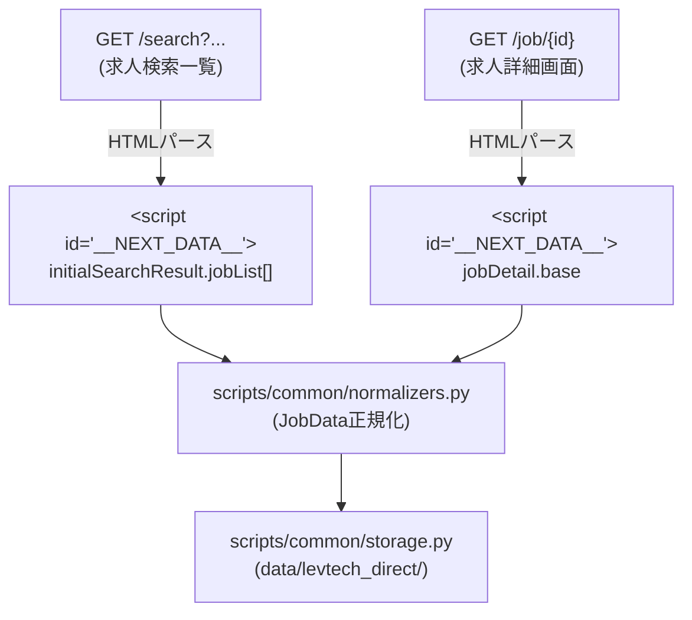

# レバテックダイレクト サイト構造リファレンス

本ドキュメントは、AIエージェントおよび自動化スクリプトがレバテックダイレクト（[levtech-direct.jp](https://levtech-direct.jp/)）から求人情報を取得・探索する際、事前の探索オーバーヘッドを削減するためのサイト構造・セレクタ・データ構造仕様書です。

---

## 1. サイト基本情報 & 認証基盤

| 項目 | 内容 |
|---|---|
| **メインドメイン** | `https://levtech-direct.jp/` |
| **求人検索URL** | `https://levtech-direct.jp/search?from_type=header` |
| **ログインURL** | `https://levtech-direct.jp/signin` |
| **推奨プロファイル** | `job-hunt`（永続ブラウザプロファイル、`%LOCALAPPDATA%\claude-browser-profiles\job-hunt`） |
| **認証要件** | **求人検索・求人詳細閲覧は完全公開（非ログインで全データ閲覧可能）**。<br>ログイン壁やBotブロック（Cloudflare/reCAPTCHA等）なし。<br>※将来的にスカウト・メッセージ・応募機能等を実装する場合は `job-hunt` プロファイルを使用。 |
| **技術スタック** | Next.js (SSR + クライアントハイドレーション) |
| **データ取得方式** | HTML内の `<script id="__NEXT_DATA__" type="application/json">` から完全な構造化JSONを取得可能。<br>`httpx`（標準HTTP GET）で高速かつ安定に取得でき、Playwright起動オーバーヘッドを回避可能。<br>DOMパース（フォールバック）も完備。 |

---

## 2. 主要URLマップ

| 画面名 | パス / URL | 認証 | 備考 |
|---|---|---|---|
| **トップページ** | `/` | 不要 | サービス概要・検索トップ |
| **ログイン** | `/signin` | 不要 | サインイン画面 |
| **求人検索（一覧）** | `/search?from_type=header` | 不要 | キーワード、年収、職種、スキル等の条件検索 |
| **マイページ** | `/mypage` | **要** | 会員専用ダッシュボード |
| **メッセージ一覧** | `/mypage/message` | **要** | スカウト・メッセージ一覧およびやり取りスレッド（共通プロファイル `job-hunt`） |

---

## 3. 画面遷移 & データ取得フロー



---

## 4. 検索URL構造 & パラメータ体系

ベースURL: `https://levtech-direct.jp/search`

### クエリパラメータ一覧

| パラメータ名 | 型 / 書式 | 説明 | 例 |
|---|---|---|---|
| `freeWord` | 文字列（URLエンコード） | フリーワード（職種・技術スタック・企業名・特徴など） | `freeWord=Python` |
| `annualIncome` | 整数（万円単位） | 希望最低年収 | `annualIncome=800` |
| `sort` | 整数（1〜3） | ソート順 | `1`: 新着順（デフォルト）<br>`2`: 年収上限が高い順<br>`3`: 年収上限が低い順 |
| `page` | 整数（1始まり） | ページ番号 | `page=2` |
| `jobsPerPage` | 整数（デフォルト12） | 1ページあたりの求人表示数 | `jobsPerPage=12` |
| `appealPoint` | 整数（複数指定可） | 特徴・アピールポイントID | `appealPoint=10`（自社サービスあり）<br>`appealPoint=26`（副業可） |
| `place` | 文字列（複数指定可） | 勤務地ID | `place=p_1`（東京都）<br>`place=p_2`（神奈川県） |
| `occupation` | 整数（複数指定可） | 職種ID | `occupation=16`（サーバーサイド） |
| `skill` | 整数（複数指定可） | スキルID | `skill=29`（TypeScript） |
| `skillJoin` | 文字列（`or` / `and`） | 複数スキル指定時の結合条件 | `skillJoin=or` |

> [!NOTE]
> **リモートワーク絞り込みの扱い**:
> レバテックダイレクトの検索フォームにはリモート専用の独立GETパラメータが存在しません。
> リモート求人を抽出する場合は以下のいずれか、または組み合わせで対応します:
> 1. `freeWord` に `フルリモート` や `リモート` を付与して検索。
> 2. 検索結果・詳細データの `jobWorkStyle`（後述）でクライアントサイドフィルタリングを実施。

---

## 5. 求人ID規則

- **詳細URL**: `https://levtech-direct.jp/job/{id}`
- **ID書式**: 5桁前後の数値文字列（例: `36202`）
- **正規表現**: `r"/job/(\d+)"`

---

## 6. データ構造仕様 (`__NEXT_DATA__`)

Next.jsがページ内にレンダリングするJSONオブジェクト（`props.pageProps`）から抽出します。

### 6.1 検索結果一覧データ (`props.pageProps.initialSearchResult`)

```json
{
  "totalResults": 6524,
  "totalRecruitingResults": 2943,
  "jobList": [
    {
      "id": 36202,
      "title": "【フルリモート・残業ほぼなし】高成長を続ける自社開発クラウドサービス『PIP-Maker』のバックエンドエンジニア",
      "companyId": 1920,
      "companyName": "株式会社4COLORS",
      "minAnnualIncome": 500,
      "maxAnnualIncome": 800,
      "prefecture": "神奈川県",
      "employmentStatus": "正社員",
      "publishedDate": "2026-10-08 00:00:00",
      "skillList": [
        {"id": "29", "name": "TypeScript"},
        {"id": "54", "name": "Node.js"}
      ],
      "occupationList": [
        {"id": "16", "name": "サーバーサイドエンジニア"}
      ],
      "appealPointList": [
        {"id": "10", "name": "自社サービスあり"}
      ]
    }
  ]
}
```

### 6.2 求人詳細データ (`props.pageProps.jobDetail`)

#### 基本情報フィールド (`jobDetail.base`)

| フィールド名 | 型 | 説明 | 共通モデル (`JobData`) マッピング |
|---|---|---|---|
| `id` | int | 求人ID | `job.id = str(val)` |
| `title` | str | 求人タイトル | `job.title` |
| `companyName` | str | 企業名 | `job.company` |
| `companyId` | int | 企業ID | `job.raw_data['company_id']` |
| `minAnnualIncome` | int | 最低年収（万円） | `job.salary_min = val * 10000` |
| `maxAnnualIncome` | int | 最高年収（万円） | `job.salary_max = val * 10000` |
| `salaryDetail` | str | 給与詳細・内訳 | `job.raw_salary` |
| `jobWorkStyle` | str | 勤務スタイル (`full_remote`, `partial_remote`, `office` 等) | `detect_remote_type` の入力、`job.remote` 判定に活用 |
| `remoteWorkFrequency` | str \| null | リモート頻度 | 勤務備考に付加 |
| `workLocation` | str | 勤務地詳細住所 | `job.location` |
| `prefecture` | str | 都道府県名 | 勤務地補足 |
| `employmentStatus` | str | 雇用形態（「正社員」など） | `job.employment_type` |
| `requiredSkill` | str (HTML) | 必須要件 | `job.requirements`（HTMLタグ除去・整形） |
| `optionalSkill` | str (HTML) | 歓迎要件 | `job.preferred_requirements`（HTMLタグ除去・整形） |
| `workDetail` | str (HTML) | 業務内容 | `job.description`（HTMLタグ除去・整形） |
| `businessSummary` | str (HTML) | 事業内容 | 企業概要・Markdown本文 |
| `developmentEnvironment` | str | 開発環境（言語、FW、ツール等） | 技術スタックタグ・本文補足 |
| `benefit` | str | 福利厚生 | 待遇・福利厚生セクション |
| `holiday` | str | 休日休暇 | 就業条件セクション |
| `selectionProcess` | str | 選考プロセス | 選考備考セクション |
| `publishedDate` | str | 掲載開始日 | 公開日 |
| `updatedAt` | str | 最終更新日時 | 更新日 |

#### 技術スタック・アピール詳細

- `jobDetail.mainSkills`: 主要技術スタック一覧（例: `["TypeScript", "Node.js"]`）→ `job.tags`
- `jobDetail.skillCategoryGroups`: 言語、フレームワーク、DB、インフラ等のカテゴリ別網羅データ
- `jobDetail.appeals`: 特徴タグ一覧（`自社サービスあり`, `残業月20時間未満`, `副業OK` 等）→ `job.tags`

---

## 7. DOMフォールバック・セレクタ

万が一 `__NEXT_DATA__` の仕様変更等でパースできない場合に使用するDOMセレクタ定義です。

### 7.1 検索結果画面 (`/search`)

```text
body
  ├── header (ヘッダーナビゲーション)
  └── main
        ├── form (検索条件フォーム)
        └── section (検索結果一覧)
              ├── a[href^="/job/"] (求人カードリンク)
              │     ├── h2 または [class*="title"] (求人タイトル)
              │     ├── [class*="company"] (企業名)
              │     ├── [class*="salary"] (年収テキスト)
              │     └── [class*="tag"] (職種・スキルタグ)
              └── nav[class*="pagination"] (ページネーション)
```

- **求人リンク**: `a[href^="/job/"]`
- **求人タイトル**: `a[href^="/job/"] h2`, `[class*="jobTitle"]`
- **企業名**: `[class*="companyName"]`
- **年収**: `[class*="salary"]`
- **ページネーション次へ**: `a[rel="next"]`, `nav a:has-text("次へ")`

### 7.2 求人詳細画面 (`/job/{id}`)

- **タイトル**: `h1`
- **企業名**: `h1` 上部または近傍の企業名リンク・テキスト
- **募集要項テーブル**: `table`, `dl`, または見出し（`h2`, `h3`）に対応するセクションブロック

---

## 8. マイページ・メッセージ画面仕様 (`/mypage/message`)

### 8.1 認証・セッション要件

- **画面URL**: `https://levtech-direct.jp/mypage/message`
- **未認証時挙動**: `https://auth.levtech.jp/{hash}/signin?client_id=ltd` に自動リダイレクト。
- **認証判定**:
  - 認証壁判定: `r"auth\.levtech\.jp|/signin|/login"`
  - ログイン済み要素: `a[href*="/mypage"]`, `a[href*="/mypage/message"]`, `a[href*="/mypage/profile"]`
  - 共通プロファイル `job-hunt`（`%LOCALAPPDATA%\claude-browser-profiles\job-hunt`）を使用。
  - `scripts/common/auth_engine.py` の `ensure_site_authenticated('levtech_direct', ...)` により、未ログイン時はトースト通知および手動ログイン待機ハンドオフが行われる。

### 8.2 画面・URL構造

- **ルーティング**: Next.js CSR（`/pages/mypage/message/[[...id]].js`）
- **一覧画面**: `https://levtech-direct.jp/mypage/message`
- **スレッド画面**: `https://levtech-direct.jp/mypage/message/{approach_id}`
- **UI構造**: 2ペイン（左カラム: メッセージ一覧、右カラム: 選択中スレッドのやり取り・求人詳細・日程）

### 8.3 内部REST API仕様（CSR取得）

メッセージ画面ではSSRの `__NEXT_DATA__` ではなく、ブラウザのCookieセッションを用いた内部REST API経由で完全な構造化JSONを取得可能。未読状態を維持したまま全件を高速取得できる。

#### 1. アプローチ一覧API (`GET /api/employees/approaches`)

全スカウト・メッセージ一覧（通常・ゴミ箱含む）を一括取得。

- **主要フィールド**:
  - `id`: アプローチID（数値）
  - `company_name`: 企業名
  - `is_headhunter`: エージェント/ヘッドハンターか
  - `is_unread`: 未読フラグ
  - `is_pinned`: ピン留めフラグ
  - `is_scouted`: スカウトフラグ
  - `is_message_trashed`: ゴミ箱フラグ
  - `scout_option`: `request_meeting`（面談希望）等
  - `scouted_title`: スカウト件名
  - `scouted_message`: スカウト本文
  - `latest_message`: 最新メッセージ（`title`, `content`, `sent_at`）
  - `job`: 紐付け求人情報（`id`, `title`, `min_annual_income`, `job_work_style`, `appeal_point_list`）
  - `approach_created_at`: 作成日時

#### 2. スレッドメッセージ履歴API (`GET /api/employees/approaches/{approach_id}/messages`)

特定アプローチ内の全送受信メッセージ履歴を取得。

- **主要フィールド**:
  - `id`: メッセージID
  - `from_type`: 送信者種別（`recruiter`, `employee`）
  - `from_name`: 送信者名
  - `title`: メッセージ件名
  - `content`: メッセージ本文
  - `sent_at`: 送信日時
  - `is_scout`: スカウトメッセージか
  - `is_read`: 既読フラグ

#### 3. 面談・選考日程API (`GET /api/employees/approaches/{approach_id}/interviews`)

面談・面接の日程調整状況・候補日時を取得。

### 8.4 DOMフォールバック・セレクタ

API呼び出しが制限された場合、以下のDOMセレクタで取得可能。

- **リストコンテナ**: `ul.MuiList-root`
- **メッセージアイテム**: `li.MuiListItem-root`
- **アイテムクリックボタン**: `button[data-display-name="TalkRoomListItem_ButtonBase"]`
  - 属性 `data-additional-value`: `{"approach_id": 5999697, "unread": false, "hot_label": false}`（JSON）
- **企業名**: `button p.MuiTypography-body1`
- **件名 / 求人タイトル**: `button p.MuiTypography-body2`
- **バッジ**: `.MuiChip-root .MuiChip-label`
- **受信日時**: アイテム下部 `p.MuiTypography-body2`

---

## 9. マイページ・基本情報画面仕様 (`/mypage/profile/basic`)

### 9.1 概要・URL構造

- **画面URL**: `https://levtech-direct.jp/mypage/profile/basic`
- **認証**: 要（`job-hunt` プロファイル）
- **フォーム基盤**: Next.js (SSR `__NEXT_DATA__`) + React Hook Form
- **データ取得元**:
  - SSR初期データ: `props.pageProps.profilesBasics`（`base`, `educational`, `otherLanguages`）
  - 定義マスタ: `props.pageProps.globalDefinition`（`prefectures`, `schoolCategories`, `languages` 等）
- **保存ボタン挙動**:
  - 初期状態は `disabled`（フォーム変更差分がある時のみ有効化）
  - ボタンセレクタ: `button[type="submit"][data-display-name="ProfileDetailLayout_Button"]`

### 9.2 主要フォーム要素・セレクタ

| 項目グループ | フィールド | セレクタ | 備考 |
|---|---|---|---|
| **氏名 (漢字)** | 姓 / 名 | `input[name="base.lastName"]` / `input[name="base.firstName"]` | 必須 |
| **氏名 (カナ)** | セイ / メイ | `input[name="base.kanaLastName"]` / `input[name="base.kanaFirstName"]` | 必須 |
| **生年月日** | 年 / 月 / 日 | `select[name="base.birthday.year"]`, `month`, `day` | 必須 |
| **性別** | 性別ラジオ | `input[name="base.gender"][value="1"|"2"|"3"]` | 1:男性, 2:女性, 3:無回答 |
| **電話番号** | 電話番号 | `div#phoneNumber input[type="tel"]` | 必須 |
| **電話連絡許可** | 許可チェック | `div#phoneNumber input[type="checkbox"]` | bool |
| **現住所** | 郵便番号 | `div#address input[placeholder="1234567"]` | 任意 |
| | 都道府県 | `div#address select` | ID 1〜48（1: 東京都 等） |
| | 以降の住所 | `div#address input[placeholder="以降の住所を入力"]` | 任意 |
| **配偶者** | あり / なし | `input[name="base.isMarried"][value="1"|"0"]` | 任意 |
| **現在年収** | 年収 (万円) | `input[name="base.currentAnnualIncome"]` | 必須 |
| **学歴** | 学校区分 | `#schoolCategoryDetail select:nth-of-type(1)` | 1:大学, 2:大学院, 3:短大, 4:専門, 5:他 |
| | 学校名 | `div#schoolCategoryDetail input[placeholder="学校名を入力"]` | 任意 |
| | 学部/学科/専攻 | `div#schoolCategoryDetail input[placeholder="学部/学科/専攻を入力"]` | 任意 |
| | 卒業年 / 月 | `#schoolCategoryDetail select:nth-of-type(2)` / `(3)` | 任意 |
| | その他学歴 | `textarea[name="educational.other"]` | 任意 |
| **語学・資格** | 母国語 | `select[name="base.nativeLanguageId"]` | 1: 日本語 |
| | その他言語1 | `#languages select:nth-of-type(1)` / `(2)` (言語名/レベル) | 任意 |
| | TOEIC / TOEFL | `input[name="base.toeic"]` / `input[name="base.toefl"]` | 任意 |
| | 保有資格 | `textarea#certificationInput` | 任意 |
| **スクール** | 受講経験 / 期間 | `div#schoolAttendanceExperience select` / `div#schoolAttendancePeriod select` | 任意 |

---

## 10. マイページ・希望条件画面仕様 (`/mypage/profile/condition`)

### 10.1 概要・URL構造

- **画面URL**: `https://levtech-direct.jp/mypage/profile/condition`
- **認証**: 要（`job-hunt` プロファイル）
- **フォーム基盤**: Next.js (SSR `__NEXT_DATA__`) + React Hook Form
- **データ取得元**:
  - SSR初期データ: `props.pageProps.condition`（`annualIncome`, `jobChangePeriod`, `jobConditions`, `businesses`, `technologyDomains`, `workPlaces`, `occupations`, `skills`, `desiredEmploymentStatuses`, `workStyles`, `requiredConditions`, `other`）
  - 定義マスタ: `props.pageProps.globalDefinition`（`occupations`, `mainSkills`, `workPlaces`, `workStyles`, `jobChangePeriods`, `desiredEmploymentStatuses`, `workFrequencies`, `employeeRequiredConditions`）
- **保存ボタン挙動**:
  - 初期状態は `disabled`（フォーム変更差分がある時のみ有効化）
  - ボタンセレクタ: `button[type="submit"][data-display-name="ProfileDetailLayout_Button"]`

### 10.2 主要フォーム要素・セレクタ

| 項目グループ | フィールド | セレクタ | 備考 |
|---|---|---|---|
| **希望年収** | 年収 (万円) | `input[name="annualIncome"]` | 整数値 |
| **転職希望時期** | 希望時期ラジオ | `input[name="jobChangePeriod"][value="1"〜"5"]` | 1:3ヶ月以内, 2:半年以内, 3:1年以内, 4:良い仕事があれば, 5:未定 |
| **企業条件** | 事業形態 | `input[name="jobConditions.businessForm"]` | `in_house_development`, `entrusted_development`, `none` |
| | リモートワーク | `input[name="jobConditions.remoteWork"]` | `full_remote`, `hybrid_work`, `none` |
| | 企業規模 | `input[name="jobConditions.projectScale"]` | `venture_or_startup`, `large_company_or_listed`, `none` |
| **業務内容意欲** | 13項目ラジオ | `input[name="businesses.{key}"]` | `coding`, `refactoring`, `architectureDesign` 等。<br>値: `strongly_desire`, `desire`, `not_motivated`, `refuse` |
| **技術領域意欲** | 7項目ラジオ | `input[name="technologyDomains.{key}"]` | `serverApplication`, `aiDataAnalysis`, `frontApplication` 等。<br>値: `strongly_desire`, `desire`, `not_motivated`, `refuse` |
| **希望勤務地** | 都道府県セレクト | `[data-display-name="DesiredWorkPlacesField_Select"] select` | 複数行可能。`p_1`（東京都）等。追加/削除ボタンあり |
| **希望職種** | 職種セレクト | `[data-display-name="DesiredOccupationField_Select"] select` | 複数行可能。数値ID（16: サーバーサイド等）。追加/削除ボタンあり |
| **希望スキル** | スキル入力 | `[data-display-name="Autocomplete_AutocompleteInput"] input` | 複数行可能。MUI Autocomplete（Go, Python 等）。追加/削除ボタンあり |
| **雇用形態** | 雇用形態チェック | `[data-display-name="DesiredEmploymentStatusSection_Checkbox"] input[type="checkbox"]` | `regular_employee`, `dispatch_employee`, `contract_employee`, `freelance` |
| | 稼働頻度 | `select[name="minWorkFrequency"]`, `select[name="maxWorkFrequency"]` | `week_5d_40h` 等 |
| **こだわり条件** | 働き方チェック | `[data-display-name="WorkStyleSection_Checkbox"] input[type="checkbox"]` | 2:上場経験, 15:フレックス, 22:副業 等 |
| **必須条件** | 必ず満たす条件 | `[data-display-name="RequiredAndOtherConditionSection_Checkbox"] input[type="checkbox"]` | `desired_occupations`, `remote_work` 等 |
| **補足・その他** | 自由記述 | `textarea[name="other"]` | 500文字以内 |

---

## 11. マイページ・職務経歴・自己PR画面仕様 (`/mypage/profile/resume`)

### 11.1 概要・URL構造

- **画面URL**: `https://levtech-direct.jp/mypage/profile/resume`
- **認証**: 要（`job-hunt` プロファイル）
- **フォーム基盤**: Next.js (SSR `__NEXT_DATA__`) + React Hook Form
- **データ取得元**:
  - SSR初期データ: `props.pageProps.profilesResume.base.resume`
  - 添付ファイル情報: `props.pageProps.profilesResume.uploadedAttachments`（cv, jobCareer, portfolio）
  - ポートフォリオURL: `props.pageProps.profilesResume.base.portfolioUrl`
- **保存ボタン挙動**:
  - 初期状態は `disabled`（フォーム入力差分があり、文字数が10文字以上の時のみ有効化）
  - ボタンセレクタ: `button[type="submit"][data-display-name="ProfileDetailLayout_Button"]`

### 11.2 主要フォーム要素・セレクタ

| 項目グループ | フィールド | セレクタ | 備考・制限 |
|---|---|---|---|
| **職務経歴・自己PR** | テキスト入力 | `textarea[name="resume"]` | **必須/推奨**。10文字以上、30,000文字以内。<br>未登録時は空文字列。 |
| **文字数カウンター** | カウンター表示 | `span:has-text("文字")` | 書式例: `0/30,000文字`, `1,234/30,000文字` |
| **添付ファイル** | 履歴書 | `input[name="attachmentDocumentCv"][type="file"]` | PDF、最大6MB |
| | 職務経歴書 | `input[name="attachmentDocumentJobCareer"][type="file"]` | PDF、最大6MB |
| | ポートフォリオ | `input[name="attachmentDocumentPortfolio"][type="file"]` | PDF、最大6MB |
| | ポートフォリオURL | `input[name="portfolioUrl"][type="text"]` | URL形式 |
| **保存ボタン** | 送信 | `button[type="submit"][data-display-name="ProfileDetailLayout_Button"]` | 変更あり＆10文字以上で活性化 |

> [!NOTE]
> **スコープ制限**:
> 本リポジトリの `manage_profile_resume.py` は、ユーザー要件に準拠して「職務経歴・自己PR」テキストエリア（`textarea[name="resume"]`）の閲覧・更新・自動バックアップ・プロファイル同期に特化しています。添付ファイル等の別項目は意図しないデータ破壊を防ぐためスクリプト側では変更対象外としています。

---

## 12. マイページ・保有スキル画面仕様 (`/mypage/profile/skill`)

### 12.1 概要・URL構造

- **画面URL**: `https://levtech-direct.jp/mypage/profile/skill`
- **認証**: 要（`job-hunt` プロファイル）
- **フォーム基盤**: Next.js (SSR `__NEXT_DATA__`) + React Hook Form + MUI (Material UI)
- **データ取得元**:
  - SSR初期データ: `props.pageProps.profilesResume`
    - `skills`: `[{ id: 29, experienceYearId: 9 }, ...]`
    - `occupations`: 経験職種リスト
    - `currentOccupations`: 現在の職種ID配列
    - `processes`: 経験担当工程リスト
    - `managementScale`: マネジメント経験ID (1: 1~5人, ..., 5: 経験なし)
    - `industries`, `jobPositions`, `developmentMethods`, `infraProjectKind`, `networkLayers`, `infraExperience`, `projectManagerProjectKind`, `projectManagementScale`, `clientNegotiationExperience`, `appealPoints`
  - 定義マスタ: `props.pageProps.globalDefinition`
    - `skills`: スキル定義マスタ（537件の `{ id, name, isMain }`）
    - `experienceYears`: 経験年数定義マスタ（10区分）
      - `15`: 半年未満, `6`: 半年以上, `7`: 1年以上, `8`: 1年半以上, `9`: 2年以上, `10`: 3年以上, `11`: 4年以上, `12`: 5年以上, `13`: 7年以上, `14`: 10年以上
    - `occupations`, `processes`, `managementScales`, `developmentMethods`, `jobPositions`, `industries` 等
- **保存ボタン挙動**:
  - 初期状態は `disabled`（フォーム入力変更差分がある時のみ有効化）
  - ボタンセレクタ: `button[type="submit"][data-display-name="ProfileDetailLayout_Button"]`

### 12.2 主要フォーム要素・セレクタ

| 項目グループ | フィールド | セレクタ | 備考・仕様 |
|---|---|---|---|
| **経験スキル** | セクション全体 | `[data-display-name="ExperienceSkillsSection_SectionFieldset"]` | 複数行コンテナ |
| | スキル入力 | `input[placeholder="経験スキルを選択"]` | MUI Autocomplete。サジェストリストから選択確定 |
| | 経験年数 | `[data-display-name="ExperienceSkillsSection_Select"] select` | 半年未満〜10年以上 |
| | 行削除ボタン | `button[data-display-name="MultipleConditionField_RemoveConditionButton"]` | 各行の削除ボタン |
| | 行追加ボタン | `button[data-display-name="MultipleConditionField_AddConditionButton"]` | スキル行を1行追加 |
| **経験職種** | 編集ボタン | `button[data-display-name="OccupationsSection_ProfileItemEditButton"]` | モーダル/Drawerを開いて編集 |
| **現在の職種** | 職種セレクト | `select#currentOccupationsInput` / `select[name="currentOccupations.0"]` | 必須。選択肢マスタ対応 |
| **経験業種** | セクション全体 | `[data-display-name="IndustriesSection_SectionFieldset"]` | 業種select + 年数select + 追加/削除 |
| **経験ポジション** | セクション全体 | `[data-display-name="JobPositionsSection_SectionFieldset"]` | ポジションselect + 年数select + 追加/削除 |
| **経験担当工程** | セクション全体 | `[data-display-name="ProcessesSection_SectionFieldset"]` | 工程select + 年数select + 追加/削除 |
| **経験開発手法** | セクション全体 | `[data-display-name="DevelopmentMethodSection_SectionFieldset"]` | 開発手法select + 追加/削除 |
| **マネジメント経験** | 最大規模 | `select#managementScalesInput` / `select[name="managementScale"]` | 1~5人 〜 51人以上、経験なし |
| **インフラ** | 案件内容 | `select[name="infraProjectKind"]` | 新規構築、リプレイス、運用 等 |
| | レイヤー | `select[name^="networkLayers"]` | レイヤー1〜7 |
| | クラウド・オンプレミス | `select[name="infraExperience"]` | クラウドのみ、オンプレミスのみ、両方 |
| **PM** | 案件内容 | `select[name="projectManagerProjectKind"]` | Web系（事業会社/SIer）、業務系 等 |
| | 規模 | `select[name="projectManagementScale"]` | 1~10人月 〜 1001人月~、経験なし |
| | 顧客折衝 | `select[name="clientNegotiationExperience"]` | あり / なし |
| **保存ボタン** | 送信 | `button[type="submit"][data-display-name="ProfileDetailLayout_Button"]` | 差分検知時に活性化 |

---

## 13. マイページ・経歴企業画面仕様 (`/mypage/profile/company`)

### 13.1 概要・URL構造

- **画面URL**: `https://levtech-direct.jp/mypage/profile/company`
- **認証**: 要（`job-hunt` プロファイル）
- **フォーム基盤**: Next.js (SSR `__NEXT_DATA__`) + React Hook Form + MUI (Material UI)
- **データ取得元**:
  - SSR初期データ: `props.pageProps.profilesResume`
    - `companies`: 経歴企業リスト（`companyName`, `isBlocked`, `enrollmentStatuses`, `projects`）
    - `currentBusinessStatuses`: 現在の業務形態キー配列
  - 親画面フォーム項目:
    - `workingStateId`: 就業状況ID（`1`: 正社員で就業中, `6`: フリーランス等）
    - `experiencedCompanyCountId`: 経験企業数ID（`1`〜`10`: 1社〜10社以上）
  - 定義マスタ: `props.pageProps.globalDefinition`
    - `workingStates`: 就業状況マスタ（7区分）
    - `businessStatuses`: 業務形態マスタ（`business_company`, `client_resident`, `in_company_contract`）
    - `employmentStatuses`: 雇用形態マスタ（8区分: 正社員, 契約社員, 派遣社員, 業務委託, 副業, アルバイト, FCオーナー, 取締役）
    - `projectScales`: 開発規模マスタ（6区分: 4人以下, 5~10人, 11~20人, 21~49人, 50~99人, 100人以上）
    - `jobPositions`: ポジションマスタ（8区分: リードエンジニア, リードデザイナー, チームリーダー, マネージャー, エンジニア, デザイナー, ディレクター, その他）
    - `processes`: 担当工程マスタ（10区分: 要件定義, 仕様設計, DB設計, インフラ構築, コーディング, レビュー, テスト・QA, 保守運用, 施策・企画, マネジメント）
- **保存ボタン挙動**:
  - 初期状態は `disabled`（フォーム入力変更差分がある時のみ有効化）
  - ボタンセレクタ: `button[type="submit"][data-display-name="ProfileDetailLayout_Button"]`

### 13.2 主要フォーム要素・セレクタ

#### 1. 親画面フォーム

| 項目 | セレクタ | 備考・仕様 |
|---|---|---|
| **就業状況** | `select#workingStateInput` (`name="workingStateId"`) | 必須。選択肢マスタ対応 |
| **現在の業務形態** | `select#businessStatusInput` (`name="currentBusinessStatuses.0"`) | 任意。事業会社/客先常駐/社内受託 |
| **経験企業数** | `select#companyCountInput` (`name="experiencedCompanyCountId"`) | 必須。0社〜10社以上 |
| **経験企業一覧** | `[data-display-name="ExperiencedCompanyGroupSection_SectionFieldset"]` | 企業カード一覧コンテナ |
| **企業カード編集ボタン** | `button[data-display-name="CompanyCard_StyledIconButton"]` (1番目) | 鉛筆アイコン。編集モーダルを開く |
| **企業カード削除ボタン** | `button[data-display-name="CompanyCard_StyledIconButton"]` (2番目) | ゴミ箱アイコン。削除確認ダイアログを開く |
| **削除確認ボタン** | `[role="dialog"] button:has-text("削除する")` | 企業削除を確定 |
| **企業追加ボタン** | `button[data-display-name="ExperiencedCompanyGroupSection_ProfileItemAddButton"]` | 企業登録モーダルを開く |
| **保存ボタン** | `button[type="submit"][data-display-name="ProfileDetailLayout_Button"]` | 差分検知時に活性化 |

#### 2. 経験企業追加/編集モーダル (`[data-display-name="ExperiencedCompanyGroupSection_UpdateExperiencedCompanyModal"]`)

| 項目グループ | フィールド | セレクタ | 備考・仕様 |
|---|---|---|---|
| **企業名** | 企業名入力 | `[data-display-name="ExperienceCompanySelector_Autocomplete"] input` | 必須。MUI Autocomplete。サジェストまたは確定 |
| | ブロック企業登録 | `[data-display-name="CompanyNameForm_Checkbox"] input[type="checkbox"]` | ブロック企業フラグ |
| **在籍状況** | 雇用形態 | `[data-display-name="EmploymentStatusField_Select"] select` | 必須。正社員(1), 契約社員(2), 業務委託(4) 等 |
| | 在籍開始年月 | `[data-display-name="EnrollmentPeriodField_PeriodForm"] [data-display-name="PeriodForm_NumberSelect"] select` (1, 2) | 年 (YYYY) / 月 (M) |
| | 在籍終了年月 | `[data-display-name="EnrollmentPeriodField_PeriodForm"] [data-display-name="PeriodForm_NumberSelect"] select` (3, 4) | 年 (YYYY) / 月 (M) |
| | 現在在籍中 | `[data-display-name="EnrollmentPeriodField_PeriodForm"] [data-display-name="PeriodForm_Checkbox"] input[type="checkbox"]` | チェック時は終了年月不要 |
| | 在籍状況追加ボタン | `button[data-display-name="FormCard_AddFormItemButton"]:has-text("在籍状況を追加する")` | 同一企業内で複数雇用形態/期間を追加 |
| **プロジェクト** | プロジェクト名 | `[data-display-name="ProjectNameField_Input"] input` | 必須。プロジェクト名 |
| | 業務期間年月 | `[data-display-name="ProjectPeriodField_PeriodForm"] [data-display-name="PeriodForm_NumberSelect"] select` | 開始年月 / 終了年月 |
| | 現在業務中 | `[data-display-name="ProjectPeriodField_PeriodForm"] [data-display-name="PeriodForm_Checkbox"] input[type="checkbox"]` | チェック時は終了年月不要 |
| | 開発規模 | `[data-display-name="ProjectScaleField_Select"] select` | 任意。4人以下(1) 〜 100人以上(6) |
| | ポジション | `[data-display-name="JobPositionField_Select"] select` | 任意。リードエンジニア(1), エンジニア(5) 等 |
| | 担当工程 | `[data-display-name="ProcessField_Select"] select` | 任意。要件定義(1), 仕様設計(2), コーディング(5) 等 |
| | プロジェクト詳細 | `[data-display-name="ProjectDescriptionField_Input"] textarea[name*="projectDescription"]` | 任意。最大2,000文字 |
| | プロジェクト追加 | `button[data-display-name="FormCard_AddFormItemButton"]:has-text("プロジェクトを追加する")` | プロジェクトを追加 |
| | プロジェクト削除 | `button[data-display-name="FormCard_IconButton"]` | 当該プロジェクトを削除 |
| **モーダル確定** | 入力を完了する | `button[data-display-name="FormModal_Button"]` | 必須項目入力完了時に活性化。親画面カードへ反映 |
| **モーダル閉じる** | 閉じるボタン | `button[data-display-name="ModalContainer_IconButton"]` | モーダルを破棄して閉じる |


