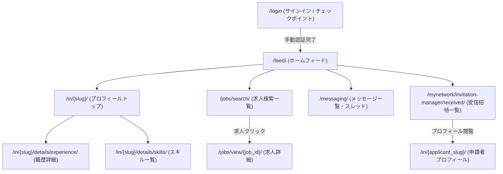

# LinkedIn（リンクトイン）サイト構造リファレンス

本ドキュメントは、AIエージェントが `sharing-browser-with-user` スキルや自動化スクリプトを利用してLinkedIn（[linkedin.com](https://www.linkedin.com/)）を探索・自動操作する際、事前の探索オーバーヘッドを削減するためのサイト構造・セレクタ・URLパラメータ仕様書です。

---

## 1. サイト基本情報 & 認証基盤

| 項目 | 内容 |
|---|---|
| **メインドメイン** | `https://www.linkedin.com/` |
| **求人検索URL** | `https://www.linkedin.com/jobs/search/` |
| **ログインURL** | `https://www.linkedin.com/login` |
| **推奨プロファイル** | `job-hunt`（永続ブラウザプロファイル） |
| **認証方式** | パスワード認証、2段階認証（MFA）、セキュリティチェックポイント（`/checkpoint/`） |
| **未ログイン・壁判定** | URLが `/login`, `/checkpoint/`, `/authwall` を含む、またはログインボタン・認証フォームが表示される |
| **ユーザープロファイル** | デフォルトスラッグ: `seiwan-maikuma-25a744362`（`/in/{slug}/`） |

---

## 2. 主要URLマップ

| 画面名 | パス / URL | 認証 | 備考 |
|---|---|---|---|
| **トップ / フィード** | `/feed/` | 要 | ログイン後のホームフィード |
| **ログイン画面** | `/login` | 不要 | メールアドレス・パスワード入力画面 |
| **求人検索** | `/jobs/search/` | 要/不要 | キーワード、勤務地、リモート形態等で求人検索 |
| **求人詳細** | `/jobs/view/{job_id}/` | 要/不要 | 各求人の募集要項・仕事内容詳細 |
| **プロフィールトップ** | `/in/{slug}/` | 要 | Headline（肩書き）、About（自己紹介）、概要 |
| **職歴詳細一覧** | `/in/{slug}/details/experience/` | 要 | 全職歴（所属企業、在籍期間、職務内容、スキル）一覧 |
| **スキル詳細一覧** | `/in/{slug}/details/skills/` | 要 | 登録スキル一覧、スキル追加・削除 |
| **メッセージ** | `/messaging/`, `/messaging/thread/{id}/` | 要 | 会話一覧＋スレッド2ペイン。`/messaging/` を開くと先頭スレッドが自動で開く |
| **受信招待管理** | `/mynetwork/invitation-manager/received/` | 要 | 受信したつながり申請の一覧・承諾・拒否画面 |

---

## 3. URLクエリパラメータ体系 (`/jobs/search/`)

| パラメータ | 項目 | 型・形式 | 設定例・備考 |
|---|---|---|---|
| `keywords` | キーワード | 文字列 | `keywords=Python`, `keywords=Backend%20Engineer` |
| `location` | 勤務地 | 文字列 | `location=Japan`, `location=Tokyo` |
| `f_WT` | リモート形態 | 数値コード（カンマ区切り可） | `1`: オンサイト（出社）, `2`: リモート, `3`: ハイブリッド |
| `start` | オフセット | 数値 | ページネーション（1ページあたり25件、例: `start=25`） |
| `currentJobId` | 選択求人ID | 数値 | 2ペイン表示時の選択中求人ID |

---

## 4. 画面遷移フロー



---

## 5. 主要画面のDOM構造・セレクタ仕様

### 5.1 求人検索結果画面 (`/jobs/search/`)

```text
div.jobs-search-results-list
  ├── ul.scaffold-layout__list-container
  │     ├── li.jobs-search-results__list-item (または div[data-job-id])
  │     │     ├── タイトルリンク (a.job-card-list__title)
  │     │     ├── 企業名 (span.job-card-container__primary-description)
  │     │     ├── 勤務地 (li.job-card-container__metadata-item)
  │     │     └── 雇用形態・給与 (li.job-card-container__metadata-item)
  │     └── ...
```

### 5.2 プロフィール画面 (`/in/{slug}/`)

```text
section (プロフィールトップ)
  ├── h1.text-heading-xlarge (ユーザー名)
  ├── div.text-body-medium (Headline / 肩書き)
  └── section[id="about"] (About / 自己紹介)
        └── div.inline-show-more-text (自己紹介本文)
```

### 5.3 職歴画面 (`/in/{slug}/details/experience/`)

```text
main
  ├── ul (職歴リストコンテナ)
  │     ├── li.pvs-list__pvs-item (各企業・職歴ブロック)
  │     │     ├── a[href*="/details/experience/"] (各職歴の編集・詳細リンク)
  │     │     ├── 役職名、企業名、在籍期間、勤務形態
  │     │     └── 業務内容詳細 (div.inline-show-more-text)
  │     └── ...
```

### 5.4 メッセージ画面 (`/messaging/`)

```text
ul.msg-conversations-container__conversations-list   ← 内部スクロールコンテナ（ul自体が scrollTop で無限スクロール）
  └── li.msg-conversation-listitem
        ├── .msg-conversations-container__convo-item-link--active   (選択中スレッド)
        ├── .msg-conversation-card__participant-names               (相手名)
        ├── time.msg-conversation-card__time-stamp                  (日付 例: Oct 8)
        ├── p.msg-conversation-card__message-snippet                (抜粋)
        │     ├── .msg-conversation-card__pill                      (種別: InMail / Sponsored / LinkedIn Offer 等)
        │     └── .msg-conversation-card__message-snippet--unread   (未読時の修飾クラス)
        └── .msg-conversation-card__unread-count                    (未読バッジ)

ul.msg-s-message-list-content   (スレッド本文)
  └── li  ├ time.msg-s-message-list__time-heading   (日付見出し)
          ├ .msg-s-message-group__name               (送信者。連投の先頭のみ)
          ├ time.msg-s-message-group__timestamp      (時刻)
          └ .msg-s-event-listitem__body              (メッセージ本文)
```

- 会話リストに `<a>` のスレッドURLはなく、カードクリック後に `page.url()` が `/messaging/thread/{id}/` に変わる（スレッドID取得にはクリック＝既読化が必要）。
- フィルタは `button` の accessible name（`Focused` / `Jobs` / `Unread` / `Connections` / `InMail` / `Starred`）で指定。
- クラス名は変更されやすいため、取得できない場合は `navigate_messages.mjs` のセレクタを見直すこと。

### 5.5 受信招待管理画面 (`/mynetwork/invitation-manager/received/`)

受信したつながり申請（招待）の一覧・承諾・拒否を行う画面。

```text
div[data-component-type="LazyColumn"] (または div[data-testid="lazy-column"])
  ├── div[componentkey^="invitation_manager_row_urn:li:invitation:"] (各招待行ラッパー)
  │     └── div[role="listitem"][componentkey^="urn:li:invitation:"] (招待アイテム本体)
  │           ├── a[href*="/in/"] (プロフィールリンク & 氏名リンク)
  │           │     ├── figure / img[alt*="profile picture"] (アバター画像)
  │           │     └── strong (申請者氏名)
  │           ├── p span (Headline / 肩書き、例: "Managing Partner at Alto Consulting")
  │           ├── img[src*="company-logo"] (企業ロゴ画像、存在する場合)
  │           ├── p / span (共通コネクション情報、例: "{Name} is a mutual connection")
  │           ├── span[data-testid="expandable-text-box"] (添付メッセージコンテナ、存在する場合)
  │           │     ├── 本文テキスト
  │           │     └── button[data-testid="expandable-text-button"] ("… show more" / "show less" 展開ボタン)
  │           ├── a[href*="/messaging/compose/"] (返信リンク: "Reply to {FirstName}", 存在する場合)
  │           ├── button[aria-label*="Ignore"] (拒否ボタン: "Ignore an invitation to connect from {name}")
  │           ├── button[aria-label*="Accept"] (承諾ボタン: "Accept {name}’s invitation")
  │           └── button[aria-label="Show more actions"] (追加メニュー)
  ├── hr (各アイテム間の区切り線)
  └── ...
```

#### 主要セレクタ・属性仕様

| 取得項目 | セレクタ / 属性 | 備考 |
|---|---|---|
| **招待アイテム行** | `div[role="listitem"][componentkey^="urn:li:invitation:"]` または `div[componentkey^="invitation_manager_row_urn:li:invitation:"]` | 一意なコンポーネントキー属性を持つ |
| **招待ID / URN** | 要素の `componentkey` 属性 | 正規表現 `urn:li:invitation:(\d+)` でID（例: `7515596575784660992`）を抽出 |
| **申請者氏名** | `a[href*="/in/"] strong` | フォールバックとして `button[aria-label*="Accept"]` の aria-label からも抽出可能 |
| **プロフィールURL** | `a[href*="/in/"]` の `href` | `https://www.linkedin.com/in/{slug}/` 形式 |
| **アバター画像** | `img[alt*="profile picture"]` の `src` | ユーザーのプロフィール画像URL |
| **肩書き (Headline)** | 名前の下にあるテキスト要素（`p span`） | 現在の役職・所属・自己PR短文 |
| **企業ロゴ** | `img[src*="company-logo"]` の `src` | 勤務先・エージェント企業のロゴ画像 |
| **共通コネクション** | `mutual connection` または `共通のつながり` を含む `p` / `span` | 人数または代表コネクション名 |
| **添付メッセージ** | `span[data-testid="expandable-text-box"]` | メッセージ付き招待のみ存在。展開ボタンで全文表示 |
| **メッセージ展開ボタン** | `button[data-testid="expandable-text-button"]` | クリックすると全文展開され、テキストが `show less` に変化 |
| **返信リンク** | `a[href*="/messaging/compose/"]` の `href` | メッセージ付き招待における返信リンク |
| **承諾ボタン** | `button[aria-label*="Accept"]` | `Accept {name}’s invitation`（安全運用の原則により自動クリックは禁止） |
| **拒否ボタン** | `button[aria-label*="Ignore"]` | `Ignore an invitation to connect from {name}`（安全運用の原則により自動クリックは禁止） |
| **空状態 (Empty State)** | `div[role="listitem"][componentkey^="urn:li:invitation:"]` が0件、または `No pending invitations` / `招待はありません` を含む見出し要素 | 保留中の受信招待が存在しない場合 |

---

## 6. 安全ガード仕様（保護対象ID）

`scripts/linkedin/manage_experience.py` では、実運用上の重要な確定職歴データを誤って変更・削除することを防ぐため、以下のIDがハードコードされた保護対象となっています：

- `2786421165`: 株式会社ヘッドウォータース (Aug 2025 - Present)
- `2786411139`: 株式会社プラスアルファ・コンサルティング (Apr 2024 - Jul 2025)

これらのIDに対する `update` または `delete` アクションは、スクリプト側で自動的に拒絶されます。
