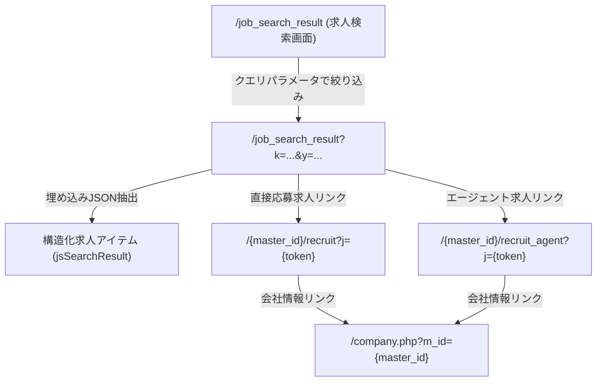

# OpenWork（オープンワーク）サイト構造リファレンス

本ドキュメントは、AIエージェントが `sharing-browser-with-user` スキルやスクリプトを利用してOpenWork（[openwork.jp](https://www.openwork.jp/)）を探索・自動操作する際、事前の探索オーバーヘッドを削減するためのサイト構造・セレクタ・URLパラメータ仕様書です。

---

## 1. サイト基本情報 & 認証・WAF基盤

| 項目 | 内容 |
|---|---|
| **メインドメイン** | `https://www.openwork.jp/` |
| **求人検索URL** | `https://www.openwork.jp/job_search_result` |
| **推奨プロファイル** | `job-hunt`（永続ブラウザプロファイル） |
| **認証要否** | 求人一覧・詳細は**不要（公開）**。マイページ/WEB履歴書（`/mypage/resume`）は**要ログイン** |
| **ボット対策 (WAF)** | AWS WAF (awselb) により、空/デフォルトUser-Agentは `403 Forbidden`。Chrome User-Agentを指定（CDP Network.setUserAgentOverride）することで正常取得可能 |
| **画像認証 (CAPTCHA)** | 短時間での連続アクセス時に「画像認証」画面が表示される。共通プロファイル `job-hunt` と連携したハンドオフにより解除可能 |

---

## 2. 主要URLマップ

| 画面名 | パス / URL | 認証 | 備考 |
|---|---|---|---|
| **トップページ** | `/` | 不要 | 検索フォームやランキング情報 |
| **求人検索画面** | `/job_search_result` | 不要 | キーワード・年収・勤務地等による求人一覧 |
| **求人詳細（直接応募）** | `/{company_master_id}/recruit?j={job_token}` | 不要 | 企業直募求人の募集要項・仕事内容詳細 |
| **求人詳細（エージェント）** | `/{company_master_id}/recruit_agent?j={job_token}` | 不要 | エージェント紹介求人の募集要項詳細 |
| **会社詳細ページ** | `/company.php?m_id={company_master_id}` | 不要 | 企業のクチコミ・評価スコア・会社概要 |
| **ログイン画面** | `/login.php` | 不要 | ユーザーログイン画面（未認証時のリダイレクト先） |
| **WEB履歴書画面** | `/mypage/resume` | **要** | 職歴・学歴・スキル・希望条件等の登録情報 |
| **メッセージ・応募管理** | `/job_apply_list` | **要** | 受信スカウト・メッセージ一覧（`type=1`: 企業, `type=2`: エージェント） |
| **メッセージスレッド** | `/job_apply/{apply_id}/messages` | **要** | 各企業・エージェントとの個別やり取り・求人詳細 |


---

## 3. URLクエリパラメータ体系 (`/job_search_result`)

| パラメータ | 項目 | 型・形式 | 設定例・備考 |
|---|---|---|---|
| `k` | フリーワード検索 | 文字列 | `k=Python`, `k=機械学習` |
| `kt` | タグキーワード | 文字列 | OpenWork定義のタグ |
| `p` | 勤務地（都道府県コード） | 1〜47の数値 | `p=13`（東京都）, `p=14`（神奈川県）, `p=27`（大阪府） |
| `o` | 職種大分類コード | 数値 | `o=1`（ITエンジニア）, `o=550`（営業）, `o=400`（経営・企画） |
| `remoteWork` | リモートワーク | 数値コード | `3`: リモートメイン, `2`: リモート可 |
| `y` | 最低年収（万円） | 数値（万円単位） | `y=600`, `y=800`, `y=1000`, `y=1250`, `y=1500` |
| `totalS` | 総合評価スコア | 小数数値 | `totalS=3.0`, `totalS=3.5`（OpenWorkクチコミスコア） |
| `jt` | 応募タイプ | 数値 | `1`: 直接応募のみ, `2`: エージェント紹介のみ |
| `u` | ソート順 | 文字列 | `std`: 標準（おすすめ順）, `new`: 新着順, `total`: スコア順 |
| `page` | ページ番号 | 1からの整数 | 1ページあたり25件固定。例: `page=2` |

> [!NOTE]
> 該当求人が0件の場合、OpenWorkは HTTP 404 を返します。スクリプトでは404を「0件ヒット」として正常ハンドリングします。

---

## 4. 画面遷移フロー



---

## 5. 主要画面のDOM構造・セレクタ仕様

### 5.1 検索結果一覧画面 (`/job_search_result`)

#### 埋め込みJSONデータ抽出（推奨）
OpenWorkの検索結果HTMLには、Vueアプリケーション用の全求人データが埋め込まれています。

- **セレクタ**: `input#jsSearchResult`
- **属性**: `data-_v-jsdata`
- **データ構造**:
  ```json
  {
    "jobCount": 525,
    "items": [
      {
        "company": {
          "id": "20826",
          "masterId": "a0C30000003Llud",
          "companyName": "PwCコンサルティング合同会社",
          "totalAve": 4.49145,
          "totalAveFormat": "4.49",
          "matchingFieldName": "コンサルティング、シンクタンク"
        },
        "job": {
          "id": "5104875",
          "title": "...",
          "occupationName": "経営・戦略・業務コンサルタント",
          "minSalary": 6000000,
          "maxSalary": 22000000,
          "salaryText": "＜賃金形態＞月給制...",
          "workAreaText": "東京都",
          "placeOfWorkText": "東京",
          "remoteWork": 3,
          "description": "仕事内容...",
          "url": "/a0C30000003Llud/recruit?j=da38a7e426dbb3c1",
          "isRegularStaff": true,
          "publishedAt": "2026-09-15 13:25:14"
        }
      }
    ]
  }
  ```

### 5.2 求人詳細画面 (`/{master_id}/recruit?j=...`)

直接応募・エージェント紹介ともに共通のセマンティックなDOM構造です。

| 項目 | 抽出セレクタ / 方法 | 備考 |
|---|---|---|
| **求人内部ID** | `button[data-_vmodal-job-id]` | 属性値 `data-_vmodal-job-id="5104875"` |
| **職種名 / タイトル** | `dt:has-text("職種名") + dd` または `h1` | 求人タイトル |
| **企業名** | `dt:has-text("社名") + dd` または `h1` | 企業名 |
| **仕事内容** | `dt:has-text("仕事内容") + dd` | 業務概要・詳細テキスト |
| **求める経験・スキル** | `dt:has-text("求める経験・スキル") + dd` | 【必須要件】【尚可要件】を含む |
| **募集要項テーブル** | `dt:has-text("募集要項") + dd table.table-job` | 募集条件の定義テーブル |
| - 給与 | `table.table-job th:has-text("給与") + td` | 年収・月給レンジ |
| - 勤務地 | `table.table-job th:has-text("勤務地") + td` | 都道府県・勤務地詳細 |
| - 勤務時間 | `table.table-job th:has-text("勤務時間") + td` | 労働時間・フレックス等 |
| - 休日休暇 | `table.table-job th:has-text("休日休暇") + td` | 休日日数・有給休暇等 |
| - 待遇・福利厚生 | `table.table-job th:has-text("待遇・福利厚生") + td` | 保険・手当・制度等 |
| - リモートワーク | `table.table-job th:has-text("リモートワーク") + td` | リモートメイン / リモート可 |
| - 雇用形態 | `table.table-job th:has-text("雇用形態") + td` | 正社員 / 契約社員等 |
| **会社概要テーブル** | `table.definitionList-wiki` | 企業の公式企業情報 |
| - 業界 | `table.definitionList-wiki th:has-text("業界") + td` | 業界分類 |
| - 公式URL | `table.definitionList-wiki th:has-text("URL") + td a` | ホームページリンク |
| - 所在地 | `table.definitionList-wiki th:has-text("所在地") + td` | 本社所在地 |
| - 社員数 | `table.definitionList-wiki th:has-text("社員数") + td` | 従業員数レンジ |
| - 設立年 | `table.definitionList-wiki th:has-text("設立年") + td` | 設立年 |
| - 代表者 | `table.definitionList-wiki th:has-text("代表者") + td` | 代表者名 |

### 5.3 WEB履歴書画面 (`/mypage/resume`)

ログイン状態でのみアクセス可能なマイページ画面です。Vue等の動的埋め込みJSONではなく、SSRされたテーブル構造で構成されています。

> [!IMPORTANT]
> **WAF対策**: AWS WAFにより直接アクセスは `403 Forbidden` となるため、Playwright起動時は `about:blank` を開き、CDPセッション（`Network.setUserAgentOverride`）でChrome User-Agentを設定してから `/mypage/resume` に遷移する必要があります。

#### 画面全体仕様

- **親コンテナ**: `#mainColumn.mypage`
- **最終更新日**: `h2.w-100p` から正規表現 `最終更新日：([0-9]{4}年[0-9]{2}月[0-9]{2}日)` で抽出

#### セクション構成とDOM構造

| セクション | 見出しセレクタ | テーブル / コンテナ仕様 | 主な抽出項目 |
|---|---|---|---|
| **基本情報** | `div.articleTitle#profile` | 直後の `table.table.mt-10` | 氏名（漢字・カナ）、生年月日、性別、現住所、電話番号、メールアドレス、現在の年収 |
| **学歴** | `div.articleTitle#education` | `#career` までの各 `table.table`（学歴ごとに1テーブル） | 学校種別、学校名、学部・学科、文理区分、卒業区分、卒業年月 |
| **職務経歴** | `div.articleTitle#career` | `#skill` までの各 `table.table` | **テーブル1**: 経験社数<br>**テーブル2〜N**: 会社名、在籍期間、雇用形態、最終役職、職種、年収、職務内容、その他理由 |
| **経験・スキル** | `div.articleTitle#skill` | 直後の `table.table.mt-10` | 経験職種（`th:has-text("経験職種")`）、経験業務・言語・OS等（`th:has-text("経験業務")` 内の `h4.categoryTitle` / `h5` / `ul`）、保有資格、語学力、自己PR |
| **希望条件** | `div.articleTitle#requirement` | 直後の `table.table.mt-10` | 希望職種、希望年収、希望勤務地、転職希望時期、希望業界等 |

### 5.4 メッセージ・応募管理画面 (`/job_apply_list`)

受信スカウトや応募中企業のやり取り一覧を管理する画面です。

#### 画面全体仕様・主要セレクタ
- **親コンテナ**: `#mainColumn`
- **メッセージアイテムリンク**: `.messageList_link`, `a[href*="/job_apply/"]`
- **企業名要素**: `.messageList_companyName`, `strong`, `h3`
- **受信日時**: 正規表現 `\d{4}年\d{1,2}月\d{1,2}日` でテキスト内からマッチ
- **返信期限**: `返信期限残りXX日`
- **未読判定**: 要素テキスト内の `未読` またはクラス `.isUnread`
- **種別**: `スカウト` / `メッセージ`
- **個別スレッドURL**: `https://www.openwork.jp/job_apply/{apply_id}/messages`

---

### 5.5 会社検索画面 (`/company_list`)

会社名フリーワードから企業一覧を検索する画面です（`scripts/openwork/resolve_company.py` で利用）。

- **検索URL**: `https://www.openwork.jp/company_list?word={keyword}`
- **企業アイテムセレクタ**: `div.companyCard`, `li.companyList_item`, `div[class*="company_item"]`
- **企業名**: `h3 a`, `a[href*="company.php"]`
- **企業ID (m_id)**: URL内の `m_id=(a[0-9A-Za-z]+)` から抽出
- **総合スコア**: `span.score`, `span[class*="rating"]`
- **業界・社員数**: リスト項目内のテキストメタデータ

---

### 5.6 会社口コミ・スコア詳細画面 (`/company_answer.php?m_id=...`)

企業の社員口コミおよび8項目評価スコアの詳細ページです（`scripts/openwork/fetch_reviews.py` で利用）。

#### 8項目レーティングのデータ構造
OpenWorkではHighchartsライブラリを用いてレーダーチャートを描画しており、HTMLソース内のJavaScript変数や埋め込みデータから正確な数値（0.00〜5.00）を抽出可能です。

| 項目キー | 項目名 | 説明 |
|---|---|---|
| `treatment_satisfaction` | 待遇面の満足度 | 給与・賞与・福利厚生に対する納得感 |
| `morale` | 社員の士気 | 組織の活気・業務へのモチベーション |
| `openness` | 風通しの良さ | 意見の言いやすさ・社内コミュニケーション |
| `mutual_respect` | 社員の相互尊重 | チームワーク・同僚への敬意 |
| `growth_20s` | 20代成長環境 | 若手の裁量・スキルアップ機会 |
| `long_term_nurture` | 人材の長期育成 | キャリア形成・定着支援 |
| `compliance` | 法令順守意識 | コンプライアンス・労働基準遵守 |
| `evaluation_fairness` | 人事評価の適正感 | 評価制度の公平性・納得度 |

#### クチコミ本文抽出
- **クチコミコンテナ**: `article.article`, `section[class*="answer"]`
- **カテゴリ分類**: 「組織体制・企業文化」「入社理由とギャップ」「働きがい・成長」「女性の働きやすさ」「ワークライフバランス」「退職検討理由」「強み・弱み・展望」「経営者への提言」
- **回答者属性**: 職種、在籍状況（現職/退社）、在籍年数、新卒/中途区分、性別


