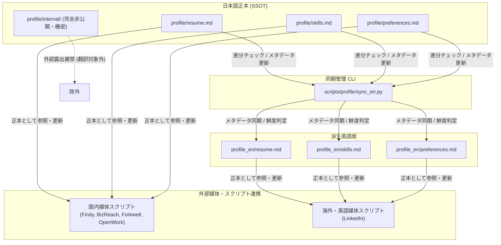

# ユーザープロフィール・英語版同期ガイド (`profile/`, `profile_en/`)

本ドキュメントでは、ユーザーの経歴・職務経歴書・希望条件・スキルの唯一の正本（SSOT）である `profile/` と、LinkedIn等英語媒体連携用の派生ファイル `profile_en/` の管理および同期スクリプト（`scripts/profile/sync_en.py`）の使い方をまとめています。

---

## 目次

1. [全体アーキテクチャとSSOT方針](#1-全体アーキテクチャとssot方針)
2. [ディレクトリ・ファイル構成](#2-ディレクトリファイル構成)
3. [英語版同期管理CLI (`sync_en.py`) の使い方](#3-英語版同期管理cli-sync_enpy-の使い方)
4. [外部求人サイトとの連携運用フロー](#4-外部求人サイトとの連携運用フロー)
5. [非公開情報の保護ルール (`profile/internal/`)](#5-非公開情報の保護ルール-profileinternal)

---

## 1. 全体アーキテクチャとSSOT方針

- **唯一の正本（SSOT）**: `profile/`（日本語）
  - ユーザーの経歴、職務経歴、スキル、希望条件、転職ステータスのすべては `profile/` 配下にFrontmatter付きMarkdownとして一元管理されます。
  - 各外部求人サイトから取得したデータ（`data/*/profile/` や `data/*/resume/`）は単なる外部スナップショット（キャッシュ）であり、ユーザー情報の正本ではありません。
- **派生英語版**: `profile_en/`（英語）
  - LinkedIn等の英語表記が求められる媒体へのプロフィール反映用データとして、`profile/` から英訳・派生させたファイル群です。
  - フロントマターに `source_file`, `source_updated_at`, `synced_at`, `language` を保持し、SSOTとの同期鮮度を管理します。



---

## 2. ディレクトリ・ファイル構成

| ファイルパス | 言語 | 役割 |
|---|---|---|
| [`profile/resume.md`](file:///c:/C/job_hunt/profile/resume.md) | 日本語 | 職務経歴書マスター（基本情報、職歴、学歴、担当プロジェクト、資格、語学） |
| [`profile/preferences.md`](file:///c:/C/job_hunt/profile/preferences.md) | 日本語 | 希望条件・転職の軸（希望年収、働き方、企業規模、技術志向、NG条件） |
| [`profile/status.md`](file:///c:/C/job_hunt/profile/status.md) | 日本語 | 現在の選考・転職活動状況（応募先、選考ステータス、次回アクション一覧） |
| [`profile/skills.md`](file:///c:/C/job_hunt/profile/skills.md) | 日本語 | スキルスタック詳細、強み、自己PR、実績エピソード（STAR法）素材集 |
| `profile/internal/` | 日本語 | **非公開・内部判定用（外部露出厳禁）**（足切り条件、企業格付け、本音メモ） |
| [`profile_en/resume.md`](file:///c:/C/job_hunt/profile_en/resume.md) | 英語 | 英語版職務経歴書マスター |
| [`profile_en/skills.md`](file:///c:/C/job_hunt/profile_en/skills.md) | 英語 | 英語版スキルスタック、強み、実績集 |
| [`profile_en/preferences.md`](file:///c:/C/job_hunt/profile_en/preferences.md) | 英語 | 英語版希望条件・キャリア軸 |

---

## 3. 英語版同期管理CLI (`sync_en.py`) の使い方

`scripts/profile/sync_en.py` は、日本語SSOTと英語版プロフィールのFrontmatter更新日を比較し、同期状態（IN_SYNC, STALE, MISSING）を判定・管理します。

### 基本的なコマンド

```powershell
# 1. 現在の同期ステータス一覧を確認（パス出力）
uv run python scripts/profile/sync_en.py

# 2. 人間向けサマリ表示（ファイルごとのステータス・日付差分）
uv run python scripts/profile/sync_en.py --summary

# 3. JSON形式でステータスを出力（CIやスクリプト連携用）
uv run python scripts/profile/sync_en.py --json

# 4. 未同期（STALE/MISSING）がある場合に非ゼロ終了コードで検知（厳格チェック）
uv run python scripts/profile/sync_en.py --strict

# 5. 英語ファイルの英訳完了後、メタデータ（source_updated_at, synced_at）を最新化
uv run python scripts/profile/sync_en.py update-meta resume.md
uv run python scripts/profile/sync_en.py update-meta --all
```

### ステータス判定ルール

| ステータス | 判定条件 | 対処方針 |
|---|---|---|
| `IN_SYNC` | `source_updated_at` == 日本語側 `updated_at` | 同期完了（更新不要） |
| `STALE` | `source_updated_at` < 日本語側 `updated_at` | 日本語側が更新されているため、英語側を英訳更新して `update-meta` を実行 |
| `MISSING` | 英語版ファイルが存在しない | 新規に英語版を作成 |

---

## 4. 外部求人サイトとの連携運用フロー

各外部媒体へのプロフィール登録・更新を行うスクリプトを実行する際は、以下のデータソースを参照します：

1. **国内媒体への反映**:
   - `Findy`（[`scripts/findy/manage_work_history.py`](file:///c:/C/job_hunt/scripts/findy/manage_work_history.py)）: `profile/resume.md` の職歴・プロジェクトを参照
   - `ビズリーチ`（[`scripts/bizreach/manage_resume.py`](file:///c:/C/job_hunt/scripts/bizreach/manage_resume.py)）: `profile/resume.md` を参照
   - `Forkwell`（[`scripts/forkwell/manage_profile.py`](file:///c:/C/job_hunt/scripts/forkwell/manage_profile.py), [`scripts/forkwell/manage_work_history.py`](file:///c:/C/job_hunt/scripts/forkwell/manage_work_history.py)）: `profile/resume.md`, `profile/preferences.md` を参照
2. **英語媒体（LinkedIn）への反映**:
   - `LinkedIn Headline/About`（[`scripts/linkedin/manage_profile.py`](file:///c:/C/job_hunt/scripts/linkedin/manage_profile.py)）: `profile_en/resume.md` のサマリ、`profile_en/preferences.md` を参照
   - `LinkedIn Experience`（[`scripts/linkedin/manage_experience.py`](file:///c:/C/job_hunt/scripts/linkedin/manage_experience.py)）: `profile_en/resume.md` の職歴を参照
   - `LinkedIn Skills`（[`scripts/linkedin/manage_skills.py`](file:///c:/C/job_hunt/scripts/linkedin/manage_skills.py)）: `profile_en/skills.md` のスキル一覧を参照

---

## 5. 非公開情報の保護ルール (`profile/internal/`)

- `profile/internal/criteria.md`（本音の足切り・NG条件）
- `profile/internal/companies.md`（企業格付け・ブラックリスト）
- `profile/internal/notes.md`（転職理由の本音メモ）

> [!CAUTION]
> `profile/internal/` 配下のファイルは、ユーザーの本音の思考・意思決定支援・求人足切り判定にのみ使用されます。
> **いかなる場合も、外部求人媒体へのプロフィール更新スクリプト、応募書類、メッセージ返信、面接対策テキスト等に露出・引用してはなりません。**
> `scripts/profile/sync_en.py` の同期対象からも完全に除外されています。
