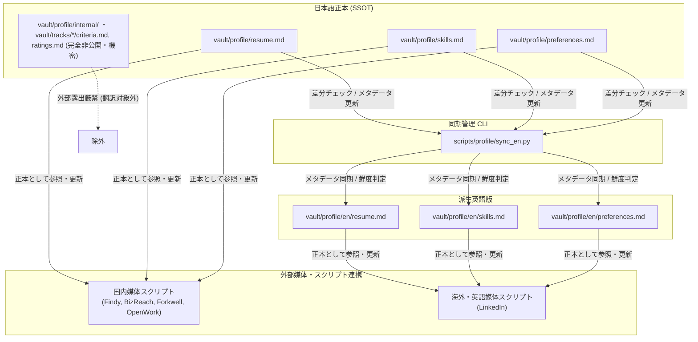

# ユーザープロフィール・英語版同期ガイド (`vault/profile/`, `vault/profile/en/`)

本ドキュメントでは、ユーザーの経歴・職務経歴書・希望条件・スキルの唯一の正本（SSOT）である `vault/profile/` と、LinkedIn等英語媒体連携用の派生ファイル `vault/profile/en/` の管理および同期スクリプト（`scripts/profile/sync_en.py`）の使い方をまとめています。

---

## 目次

1. [全体アーキテクチャとSSOT方針](#1-全体アーキテクチャとssot方針)
2. [ディレクトリ・ファイル構成](#2-ディレクトリファイル構成)
3. [英語版同期管理CLI (`sync_en.py`) の使い方](#3-英語版同期管理cli-sync_enpy-の使い方)
4. [外部求人サイトとの連携運用フロー](#4-外部求人サイトとの連携運用フロー)
5. [非公開情報の保護ルール (`vault/profile/internal/` ほか)](#5-非公開情報の保護ルール-vaultprofileinternal-ほか)
6. [職務経歴書・英文レジュメの PDF 出力 (`export_pdf.py`)](#6-職務経歴書英文レジュメの-pdf-出力-export_pdfpy)
7. [履歴書の PDF 出力 (`export_rirekisho.py`)](#7-履歴書の-pdf-出力-export_rirekishopy)

---

## 1. 全体アーキテクチャとSSOT方針

- **唯一の正本（SSOT）**: `vault/profile/`（日本語）
  - ユーザーの経歴、職務経歴、スキル、共通の希望条件（職種・技術志向・ドメイン・共通NG）は `vault/profile/` 配下にFrontmatter付きMarkdownとして一元管理されます。
  - track 固有の希望条件（年収・出社/勤務地・企業フェーズ・雇用形態）は `vault/tracks/{track}/strategy.md`（国内: `vault/tracks/domestic/strategy.md`）、選考状況は `vault/tracks/{track}/pipeline.md`、媒体アカウントの登録・同期状況は `vault/profile/accounts.md` で管理します。
  - 各外部求人サイトから取得したデータ（`data/*/profile/` や `data/*/resume/`）は単なる外部スナップショット（キャッシュ）であり、ユーザー情報の正本ではありません。
- **派生英語版**: `vault/profile/en/`（英語）
  - LinkedIn等の英語表記が求められる媒体へのプロフィール反映用データとして、`vault/profile/` から英訳・派生させたファイル群です。
  - フロントマターに `source_file`, `source_updated_at`, `synced_at`, `language` を保持し、SSOTとの同期鮮度を管理します。



---

## 2. ディレクトリ・ファイル構成

| ファイルパス | 言語 | 役割 |
|---|---|---|
| [`vault/profile/resume.md`](../../vault/profile/resume.md) | 日本語 | 職務経歴書マスター（基本情報、職歴、学歴、担当プロジェクト、資格、語学） |
| [`vault/profile/preferences.md`](../../vault/profile/preferences.md) | 日本語 | 共通の希望条件・転職の軸（職種、技術志向、ドメイン、共通NG条件） |
| [`vault/tracks/domestic/strategy.md`](../../vault/tracks/domestic/strategy.md) | 日本語 | 国内 track 固有の希望条件（希望年収、出社/勤務地、企業フェーズ、雇用形態） |
| [`vault/tracks/domestic/pipeline.md`](../../vault/tracks/domestic/pipeline.md) | 日本語 | 現在の選考・転職活動状況（応募先、選考ステータス、次回アクション一覧。選考一覧は `scripts/vault/build_pipeline.py` が自動生成） |
| [`vault/profile/accounts.md`](../../vault/profile/accounts.md) | 日本語 | 求人媒体アカウントの登録・同期状況 |
| [`vault/profile/rirekisho.md`](../../vault/profile/rirekisho.md) | 日本語 | 履歴書の汎用項目（ふりがな・住所・学歴/職歴・免許資格・本人希望の既定文）。氏名・生年月日・連絡先は `resume.md` から読む |
| [`vault/profile/skills.md`](../../vault/profile/skills.md) | 日本語 | スキルスタック詳細、強み、自己PR、実績エピソード（STAR法）素材集 |
| `vault/profile/internal/` | 日本語 | **非公開・内部判定用（外部露出厳禁）**（本音メモ） |
| `vault/tracks/domestic/criteria.md`, `ratings.md` | 日本語 | **非公開・内部判定用（外部露出厳禁）**（足切り条件、企業格付け） |
| [`vault/profile/en/resume.md`](../../vault/profile/en/resume.md) | 英語 | 英語版職務経歴書マスター |
| [`vault/profile/en/skills.md`](../../vault/profile/en/skills.md) | 英語 | 英語版スキルスタック、強み、実績集 |
| [`vault/profile/en/preferences.md`](../../vault/profile/en/preferences.md) | 英語 | 英語版希望条件・キャリア軸 |

---

## 3. 英語版同期管理CLI (`sync_en.py`) の使い方

`scripts/profile/sync_en.py` は、日本語SSOTと英語版プロフィールのFrontmatter更新日を比較し、同期状態（IN_SYNC, STALE, MISSING）を判定・管理します。

### 基本的なコマンド

```powershell
# 1. 現在の同期ステータス一覧を確認（パス出力）
uv run python scripts/profile/sync_en.py

# 2. 人間向けサマリ表示（ファイルごとのステータス・日付差分）
uv run python scripts/profile/sync_en.py --summary

# 3. JSON形式でステータスを出力（CIやスクリプト連携用）
uv run python scripts/profile/sync_en.py --json

# 4. 未同期（STALE/MISSING）がある場合に非ゼロ終了コードで検知（厳格チェック）
uv run python scripts/profile/sync_en.py --strict

# 5. 英語ファイルの英訳完了後、メタデータ（source_updated_at, synced_at）を最新化
uv run python scripts/profile/sync_en.py update-meta resume.md
uv run python scripts/profile/sync_en.py update-meta --all
```

### ステータス判定ルール

| ステータス | 判定条件 | 対処方針 |
|---|---|---|
| `IN_SYNC` | `source_updated_at` == 日本語側 `updated_at` | 同期完了（更新不要） |
| `STALE` | `source_updated_at` < 日本語側 `updated_at` | 日本語側が更新されているため、英語側を英訳更新して `update-meta` を実行 |
| `MISSING` | 英語版ファイルが存在しない | 新規に英語版を作成 |

---

## 4. 外部求人サイトとの連携運用フロー

各外部媒体へのプロフィール登録・更新を行うスクリプトを実行する際は、以下のデータソースを参照します：

1. **国内媒体への反映**:
   - `Findy`（[`scripts/findy/manage_work_history.py`](../../scripts/findy/manage_work_history.py)）: `vault/profile/resume.md` の職歴・プロジェクトを参照
   - `ビズリーチ`（[`scripts/bizreach/manage_resume.py`](../../scripts/bizreach/manage_resume.py)）: `vault/profile/resume.md` を参照
   - `Forkwell`（[`scripts/forkwell/manage_profile.py`](../../scripts/forkwell/manage_profile.py), [`scripts/forkwell/manage_work_history.py`](../../scripts/forkwell/manage_work_history.py)）: `vault/profile/resume.md`, `vault/profile/preferences.md` を参照
2. **英語媒体（LinkedIn）への反映**:
   - `LinkedIn Headline/About`（[`scripts/linkedin/manage_profile.py`](../../scripts/linkedin/manage_profile.py)）: `vault/profile/en/resume.md` のサマリ、`vault/profile/en/preferences.md` を参照
   - `LinkedIn Experience`（[`scripts/linkedin/manage_experience.py`](../../scripts/linkedin/manage_experience.py)）: `vault/profile/en/resume.md` の職歴を参照
   - `LinkedIn Skills`（[`scripts/linkedin/manage_skills.py`](../../scripts/linkedin/manage_skills.py)）: `vault/profile/en/skills.md` のスキル一覧を参照

---

## 5. 非公開情報の保護ルール (`vault/profile/internal/` ほか)

- `vault/tracks/domestic/criteria.md`（本音の足切り・NG条件）
- `vault/tracks/domestic/ratings.md`（企業格付け・ブラックリスト）
- `vault/profile/internal/notes.md`（転職理由の本音メモ）

> [!CAUTION]
> 上記の非公開ファイルは、ユーザーの本音の思考・意思決定支援・求人足切り判定にのみ使用されます。
> **いかなる場合も、外部求人媒体へのプロフィール更新スクリプト、応募書類、メッセージ返信、面接対策テキスト等に露出・引用してはなりません。**
> `scripts/profile/sync_en.py` の同期対象からも完全に除外されています。

---

## 6. 職務経歴書・英文レジュメの PDF 出力 (`export_pdf.py`)

媒体へのアップロードや応募メール添付用に、`vault/profile/resume.md`（日本語）または `vault/profile/en/resume.md`（英語）から A4 の職務経歴書 PDF を生成します。アップロード自体は手動で行います。

```powershell
uv run python scripts/profile/export_pdf.py --lang ja -s          # 職務経歴書 → data/exports/{日付}_career_ja.pdf
uv run python scripts/profile/export_pdf.py --lang en -s          # 英文レジュメ → data/exports/{日付}_career_en.pdf
uv run python scripts/profile/export_pdf.py --lang ja --contact   # 連絡先（frontmatter の email / phone）を載せる
uv run python scripts/profile/export_pdf.py --lang ja --html      # 確認用に同名 HTML も保存
```

### 仕組み

```
resume.md ─(frontmatter の allowlist 項目 + allowlist の H2 節)→ Jinja2 テンプレート + 印刷用 CSS
          → 漏洩チェック → ヘッドレス Chromium（Edge → Chrome → Playwright 同梱の順）の page.pdf()
```

- テンプレート: [`scripts/profile/pdf_templates/career.html.j2`](../../scripts/profile/pdf_templates/career.html.j2)、スタイル: [`career.css`](../../scripts/profile/pdf_templates/career.css)。日本語フォントは BIZ UDPゴシック（Windows 標準）。
- **載せる情報（allowlist）**:
  - フロントマター: `name`（日本語版は `name_en` も併記）、`links`、`primary_skills`、`certifications`、`english_skill`、英語版のみ `location`。`--contact` 指定時だけ `email` / `phone`。
  - 本文: `SECTION_ALLOWLIST` に前方一致する H2 節のみ（日本語: 職務要約・職務経歴・学歴・課外活動 等、英語: Professional Summary・Work Experience・Education・Extracurricular 等）。`基本情報` / `Basic Information` 節は使いません。
  - どちらにも当たらない H2 節は**載せずに stderr へ警告**します。resume.md に新しい節を足して PDF に載せたいときは `SECTION_ALLOWLIST` に追加してください。
  - 主要スキル・資格・語学は職務要約の直後にまとめて出します。区切り線（`---`）は描画しません。
- **漏洩ガード**: 生成 HTML に次のいずれかが含まれると PDF を作らず終了コード 1 で止まります。
  - 現在年収（`current_annual_income`）・生年月日（`birth_date`）
  - `--contact` なしのときのメールアドレス・電話番号
  - 非公開ファイル（`vault/profile/internal/`、各 track の `criteria.md` / `ratings.md`）の 15 文字以上の文
- **英語版の鮮度チェック**: `sync_en.py` の判定で `vault/profile/en/resume.md` が `UP_TO_DATE` でなければ止まります（`--allow-stale` で警告のみにして続行）。
- 出力先 `data/exports/` は gitignore 済み。stdout には生成した PDF（と `--html` 時の HTML）のパスのみを出し、`-s` でページ数・元データ更新日・載せた節を表示します。

### 未対応（今後）

- 応募先ごとの調整（載せるプロジェクトの取捨・職務要約の差し替え）

---

## 7. 履歴書の PDF 出力 (`export_rirekisho.py`)

厚生労働省の履歴書様式例に倣った A4 2 枚（1 枚目: 個人情報・学歴/職歴、2 枚目: 免許/資格・志望動機・本人希望）を生成します。写真欄はありません。

```powershell
uv run python scripts/profile/export_rirekisho.py -s                                   # 志望動機なし → data/exports/{日付}_rirekisho.pdf
uv run python scripts/profile/export_rirekisho.py --company loglass -s                 # 志望動機入り → data/exports/{日付}_rirekisho_loglass.pdf
uv run python scripts/profile/export_rirekisho.py --company <key> --track overseas --date 2026-11-01 --html
```

- **応募先に依らない項目**: [`vault/profile/rirekisho.md`](../../vault/profile/rirekisho.md)。フロントマターにふりがな・性別・住所、`education` / `work` / `licenses`（`{year, month, text}` の行リスト）、`currently_employed`。本文の `## 本人希望記入欄` が既定文。氏名・生年月日・メール・電話は `resume.md` のフロントマターから読む（二重管理しない）。
- **応募先ごとの項目**: `vault/tracks/{track}/companies/{company-key}/application.md` の `## 志望動機`（必須）と `## 本人希望記入欄`（任意。書けば既定文を上書き）。1 行が 1 段落になる。`--company` 指定時にこのファイルが無ければ止まる。
- 学歴・職歴欄は見出し行（学歴・職歴）を付け、`currently_employed: true` なら「現在に至る」、最後に「以上」を付けて、18 行まで空行で埋める。年齢は記入日（`--date`、既定は今日）時点の満年齢。
- **漏洩ガード**: 履歴書なので生年月日・住所・連絡先は載せる。現在年収（`current_annual_income`）と非公開ファイルの 15 文字以上の文が混じったら PDF を作らず終了コード 1。
- テンプレート: [`rirekisho.html.j2`](../../scripts/profile/pdf_templates/rirekisho.html.j2)、スタイル: [`rirekisho.css`](../../scripts/profile/pdf_templates/rirekisho.css)（BIZ UD明朝）。PDF 化は `export_pdf.print_pdf()` を共用（ページ番号なし・余白 12mm）。

