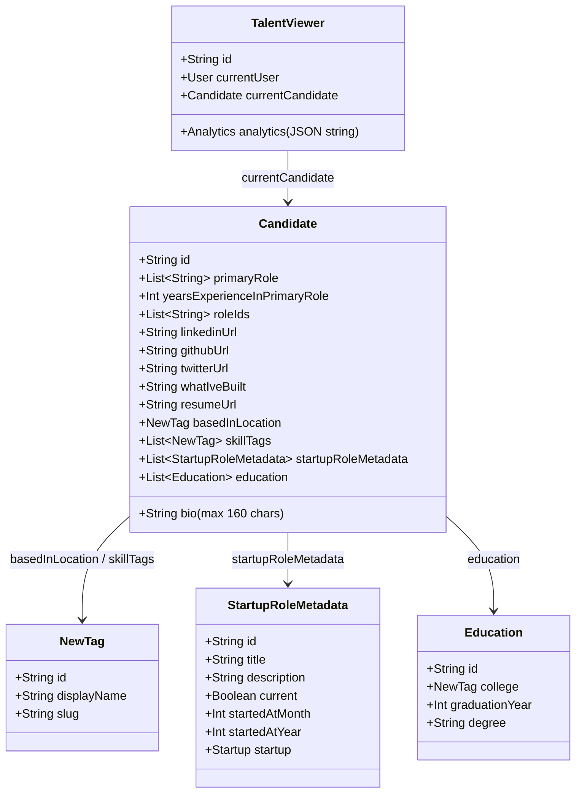

# Wellfound（旧AngelList）サイト構造リファレンス

本ドキュメントは、AIエージェントおよび自動化スクリプトがWellfound（[wellfound.com](https://wellfound.com/)）を安全かつ高精度に探索・操作するためのサイト構造、認証仕様、DOMセレクタ、および内部Apollo GraphQLキャッシュデータ仕様書です。

---

## 1. サイト基本情報 & 認証基盤

| 項目 | 内容 |
|---|---|
| **メインドメイン** | `https://wellfound.com` |
| **プロフィール編集URL** | `https://wellfound.com/profile/edit` |
| **希望条件（Preferences）URL** | `https://wellfound.com/profile/edit/preferences` |
| **ログインURL** | `https://wellfound.com/login` |
| **未ログイン時リダイレクト** | `https://wellfound.com/login` または `https://wellfound.com/join` |
| **推奨プロファイル** | `job-hunt`（リポジトリ共通永続ブラウザプロファイル: `%LOCALAPPDATA%\claude-browser-profiles\job-hunt`） |
| **認証方式** | Google OAuth / メールアドレス・パスワード認証（Cloudflare保護の可能性あり） |
| **未ログイン判定** | URLが `wellfound.com/login`、`wellfound.com/join`、または `accounts.google.com` を含む |
| **ログイン済み判定** | URLが `/profile/edit` や `/jobs` 等、ヘッダーにユーザー名・アバター（`img[alt*="Avatar for"]`）、または「Open to offers」ステータスボタンが存在 |
| **フロントエンド技術** | **Next.js (SSR/SSG)** + **React** + **Apollo Client (GraphQL)** |
| **API/データアーキテクチャ** | 画面読み込み時に `window.__NEXT_DATA__.props.pageProps.apolloState.data` に全プロフィールデータが正規化されたApolloキャッシュとして埋め込まれている。フォーム入力変更時に動的アクションバー（`Save` / `Cancel` ボタン）が出現し、フォーム送信により保存・更新が行われる |

---

## 2. 主要URLマップ

| 画面名 | パス / URL | 認証 | 備考 |
|---|---|---|---|
| **トップ / 求人** | `/jobs` | 任意 | 求人検索・企業探索 |
| **ホーム** | `/jobs/home` | **要** | ログイン後ダッシュボード |
| **求人応募履歴** | `/jobs/applications` | **要** | 応募済み求人一覧・ステータス |
| **メッセージ** | `/jobs/messages` | **要** | 企業・リクルーターとのチャット一覧 |
| **プロフィール編集（概要）** | `/profile/edit/overview` | **要** | プロフィール完成度・サマリ |
| **プロフィール編集（詳細）** | `/profile/edit` | **要** | About/Bio、職歴、学歴、スキル、ソーシャルリンク |
| **レジュメ管理** | `/profile/edit/resume` | **要** | レジュメ（CV）ファイルアップロード・確認 |
| **希望条件（Preferences）** | `/profile/edit/preferences` | **要** | 希望年収、リモート希望、ビザ要件、勤務地 |
| **企業カルチャー** | `/profile/edit/culture` | **要** | カルチャーフィット・働き方選好 |
| **公開プロフィール** | `/u/{username}` | 不要 | 外部・採用担当者向け公開プロフィール |

---

## 3. データ構造（Apollo GraphQL Normalized Store）

Wellfound は Next.js ページに Apollo Client の正規化キャッシュを `window.__NEXT_DATA__.props.pageProps.apolloState.data` として埋め込んでいる。

### 3.1 主要エンティティ一覧

### 3.2 `Candidate:<userId>` フィールド仕様

| フィールド名 | 型 | 説明・制約 |
|---|---|---|
| `bio` | `String` | 短い自己紹介（**最大160文字**） |
| `primaryRole` | `List[String]` | 主職種（例: `["Software Engineer"]`） |
| `yearsExperienceInPrimaryRole` | `Int` | 経験年数（例: `2`） |
| `roleIds` | `List[String]` | 希望職種IDの配列（例: `["14726", "151647", ...]`） |
| `skillTags` | `List[Ref]` | 保有スキル参照リスト（`NewTag:<id>`） |
| `startupRoleMetadata` | `List[Ref]` | 職歴参照リスト（`StartupRoleMetadata:<id>`） |
| `education` | `List[Ref]` | 学歴参照リスト（`Education:<id>`） |
| `basedInLocation` | `Ref` | 居住地タグ参照（`NewTag:<id>`） |
| `resumeUrl` | `String` | アップロード済みレジュメファイル（S3署名付きURL） |
| `whatIveBuilt` | `String` | 実績・成果（Achievements、最大1000文字） |
| `linkedinUrl` | `String` | LinkedIn プロフィールURL |
| `githubUrl` | `String` | GitHub プロフィールURL |
| `twitterUrl` | `String` | X (Twitter) URL |
| `onlineBioUrl` | `String` | 個人ポートフォリオ/WebサイトURL |
| `pronouns` | `String` | 代名詞（例: `HE_HIM`） |
| `gender` | `String` | 性別（例: `MALE`） |
| `raceEthnicityOrigins` | `List[String]` | 人種・エスニシティ（例: `["SOUTH_ASIAN"]` 等） |

### 3.3 `TalentViewer:<userId>` の希望条件（Analytics Traits）

`TalentViewer:<userId>.analytics.traits` は JSON 文字列としてシリアライズされており、以下の情報が含まれる:

- `name`: 氏名（例: `"seiwan maikuma"`）
- `candidate_desired_salary`: 希望年収（数値、例: `40000`）
- `candidate_desired_salary_currency`: 通貨（例: `"USD"`）
- `candidate_remote_work_preference`: リモート希望フラグ（`true`/`false`）
- `candidate_interested_locations`: 希望国・地域リスト（例: `["Canada", "United States", "United Kingdom", "Ireland"]`）
- `candidate_role_tags`: 希望職種名リスト

---

## 4. DOM セレクタ & 入力操作仕様

### 4.1 プロフィール編集画面 (`/profile/edit`)

| 項目 | セレクタ | 備考 |
|---|---|---|
| **Bio (自己紹介)** | `textarea#form-input--bio` | 最大160文字 |
| **氏名 (Your name)** | `input#form-input--name` | テキスト入力 |
| **LinkedIn URL** | `input#form-input--linkedinUrl` | URLテキスト入力 |
| **GitHub URL** | `input#form-input--githubUrl` | URLテキスト入力 |
| **Website URL** | `input#form-input--onlineBioUrl` | URLテキスト入力 |
| **Twitter URL** | `input#form-input--twitterUrl` | URLテキスト入力 |
| **Achievements (What I've built)** | `textarea#form-input--whatIveBuilt` | 最大1000文字 |
| **スキル入力欄** | `input[placeholder*="Python, React"]` | Downshiftオートコンプリート（項目クリックで即GraphQL保存） |
| **スキル項目** | `div[id*="downshift-"][id*="-item-"]` | `mousedown` + `mouseup` + `click` イベント発火が必要 |
| **職歴追加リンク** | `a.styles_add__EROyj, a:has-text("+ Add work experience")` | インラインフォームを展開 |
| **職歴企業名入力** | `input[placeholder="Type to search"]` | オートコンプリート。未登録企業は `Create {名前}` を選択 |
| **職歴役職名** | `input#form-input--title` | テキスト入力 |
| **職歴開始/終了日** | `input[placeholder="Start date"]`, `input[placeholder="End date"]` | `react-datepicker`。入力後 **`Enter` キー押下** が必須 |
| **職歴在籍チェック** | `input#form-input--current--true` | 非表示。`label[for="form-input--current--true"]` のクリックが必要 |
| **職歴編集ボタン** | `.styles_edit__qR593` | 該当職歴の編集インラインフォームを展開 |
| **職歴削除リンク** | `a.styles_destroy__pSrL8, a:has-text("Remove position")` | 職歴を削除（`window.confirm` ハンドラ必須） |
| **職歴保存ボタン** | `form button[type="submit"]:has-text("Save")` | 職歴フォーム内の送信ボタン |
| **人種・エスニシティ** | `input#form-input--raceEthnicityOrigins--EAST_ASIAN` 等 | 非表示。親labelまたはparentElementのクリックが必要 |
| **動的アクションバー** | `div[class*="styles_actionBar"]` | フォーム変更時に動的出現 |
| **保存ボタン** | `button:has-text("Save")` | 変更をサーバーへ反映 |
| **キャンセルボタン** | `button:has-text("Cancel")` | 変更を破棄して元に戻す |

### 4.2 希望条件画面 (`/profile/edit/preferences`)

| 項目 | セレクタ | 備考 |
|---|---|---|
| **ビザ要件 (Sponsorship)** | `input#form-input--requireSponsorship--true`, `--false` | ラジオボタン |
| **米国労働許可 (US Auth)** | `input#form-input--usAuthorized--true`, `--false` | ラジオボタン |
| **希望勤務形態 (Looking for)** | `input#form-input--lookingFor--contract`, `--internships`, `--cofounders` | チェックボックス |
| **リモート希望** | `input#form-input--distributedTeamOk--true` | チェックボックス |
| **希望年収** | `input#form-input--expectedSalary` | テキスト入力（例: `40,000`） |
| **通貨** | `input[name="currencyCode"]` | 隠し入力（例: `USD`） |

---

## 5. 保存・更新メカニズム & 安全ガード方針

1. **動的アクションバーと Save ボタン**:
   - 入力フィールド（Bio, ソーシャルリンク等）の値を変更すると、直下に `div[class*="styles_actionBar__..."]` が動的にレンダリングされる。
   - アクションバー内の `button:has-text("Save")` をクリックすることでフォームデータが送信され、保存完了後にアクションバーが自動消滅する。
   - `button:has-text("Cancel")` をクリックすると変更が破棄され、元の値に戻る。
2. **職歴 (Experience) の操作特性**:
   - モーダルではなくページ内のインラインフォームとして展開される。
   - 会社名検索オートコンプリートでは、新規企業名登録時に `Create {名前}` アイテムを明示的に選択する。
   - `Start date` / `End date`（`react-datepicker`）は文字入力後に `Enter` キーを押下することで内部 Apollo 変数へ反映される。
   - 在籍チェックボックス（`#form-input--current--true`）は `display:none` のため、対応する `label` をクリックする。
   - 削除時は `a.styles_destroy__pSrL8`（"Remove position"）をクリックする。
3. **スキル (Skills) の操作特性**:
   - `Downshift` ライブラリによるオートコンプリート。選択時に `ProfileCreateSkill` / `ProfileSaveSkills` Mutation が即座に発火し、フォーム保存ボタンなしで自動保存される。
4. **安全ガード**:
   - 更新処理前には必ず最新の `window.__NEXT_DATA__` 全体を JSON およびフロントマター付き Markdown としてローカルに完全バックアップ保存（`data/wellfound/profile/backups/`）する。
   - `--dry-run` オプション指定時は、実際の値変更や Save ボタンクリックを行わず、変更差分プレビューのみを生成して終了する。
