# YOUTRUST（ユートラスト）サイト構造リファレンス

本ドキュメントは、AIエージェントおよび自動化スクリプトがYOUTRUST（[youtrust.jp](https://youtrust.jp/)）を安全かつ高精度に探索・操作するためのサイト構造、認証仕様、DOMセレクタ、および内部REST API仕様書です。

---

## 1. サイト基本情報 & 認証基盤

| 項目 | 内容 |
|---|---|
| **メインドメイン** | `https://youtrust.jp` |
| **プロフィール設定URL** | `https://youtrust.jp/settings/profile` |
| **ログインURL** | `https://youtrust.jp/sign_in` |
| **未ログイン時リダイレクト** | `https://youtrust.jp/sign_in?redirect_path=%2Fsettings%2Fprofile&type=sign_in` |
| **推奨プロファイル** | `job-hunt`（リポジトリ共通永続ブラウザプロファイル: `%LOCALAPPDATA%\claude-browser-profiles\job-hunt`） |
| **認証方式** | Google OAuth / Facebook / Apple / メールアドレス・パスワード認証 |
| **未ログイン判定** | URLが `/sign_in` または `accounts.google.com` を含む、またはタイトルに「ログイン」 |
| **認証壁正規表現** | `youtrust\.jp/sign_in|accounts\.google\.com` |
| **ログイン済み判定** | `header a[href*="/friend_connections"]` `header a[href*="/chat_rooms"]` `header a[href*="/users/"]` `a[href*="/settings/profile"]` `button:has-text("保存")` |
| **フロントエンド/バックエンド** | **React / Next.js SPA** + **Ruby on Rails REST API** |
| **CSRFトークン** | `meta[name="csrf-token"]`（`authenticity_token` 形式） |
| **APIアーキテクチャ** | 認証済みセッションCookieを用いて `/api/...` 配下のRESTエンドポイントから完全な構造化JSONを取得・更新 |

---

## 2. 主要URLマップ

| 画面名 | パス / URL | 認証 | 備考 |
|---|---|---|---|
| **トップ / タイムライン** | `https://youtrust.jp/` | **要** | つながりの投稿・新着情報タイムライン |
| **サインイン** | `https://youtrust.jp/sign_in` | 不要 | ログイン画面（OAuth連携・メールログイン） |
| **プロフィール設定** | `https://youtrust.jp/settings/profile` | **要** | 氏名、ビジネスネーム、生年月日公開範囲、居住地、自己紹介 |
| **意欲設定** | `https://youtrust.jp/settings/career_motivation` | **要** | 転職意欲・副業意欲（積極的に探している / 良い話があれば / 今は考えていない等） |
| **意欲の非公開企業** | `https://youtrust.jp/settings/career_motivation_hidden_company` | **要** | 現在の所属企業や特定企業への意欲非公開設定 |
| **職歴・学歴設定** | `https://youtrust.jp/settings/background` | **要** | 職歴企業、所属期間、職種、プロジェクト詳細、学歴 |
| **資格・受賞歴設定** | `https://youtrust.jp/settings/qualifications_and_awards` | **要** | 保有資格、表彰・受賞実績 |
| **関連リンク設定** | `https://youtrust.jp/settings/links` | **要** | GitHub, X(Twitter), Note, 個人サイト等 |
| **希望の働き方・場所** | `https://youtrust.jp/settings/desired` | **要** | リモート希望、希望勤務地、希望雇用形態 |
| **メッセージ・チャット** | `https://youtrust.jp/chat_rooms` | **要** | 企業・個人からのスカウト・メッセージ一覧 |
| **つながり一覧** | `https://youtrust.jp/friend_connections` | **要** | 相互フォロー・友達一覧 |
| **公開プロフィール** | `https://youtrust.jp/users/{user_id}` | **要** | 外部・他ユーザー向け公開プロフィール画面 |

---

## 3. 画面遷移フロー

```mermaid
flowchart TD
    SignIn["/sign_in (サインイン)"] -->|"OAuth / メール認証"| Profile["/settings/profile (プロフィール設定)"]
    Profile --> Motivation["/settings/career_motivation (意欲設定)"]
    Profile --> Hidden["/settings/career_motivation_hidden_company (非公開企業)"]
    Profile --> Background["/settings/background (職歴・学歴)"]
    Profile --> Awards["/settings/qualifications_and_awards (資格・受賞)"]
    Profile --> Links["/settings/links (関連リンク)"]
    Profile --> Desired["/settings/desired (希望の働き方)"]
    Profile --> Chat["/chat_rooms (メッセージ・スカウト)"]
    Profile --> PublicProfile["/users/{user_id} (公開プロフィール)"]

    subgraph "settings/profile フォーム項目"
        Name["氏名 (input placeholder='テキスト')"]
        BizName["ビジネスネーム (input placeholder='ニックネーム、旧姓など')"]
        Birth["生年月日 (表示のみ・変更不可)"]
        BirthScope["生年月日公開範囲 (ラジオ: つながりまで / 非公開)"]
        Location["居住地 (input placeholder='東京都...')"]
        LocationNote["居住地補足 (input placeholder='田園都市線の民')"]
        LocationScope["居住地公開範囲 (ラジオ: 全員 / つながりまで)"]
        Intro["自己紹介 (textarea)"]
        SaveBtn["保存ボタン (button:has-text('保存'))"]
    end
    Profile --- Name
    Profile --- BizName
    Profile --- Birth
    Profile --- BirthScope
    Profile --- Location
    Profile --- LocationNote
    Profile --- LocationScope
    Profile --- Intro
    Profile --- SaveBtn
```

---

## 4. プロフィール設定画面（`/settings/profile`）のDOMセレクタ定義

### 4.1 フォーム入力要素

| 項目 | セレクタ | 型 / 属性 | 備考 |
|---|---|---|---|
| **氏名（必須）** | `input[placeholder="テキスト"]` | `text` | 必須。空文字保存不可 |
| **ビジネスネーム** | `input[placeholder="ニックネーム、旧姓など"]` | `text` | 任意設定 |
| **生年月日** | `input` (disabled) / combobox | disabled | 登録後はWEB画面上から変更不可 |
| **生年月日公開範囲** | `input[type="radio"]` | radio | `birthday_scope_friend`（つながりまで公開） `birthday_scope_private`（非公開） |
| **居住地（場所）** | `div[tabindex="0"][role="combobox"]:not([aria-disabled="true"])` 選択肢: `li[role="option"]` (完全一致) | combobox / listbox | 都道府県。ドロップダウン先頭にプレースホルダー「例: 東京都」があるため、完全一致（`filter({ hasText: /^東京都$/ })`）で選択する |
| **居住地の補足** | `input[placeholder="田園都市線の民"]` | `text` | 最大30文字 |
| **居住地公開範囲** | `input[type="radio"]` | radio | `all_users`（すべてのユーザー） `only_friends`（つながりまで） |
| **自己紹介** | `textarea` | textarea | 経歴要約・自己PR・現在の仕事等 |
| **保存ボタン** | `button:has-text("保存")` | button | 初期状態は `disabled`。値変更時にクリック可能化 |

### 4.2 表示要素（Read）

| 項目 | セレクタ | 備考 |
|---|---|---|
| **現在のポジション** | `text=株式会社...` / `p` 等 | 所属企業および職種・役職 |
| **スキル・経験** | バッジ要素 / `text=*年以上` | 登録済み技術スタック・経験年数 |
| **ヘッダーユーザー導線** | `header a[href*="/users/"]` | ログイン中ユーザーIDの特定に使用可 |

---

## 5. 内部REST API仕様（GET）

### 4.3 職歴・学歴設定画面（`/settings/background`）のDOMセレクタ定義

| 項目 | セレクタ | 備考 |
|---|---|---|
| **職歴を追加ボタン** | `button:has-text("職歴を追加")` | クリックで「職歴の追加」モーダルを表示 |
| **学歴を追加ボタン** | `button:has-text("学歴を追加")` | クリックで「学歴の追加」モーダルを表示 |
| **部署・チームの追加ボタン** | `button:has-text("部署・チームの追加")` | クリックで「部署・チームの追加」モーダルを表示 |
| **職歴・学歴カード編集ボタン** | `button[aria-label="編集"]` | 親要素ホバー時に可視化（`visibility: visible`）。Playwrightでは親ホバーまたは `{ force: true }` |
| **職歴・学歴カード削除ボタン** | `button[aria-label="削除"]` | 親要素ホバー時に可視化。クリックで確認ダイアログ表示 |
| **会社名（モーダル内）** | `div[role="dialog"] input[placeholder="株式会社YOUTRUST"]` | Autocomplete / テキスト入力 |
| **雇用形態（モーダル内）** | `div[role="dialog"] [role="combobox"]` (正社員等) | Select / Combobox |
| **学校名（モーダル内）** | `div[role="dialog"] input[placeholder="YOUTRUST大学"]` | テキスト入力 / Autocomplete |
| **学部・学科（モーダル内）** | `div[role="dialog"] input[placeholder="〇〇学部"]` | テキスト入力 |
| **ゼミ・研究室（モーダル内）** | `div[role="dialog"] input[placeholder="森田ゼミ"]` | 任意入力 |
| **サークル・部活（モーダル内）** | `div[role="dialog"] input[placeholder="フットサル部"]` | 任意入力 |
| **保存ボタン（モーダル内）** | `div[role="dialog"] button:has-text("保存")` | 初期状態disabled、必須入力で活性化 |
| **次へボタン（モーダル内）** | `div[role="dialog"] button:has-text("次へ")` | 職歴追加モーダルで部署入力ステップへ遷移 |
| **キャンセルボタン（モーダル内）** | `div[role="dialog"] button:has-text("キャンセル")` | モーダルを閉じる |

---

## 5. 内部REST API仕様

ブラウザコンテキスト（セッションCookie認証済み）から呼び出せる内部API一覧です。CSRFトークン（`meta[name="csrf-token"]`）を `X-CSRF-Token` ヘッダーに付与することで、GETだけでなくPOST / PATCH / DELETE操作も完全実行可能です。

### 5.1 取得エンドポイント (GET)

| エンドポイント | メソッド | 説明 / 主な取得データ |
|---|---|---|
| `/api/session_user` | GET | ログインユーザー基本情報（`id`, `name`, `email`, `profile_image_url`, アカウントステータス） |
| `/api/users/@me` | GET | 詳細プロフィール（`id`, `name`, `business_name`, `introduction_content`, `educations`（学歴一覧） 等） |
| `/api/users/{user_id}/user_birthday` | GET | 生年月日（`year`, `month`, `day`, `scope`） |
| `/api/users/@me/user_profile_location` | GET | 居住地・場所設定（未設定時は 404） |
| `/api/users/@me/user_current_affiliations` | GET | 現在の所属企業・役職（`display_label`, `company`, `career_company_history_id`） |
| `/api/v3/users/@me/career_company_histories` | GET | 職歴企業および所属配下の部署・チーム一覧（階層構造） |
| `/api/v2/users/@me/careers` | GET | 職歴・プロジェクト一覧（旧エンドポイント、互換用） |
| `/api/school_masters` | GET | 学校マスター検索API |
| `/api/users/@me/career_motivation` | GET | 転職意欲・副業意欲（`job_change_motivation`, `side_job_motivation`） |
| `/api/users/@me/user_profile_qualifications` | GET | 保有資格一覧 |
| `/api/users/@me/user_profile_awards` | GET | 受賞歴一覧 |
| `/api/users/@me/user_profile_links` | GET | 関連外部リンク一覧（GitHub, X, ブログ等） |
| `/api/users/{user_id}/user_profile_languages` | GET | 語学スキル一覧 |
| `/api/user_desired_work_style_type` | GET | 希望の働き方（リモート、フルリモート等） |
| `/api/user_desired_work_locations` | GET | 希望の勤務地 |

### 5.2 職歴（Career）操作エンドポイント (POST / PATCH / DELETE)

| エンドポイント | メソッド | 説明 / Payload概要 |
|---|---|---|
| `/api/v3/users/@me/career_company_histories` | POST | 企業職歴の新規作成。`career_company_history: { company_name, corporate_number, label_type, joined_at, left_at, career: { name, role, career_job_categories, began_at, ended_at, description, career_users, add_current_affiliation } }` |
| `/api/v3/users/@me/career_company_histories/{id}` | PATCH | 企業職歴の更新。`career_company_history: { company_name, corporate_number, label_type, joined_at, left_at }` |
| `/api/v3/users/@me/career_company_histories/{id}` | DELETE | 企業職歴の削除 |
| `/api/v3/users/@me/career_company_histories/{id}/careers` | POST | 既存企業配下に部署・チーム（プロジェクト）を追加。`career: { name, role, career_job_categories, began_at, ended_at, description, career_users, add_current_affiliation }` |
| `/api/v3/users/@me/career_company_histories/{id}/careers/{career_id}` | PATCH | 部署・チーム（プロジェクト）の更新。`career: { name, role, career_job_categories, began_at, ended_at, description, new_career_users, delete_career_users, add_current_affiliation }` |
| `/api/v3/users/@me/career_company_histories/{id}/careers/{career_id}` | DELETE | 部署・チーム（プロジェクト）の削除 |

### 5.3 学歴（Education）操作エンドポイント (POST / PATCH / DELETE)

| エンドポイント | メソッド | 説明 / Payload概要 |
|---|---|---|
| `/api/v3/users/@me/educations` | POST | 学歴の新規追加。`education: { name, major_subject, entered_at, graduated_at, school_master_id, seminar_name, club_name }` |
| `/api/v3/users/@me/educations/{id}` | PATCH | 学歴の更新。`education: { name, major_subject, entered_at, graduated_at, school_master_id, seminar_name, club_name }` |
| `/api/v3/users/@me/educations/{id}` | DELETE | 学歴の削除 |

---

## 6. 自動化スクリプトでの安全設計と注意点

1. **二重安全ガード**:
   - プロフィール変更操作（`update`, `sync`）の実行前には必ず最新プロフィールの完全バックアップを `data/youtrust/profile/backups/{timestamp}.md` に自動退避します。
   - 職歴・学歴変更操作（`add`, `update`, `delete`, `sync`）の実行前には必ず最新の職歴・学歴の完全バックアップを `data/youtrust/background/backups/{timestamp}.md` に自動退避します。
   - `--dry-run` オプションで変更予定内容を事前確認（Unified Diff または 送信予定Payload）できます。
2. **生年月日の保護**:
   - 生年月日そのものはYOUTRUST仕様上変更不可となっているため、スクリプト側でも編集対象から除外し、公開範囲フラグのみを変更可能とします。
3. **エントリポイント出力規約準拠**:
   - 標準出力には処理後の成果物パス（Markdownファイルパス等）のみを出力します。進捗・ログは標準エラー出力に出力し、AI連携時やCLIパイプラインでの破損を防ぎます。

---

## 7. 職歴・プロジェクトAPIの重要制約とバリデーション仕様

| 項目 | 制約 / 仕様 | 詳細・対処方針 |
|---|---|---|
| **雇用形態 (正社員)** | `label_type: "label_type_none"` | YOUTRUST内部の歴史的仕様により、UI上の「正社員」は `label_type_none` にマッピングされています（`label_type_full_time` や `label_type_full_time_employee` だと 400 エラーになります）。 |
| **職種カテゴリ** | `career_job_categories: ["v3_engineering__..."]` | カテゴリはオブジェクトの配列ではなく、カテゴリ識別文字列の配列（`["v3_engineering__ai_engineer"]`, `["v3_engineering__web_engineer"]` 等）を渡します。 |
| **開始年月** | `began_at: "YYYY-M-01"` | 部署・プロジェクト登録時は `began_at` が必須です。形式は `"2026-7-01"` や `"2025-8-01"` 等の文字列を指定します（レスポンス時は UNIX 秒の整数に変換されます）。 |
| **業務内容文字数制限** | `description` 最大約300文字 | 業務内容（`description`）が約350〜400文字を超えると HTTP 400 エラーで弾かれます。300文字以内（推奨280文字程度）に要約・整形して投入する必要があります。 |
| **企業職歴と部署の階層** | 2段階階層（企業 -> 部署/PJ） | 1つの企業職歴（`career_company_history`）配下に複数の部署・プロジェクト（`career`）が紐づく階層構造です。 |

